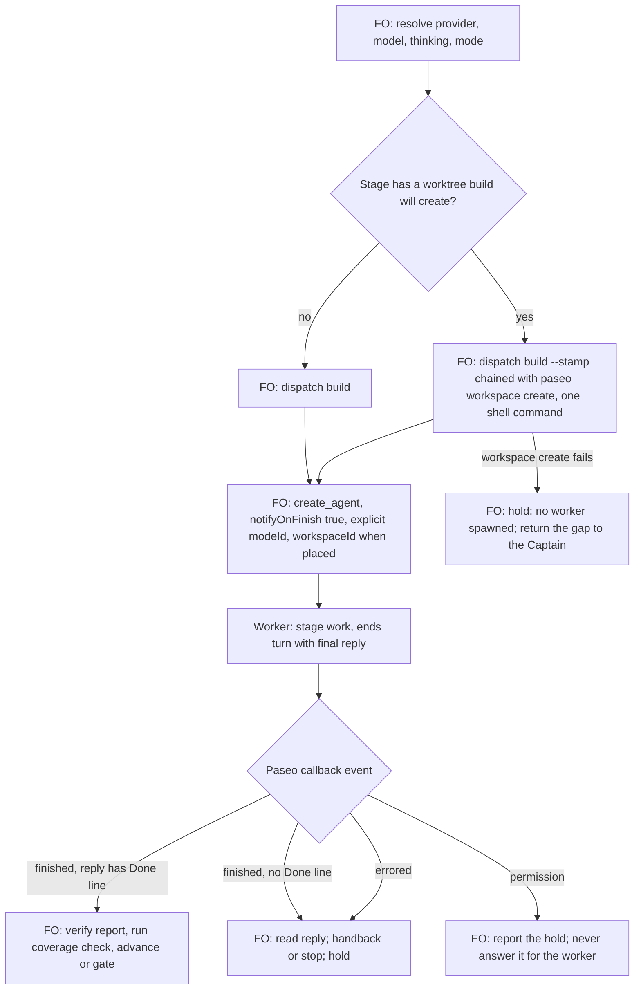

## Scope

- Source: Batch 12 sitting: the Captain 「可以」 (chat, 2026-11-02), answering 「決定：多開「完成通知」和「挑剔使用者可用 Gemini」兩張票，先前五件事照建議，可以嗎？」. FO had stated: 「工作者完成時要確實通知到 FO」, 「排第一」.
- Bite: batch 12, 2026-11-01. Four Claude ideation workers spawned with `paseo agent run --no-wait` were told to send completion to `main`; all four `SendMessage(to="main")` calls were refused because `main` resolves to the worker itself. Three fell back to `send_agent_prompt`; the roster worker ended with no signal, and the Captain asked 「卡住了嗎」 about nine hours later. `agent run` has no notify option; `create_agent` defaults `notifyOnFinish` true.
- Consumer: every FO dispatching a worker through Paseo.
- `main` is enforced by the `dispatch_records.py` regex, a `references/sd/workflow.md` sentence pinned in `test_sd_dispatch.py`, and `MAIN_LINE` in `replay_dispatch.py`. A Claude worker through Paseo hands publication to FO as a Codex worker does.
- Upstream first: Spacedock's completion contract, Paseo's own skill, `extensions/paseo/EXTENSION.md`.

## Non-goals

- A polling watcher; a change to Spacedock or Paseo; workers on non-Paseo hosts.

## Budget

- One package PR. Keep the rule in `extensions/paseo/EXTENSION.md`; workflow word budget unchanged unless the design names a raise for the Captain.

## Stop condition

- A real Claude worker and a real Codex worker through Paseo each deliver a completion the FO receives, with no fallback improvised by the worker. If `create_agent`'s callback does not reach the FO on a stage worker, stop and return that evidence to FO.

## FO alignment

Alignment: needed before ideation; the scope is the Captain's ruling.
Result: aligned at backlog: Batch 12 sitting: the Captain 「可以」 (chat, 2026-11-02), answering 「決定：多開「完成通知」和「挑剔使用者可用 Gemini」兩張票，先前五件事照建議，可以嗎？」, approved the outcome and bounds in this file.
Surfaces: none
Visible change: none
Release review: not needed: workflow maintenance, on no journey map.

## Design

**Proposition.** After this release, a First Officer (FO) in a workflow listing the `paseo` extension spawns every stage worker with `create_agent` and `notifyOnFinish: true`, and the worker ends its turn with the `Done:` line as its final reply. Paseo delivers that reply to the FO. The worker sends nothing itself, so no name can be refused and no fallback is improvised. A worker that stops early, errors or waits on a permission also reaches the FO, which today's command-line spawn does not do.

**FAQ**

- *Why not keep the worker's own message?* It only fires if the worker gets that far and picks a working address. In batch 12 one worker did not. The callback fires on finish, error and permission whatever the worker did.
- *Is this new behaviour for Spacedock?* No. Its Codex ensign runtime already makes "one minimal final message" the completion signal, and its Codex FO runtime says that signal "starts completion verification, not completion itself". This applies the same contract to a Claude worker through Paseo.
- *Does a finish mean the stage is done?* No. A finish with no `Done:` line is a handback or a stop. FO reads the reply and the report as it does today, then runs `dispatch_records.py --coverage`.
- *What about the worktree?* `create_agent` needs a registered workspace, and `dispatch build --stamp` is what creates the worktree. See D1.
- *What does a Claude worker publish?* Nothing: it hands publication to FO as a Codex worker does, per the Scope. The section stops naming a provider, and a new ADR records that this widens ADR 0042.



### Upstream check

- Spacedock 0.27.3: `references/codex-ensign-runtime.md` makes the final message the signal; `references/claude-ensign-runtime.md` makes it `SendMessage(to="team-lead")`; `references/fo-dispatch-core.md` says "On exit 0, the next host action MUST be `«worker.spawn»`". Used unchanged.
- kc-dev-flow-2 0.34.0 at origin/main 146727de: `extensions/paseo/EXTENSION.md` says only "Preserve worker completion notifications" and offers the command-line spawn for placement. `dispatch_records.py` `PARTS` refuses a record without the `main` line. `replay_dispatch.py` already has `--no-completion-line` and `--scope`, so it needs no change.
- Sibling adopters, read-only 2026-11-02: `subspace-relay` and `kc-paseo-plugins` do not list `paseo`, and neither has a completion rule to borrow. The qnow checkout, last commit 2026-10-25, showed no `extensions:` list under `docs/*/README.md`. See D2.
- Paseo 0.14.0 own docs and bundle: "Agent-scoped `create_agent` defaults `notifyOnFinish` to true"; "top-level calls have no parent callback"; `paseo agent run --help` has no notify option.
- Existing-code check: nothing new is built. The change reuses Paseo's callback, `create_workspace`'s command-line twin and `dispatch_records.py`'s README lookup.

### Evidence: what the receiver actually gets

Live probes, 2026-11-02, Paseo 0.14.0. This worker was the stand-in receiver and was running at the time, because the assignment bars messaging the FO. Each dispatch file carried Spacedock's completion block verbatim.

| Worker | Spawn | Scope line | What arrived |
| --- | --- | --- | --- |
| Claude Sonnet low | `paseo agent run --no-wait` | `main` | Nothing. `SendMessage(to="main")` was refused: "You are the main conversation — 'main' addresses you". The worker ended saying it could not send. |
| Codex Sol low | `paseo agent run --no-wait` | `main` | Nothing. It sat on a permission prompt, found only by `list_pending_permissions`. Cancelling it also sent nothing. |
| Claude Sonnet low | `create_agent` | new line | `event="finished"` carrying the `Done:` line; no `SendMessage`. |
| Codex Sol low | `create_agent` | new line | `event="finished"` carrying the `Done:` line. |
| Claude Opus high | `create_agent` | new line, plus the real Signal fact through a fetch command | `event="finished"`, reply exactly the `Done:` line; no send. |
| Codex Astra high | `create_agent` | same | `event="finished"`, the `Done:` line after a `---`; no send. |

Received text, Claude Opus row, ids shortened:

```text
<paseo-system version="1" kind="agent-notification" source-agent-id="f0976afd…" message-id="bb615f7d…" source-server-id="srv_Vu_g…" source-agent-title="wc probe cc-sig tool" event="finished">
Agent f0976afd… (wc probe cc-sig tool) finished.

Server: srv_Vu_g…

&lt;agent-response&gt;
Done: Probe task cc-sig completed ideation. Report written to /tmp/wc-probe-b12/cc-sig/report.md.
&lt;/agent-response&gt;
</paseo-system>
```

Real workers in the FO's own session transcript (`5c030106…jsonl`), counted by agent id over raw rows, read 2026-11-02, excluding batch 12's latest spawns:

| Spawn route | Agents | Got a callback |
| --- | --- | --- |
| `create_agent`, notify not false | 125 | 125 |
| `create_agent`, notify false, no later send | 3 | 0 |
| Command line, no later `send_agent_prompt` | 22 | 0 |
| Command line, later `send_agent_prompt` | 12 | 12 |

The transcript holds 204 distinct callbacks: 192 finished, 8 errored, 4 permission. An idle FO started a new turn on them; a running FO got them queued mid-turn. Stage-worker callbacks were 42.5 words at the median, 73 at p90 and 301 at most, over 114. Bound: command-line ids were matched as UUIDs in the spawn call's output, so the 22 may include an id that was not a spawned agent.

Other observations:

- `create_agent` from this Claude session with a Codex provider and no mode was refused: "cannot inherit mode 'auto' from caller … Pass an explicit mode". Mode `auto` is what a command-line Codex spawn got (`paseo agent inspect`), so it preserves today's permissions.
- Placement: `paseo workspace create --isolation local --path <real git worktree> --background --json`, then `create_agent` with that `workspaceId`, gave `pwd` and `git rev-parse --show-toplevel` both equal to the worktree. `git worktree list` showed no extra worktree.
- Not verified: a Codex FO as receiver. The probe's Codex parent held on an MCP approval prompt for `create_agent`; this worker does not answer permission prompts and cancelled it. Also not verified: delivery across hosts, and `dispatch build --stamp` in the same chain. This dispatch's own spawn is `create_agent`, `notifyOnFinish: true`, so FO holds one real stage-worker callback from this task's completion.

The stop condition did not fire: real stage workers' callbacks reach the FO.

### Change

1. `kc-dev-flow-2/extensions/paseo/EXTENSION.md`. The heading becomes `## Workers through Paseo`; the opening line and "the Paseo Codex exception" stop naming Codex. New paragraph:

   > Spawn with create_agent, notifyOnFinish true and an explicit modeId, because a Codex child will not inherit a Claude FO's mode. In scope notes and follow-ups, replace the main line with: "Your final reply is your completion message: Paseo delivers it to FO when your turn ends. End your turn with the Done line below as that reply; do not send it with SendMessage or send_agent_prompt." A finished callback starts verification, as in Spacedock's Codex contract; without a Done line it is a handback or a stop, so read it and the report before advancing. Errored and permission callbacks are holds, never completion.

   The placement sentences about the command-line spawn become:

   > If Spacedock creates the worktree during dispatch build, chain paseo workspace create --isolation local --path <worktree> --background --json onto that same build command, so create_agent stays the next host action. Paseo's CLI spawn has no finish callback; do not use it for a stage worker. Check current Paseo help before use.

2. `kc-dev-flow-2/scripts/dispatch_records.py`: a constant holding that scope line. The `PARTS` entry for the completion recipient also passes when a record's scope notes hold the constant and the README found by `find_readme` lists `paseo`. A record with the line in a workflow not listing `paseo`, or with no README found, still reports the same `needs a scope-notes line naming main …` message, so `laws_check.py`'s parser needs no change.
3. `kc-dev-flow-2/scripts/test_dispatch_records.py`: those cases, and one asserting `EXTENSION.md` contains the constant.
4. `kc-dev-flow-2/README.md` extension row and `kc-dev-flow-2/references/sd/adoption.md` paseo mention: drop "Codex".
5. New ADR, short title "Paseo stage workers complete by final reply and hand publication to FO", number reserved by FO at implementation dispatch. Words: 「可以」 (chat, 2026-11-02), asked 「決定：多開「完成通知」和「挑剔使用者可用 Gemini」兩張票，先前五件事照建議，可以嗎？」. It widens ADR 0042 to Claude workers.

Unchanged: `references/sd/workflow.md` and its word budget, the `test_sd_dispatch.py` pins, `skills/dev/SKILL.md`, `replay_dispatch.py`, and the Signal fact. Other hosts keep the `main` line. No new obligation requires a profile change.

### Words FO reads at each moment

Counted with Python `str.split()` over origin/main and over the drafted text.

| Moment | Source | Before | After | Change |
| --- | --- | --- | --- | --- |
| Startup, resume, each stage definition | `references/sd/workflow.md` | 5781 | 5781 | 0 |
| Before a Paseo worker dispatch | `extensions/paseo/EXTENSION.md` | 713 | 819 | +106 |
| Writing scope notes, Codex worker | completion line | 15 | 35 | +20 |
| Writing scope notes, Claude worker | `main` line plus this dispatch's 25-word `send_agent_prompt` line | 40 | 35 | -5 |
| Worker completes, command-line spawn | worker's message, when it sends | 20 or nothing | 33 | +13 |
| Worker completes, `create_agent` plus worker's message | callback and message | 53 | 33 | -20 |

Reading rises overall, by 106 words on the dispatch moment. This task adds a duty rather than cutting text, so no moment is required to fall; the rise is named for the Captain. A long final reply costs FO more: 301 words is the observed worst case.

### Batch overlap

| Task | Shared file or check | Effect |
| --- | --- | --- |
| model-roster-question-needs-both-families | `extensions/paseo/EXTENSION.md`, ADR index | Its design has dropped its edit to this section and its D2 points here. It lands after this and uses the same spawn route for a Claude row. |
| special-roles-follow-the-model-table | `workflow.md`, `lint-skills.py`, `test_sd_dispatch.py` | This task changes none of them. None. |
| second-round-prompts-a-step-back | `dispatch_records.py` named only in its overlap table | None. |
| validation-gate-requires-the-question-check | `workflow.md`, `lint-skills.py` | None. |
| picky-reviewers-may-run-on-gemini | `extensions/release-acceptance/EXTENSION.md` | None: reviewers are not stage workers. |
| adoption-asks-which-extensions (other session) | `dispatch_records.py`, `test_dispatch_records.py` | Same file, adjacent question: it judges a record against the extensions listed when dispatched; this reads `paseo` from the current README. Whichever lands second rebases and should reuse its helper. |
| adr-required-statement (other session, validation) | `references/sd/adoption.md`, ADR index | Different section; number by FO. |
| comment-check-reaches-delivery-gate (other session) | `delivery_gate.py` | None. |
| adr-silent-undo-probe, journey-canvas-hosted-poc, journey-server-host-pilot, ops-inbox-r1-setup-and-isolation, pr-review-lite-value-pilot (other sessions) | none found by search of their task files | None. |

Recommended order: this task first, as FO stated 「排第一」; then model-roster-question-needs-both-families; the rest as their designs state.

### Needs decision

- **D1. May the worktree registration share the shell command with `dispatch build --stamp`?** Recommended: yes. `create_agent` stays Spacedock's next host action, and the only added step runs in that same command with no FO judgment. Past ruling: validation of paseo-codex-dispatch-practice failed FO for two operations between build and spawn, counting operations rather than seconds; no `Override:` line touches this, and that case was FO reading and committing as separate host actions. What gets worse: a registration failure leaves a stamped dispatch with no worker, which FO must hold on. The alternative, command-line spawn then an arming `send_agent_prompt`, keeps one-call placement (12 of 12 got callbacks) but steers every new worker with a second message and needs its own dispatch record.
- **D2. Does the rule stay only in the listed `paseo` extension?** Recommended: yes, as the Budget says. The roster question already requires `paseo` listed, so a Claude stage worker through Paseo normally has it. What gets worse: `subspace-relay` and `kc-paseo-plugins` do not list `paseo`, so an FO there that spawns a Claude worker through Paseo still gets the refused `main`. The alternative is about 20 more words in the workflow's Signal fact, a word-budget raise that loads on every dispatch for all adopters.

## Acceptance criteria

**AC-1** On the candidate package, one real Claude stage worker and one real Codex stage worker, spawned as the extension says, each deliver a `finished` callback to the real FO whose reply holds that task's `Done:` line.
Verified by: the FO transcript rows quoted in the task, plus each worker's timeline showing no `SendMessage`, `send_agent_prompt` or `team-lead` attempt. Falsifier: the same worker with the `main` line through `paseo agent run --no-wait` gives no callback, and the Claude one shows the refusal; both observed 2026-11-02.

**AC-2** A worker that ends without a `Done:` line, one cancelled and one holding on permission each reach the FO as a callback with the matching event.
Verified by: three live spawns recording the event each produces. Falsifier: the command-line route produces none of them; the permission and cancel cases were observed 2026-11-02.

**AC-3** `dispatch_records.py` accepts a record with the Paseo line when the README lists `paseo`, and refuses it when the README does not list `paseo` or none is found.
Verified by: new `test_dispatch_records.py` cases asserting the printed reason. Falsifier: removing the listed-`paseo` condition makes the not-listed case pass, so the test fails; removing the new branch makes the listed case fail.

**AC-4** The accepted line in `dispatch_records.py` is the one `EXTENSION.md` tells FO to write.
Verified by: a test reading both. Falsifier: changing one word in either fails it.

**AC-5** A stage whose worktree `dispatch build --stamp` creates starts its worker in that worktree with `create_agent` as the next host action after that one command, under the design's D1 ruling.
Verified by: one real run recording the command, `pwd`, `git rev-parse --show-toplevel` and `git worktree list`. Falsifier: omit `workspaceId` and the worker starts in the FO's workspace, so the check fails.

**AC-6** `references/sd/workflow.md`'s word count and `WORKFLOW_BUDGET_STEPS` in `lint-skills.py` are unchanged, the `scope-notes-main-line` pins still pass, and a non-Paseo dispatch still carries the `main` line.
Verified by: `lint-skills.py` and `test_sd_dispatch.py` exit 0 with `git diff` showing neither file changed. Falsifier: any edit to the `main` sentence fails its pin.

**AC-7** The words FO reads recount at no more than the table's After column, 819 for the extension, by a recount independent of the design's.
Verified by: the validator's own count over the candidate's `EXTENSION.md`. Falsifier: a candidate over 819 fails unless the Captain names a rise.

**AC-8** A new ADR with the design's short title records the Captain's words and the question asked, and states it widens ADR 0042.
Verified by: `adr_lint.py` on the candidate, which checks the `**Words:**` and `**Options considered:**` labels, and reading the file for the question asked and the ADR 0042 sentence, which no script checks. Falsifier: removing the `**Words:**` label fails the lint.

## Number guards

ADR: 0048

## Captain amendments

### Amendment 1 — 2026-11-02, chat
Captain: 「可以」 (chat, 2026-11-02)
Asked: 「決定：#763 用 Claude Opus / high 重新驗證，可以嗎？」, which FO had stated as: 「**建議不放寬條件：** 重新驗證 #763 時，驗證者改用 Claude Opus / high，它本身就是一個真實的 Claude 階段工作者，它的完成通知就是證據。」
Supersedes: none

## Stage Report: ideation

- DONE: A design for this task's Scope, with real evidence from one Claude and one Codex worker of what the FO actually receives
  `## Design`: six live probes across both models and routes, 162 of FO's real workers counted by spawn route; the stand-in receiver's limit is stated.
- DONE: A `### Batch overlap` section naming each file the design would change and each other batch task (worker-completion-reaches-fo-on-paseo, model-roster-question-needs-both-families, special-roles-follow-the-model-table, second-round-prompts-a-step-back, validation-gate-requires-the-question-check, picky-reviewers-may-run-on-gemini) and live task of other sessions (adoption-asks-which-extensions, adr-required-statement, adr-silent-undo-probe, comment-check-reaches-delivery-gate, journey-canvas-hosted-poc, journey-server-host-pilot, ops-inbox-r1-setup-and-isolation, pr-review-lite-value-pilot (driven by other sessions; read only)) that changes the same file or check, so FO can order implementation
  Real file overlap only with model-roster-question-needs-both-families and adoption-asks-which-extensions; adr-required-statement shares `adoption.md` in another section; order given.
- DONE: The words FO reads at each lifecycle moment, before and after, per root learning.md "Measure the words FO reads at each moment, not one file's size"
  `### Words FO reads at each moment`: workflow 5781 unchanged, extension 713 to 819, completion 53 to 33 where a worker also sent.
- DONE: Acceptance criteria with reproducible evidence clauses and falsifiers, and unresolved decisions for the Captain, each with a recommendation and what gets worse under it
  AC-1 to AC-8 below; D1 and D2 in `### Needs decision`.
- DONE: AC-1 current evidence: not yet verified on the candidate; the probes used a drafted line and a stand-in receiver, and the falsifier arms were observed 2026-11-02.
- DONE: AC-2 current evidence: not yet verified for the `create_agent` route live; the transcript holds 8 errored and 4 permission callbacks; the command-line arm was observed.
- DONE: AC-3 current evidence: not yet verified; no code exists.
- DONE: AC-4 current evidence: not yet verified; no code exists.
- DONE: AC-5 current evidence: placement through `paseo workspace create` observed on a real worktree; not yet verified with `dispatch build --stamp` in the chain.
- DONE: AC-6 current evidence: not yet verified on a candidate; the design changes neither file.
- DONE: AC-7 current evidence: 819 counted on the drafted text, not on a candidate.
- DONE: AC-8 current evidence: not yet verified; no ADR exists.

### Summary

The design makes Paseo's finish callback the completion signal: `create_agent` with notify on, the worker's final reply as the `Done:` line, the rule in the paseo extension, and `dispatch_records.py` accepting that line only where `paseo` is listed. The callback reached the receiver from real Claude and Codex workers with no send attempted; the old route gave nothing on both models, and 125 of 125 real FO spawns with notify on got callbacks. `design_surfaces.py check` printed "design surfaces presentable", exit 0. A Codex FO as receiver remains unverified, and D1 and D2 are for the Captain. All probe workspaces and temporary files are removed.

## Stage Report: implementation

- DONE: Implement the approved design, including D1 and D2, in only its six named files; commit locally, no product push.
  Branch `spacedock-ensign/worker-completion-reaches-fo-on-paseo`; fetched base `146727ded0d4ce8014ea0b41a45dc3409d6b269b`; candidate `c129cb215c2630d08853eeffae0fd5a2ee7e40c6`; clean code tree. Extension owns callback spawning, final reply, same-command workspace registration and the Claude publication handoff.
- SKIPPED: One Draft PR (Conventional Commit title scoped to the plugin) from a branch off origin/main implementing the approved design and acceptance criteria.
  FO owns push/open under the dispatch and `dispatch/implementation-1-message-1.md`; no PR opened: no push grant. Title and body prepared at `/tmp/impl-worker-completion-reaches-fo-on-paseo-pr.md`; GitHub API lookup failed with `error connecting to api.github.com`, so PR state was not independently verified here.
- DONE: ADR 0048 records the ruling the design names, quoting the Captain's words from the task file and its gate records.
  `docs/adr/0048-paseo-stage-workers-complete-by-final-reply-and-hand-publication-to-fo.md` quotes 「可以」, 「照建議」 and both questions; records D1/D2 and explicitly widens ADR 0042. No workflow-budget rise or version bump.
- SKIPPED: Every acceptance criterion green with the evidence each names; each falsifier shown failing by a mutation you run (python3 -B, caches cleared).
  AC-1, AC-2 and AC-5, including real Claude/Codex callbacks, early finish, error, permission, cancel, build/registration placement and workspaceId falsifier, are not run, FO-owned by `implementation-1-message-1.md`; no stand-in receiver was used. AC-3/4/6/7/8 local proof follows.
- DONE: AC-3 accepts the final-reply line only with listed paseo, retaining the existing diagnostic otherwise.
  `test_dispatch_records.DispatchRecordTests` exercises listed, unlisted, missing README, similarly named extension, exact instruction and scope boundaries; removing the paseo condition or the acceptance branch makes the new test fail with AssertionError.
- DONE: AC-4 keeps the extension's quoted scope instruction identical to the checker's constant.
  The independent literal/document/constant assertion passes; changing one word in either implementation or extension fails. `PaseoCompletionMutationTests` runs all four mutations with `python3 -B` in a cache-free copy, checks AssertionError and verifies no pyc files.
- DONE: AC-6 retains workflow words, budget, both main-line pins and non-Paseo dispatch.
  Repository `lint-skills.py` exit 0: 5781 of 5781; workflow.md, lint-skills.py and test_sd_dispatch.py byte-identical to base. `SPACEDOCK_BIN=/Users/kent/.local/bin/spacedock python3 -B kc-dev-flow-2/scripts/test_sd_dispatch.py --sd-plugin-root /Users/kent/.codex/plugins/cache/spacedock/spacedock/0.27.3` exit 0, including both main-line mutation pins and real non-Paseo main-line dispatch.
- DONE: AC-7 independently recounts the words FO reads at the dispatch moment.
  Python str.split recount: extension 713 -> 819; workflow 5781 -> 5781; budget source unchanged. In a cache-free candidate archive, adding one word makes the <=819 assertion fail (820); no rise beyond the accepted table.
- DONE: AC-8 and required ADR lint pass; the missing-label falsifier is refused.
  `python3 -B /Users/kent/.codex/plugins/cache/kc-claude-plugins/kc-dev-flow-2/0.34.0/scripts/adr_lint.py docs/adr --since 146727ded0d4ce8014ea0b41a45dc3409d6b269b --require 0048` exit 0, 47 records; removing Words label in the archived copy returns exit 1 with the required-label diagnostic.
- DONE: Repository skill lint, number guards and comment ratio are within their required limits.
  Skill lint exit 0; package `number_guards.py check --repo <assigned worktree> --workflow-dir <workflow> --task <entity> --base 146727ded0d4ce8014ea0b41a45dc3409d6b269b` exit 0, no findings (migration guard skipped: no migrations-path declared); `comment_ratio.py <base> HEAD` exit 0: 75 code lines, 1 comment, 1.3%, maximum 5%.
- DONE: Dispatch-record regression tests and cache-free proof run.
  `python3 -B -m unittest test_dispatch_records` exit 0, 99 tests, one environment-bound builder test skipped; the later cache-free candidate-archive run supplies SPACEDOCK_BIN/SD_PLUGIN_ROOT and passes 25 tests including that real builder test and four completion mutations, no skips. Logs: `/tmp/impl-worker-completion-proof.log`, `/tmp/impl-worker-completion-sd-dispatch.log`; replay: `python3 -B /tmp/impl-worker-completion-proof.py <assigned worktree> /Users/kent/.codex/plugins/cache/kc-claude-plugins/kc-dev-flow-2/0.34.0`.
- SKIPPED: roborev evidence= line; FO pushes, opens the Draft PR, runs RoboRev and reads CI.
  Required post-commit `/Users/kent/.claude/plugins/cache/kc-claude-plugins/kc-dev-flow-2/0.34.0/extensions/roborev/roborev_gate.py --repo <assigned worktree> --base 146727ded0d4ce8014ea0b41a45dc3409d6b269b` exit 3: `incomplete: the roborev daemon is not running`; no review-clean claim. Push, Draft PR, exact-head FO review and hosted CI are not run, FO-owned.
- DONE: Affected-document review from package doc_impact.py.
  Updated: ADR 0048. Unaffected: ADR 0045 (names-only validation-ruling predicate unchanged); learning.md (its parser/reading/measurement practices remain true). Manually updated extension, package README row and adoption paseo mention; no affected retained diagram. Existing design/upstream capability audit reused; no new abstraction or removed capability.
- DONE: Design surface check and CI cost statement.
  Package `design_surfaces.py check <entity>` exit 0: design surfaces presentable; scope check not run outside ideation. CI trigger unchanged; cost per PR not measured.

### Summary

The bounded Pilot implementation is locally committed with prepared PR text: Paseo stage workers finish by final reply, while the dispatch checker gates that instruction on the listed extension and other hosts retain main. Structural tests and their falsifiers pass; native callback/placement acceptance, RoboRev, publication and hosted CI remain FO-owned and are not claimed complete. Split-root report sync is the worker's handoff obligation; no task frontmatter or product remote was changed.

## Stage Report: validation

- DONE: Independent verdict on PR #763 head c129cb21 against every acceptance criterion in the task file, re-running each evidence command and at least one falsifier per criterion yourself, and judging each limit the implementation report states
  REJECTED at c129cb215c2630d08853eeffae0fd5a2ee7e40c6, base 146727ded0d4ce8014ea0b41a45dc3409d6b269b; detached checks completed and throwaway worktree removed. Local falsifiers rerun; native falsifiers reviewed only under the no-spawn instruction. Full evidence: worker-completion-reaches-fo-on-paseo/validation/evidence-1.md.
- DONE: AC-1, AC-2 and AC-5 use FO's real runs in native-runs/README.md and its logs, and the real dispatch of worker bc46043b; judge them as FO's record, name any gap, and do not start agents yourself. Hosted CI is on PR #763
  Independently matched FO transcript calls, tool results and notifications; saved bounded excerpts in validation/native-record-1.json. All five hosted checks succeeded at the exact head. No agents started or permissions answered.
- DONE: A minimal acceptance script the Captain can run (three to six steps, exact commands, expected output), run by you exactly as written in a fresh bash shell, with its observed output; /Users/kent/.claude/plugins/cache/kc-claude-plugins/kc-dev-flow-2/0.34.0/scripts/adr_lint.py docs/adr --since <base> with its exit code; your verdict naming the head, with findings classified by the workflow's Review-finding disposition
  Four steps in validation/acceptance-1.md, executable copy acceptance-1.sh; bash --noprofile --norc ran unchanged, exit 0. Both dispatched Claude-cache and loaded Codex-cache ADR lint commands exit 0, requiring 0048, 47 records; no native completion claim.
- FAILED: AC-1 — real Claude and Codex stage-worker completion on the candidate
  FO's Claude f33b5aa3 and Codex e48b1442 callbacks are real, with no worker send attempt, but both only read CLAUDE.md: no generated stage dispatch, fetched Signal or ensign completion block. Native README explicitly calls them probes; the real stage worker bc46043b is Codex and was still running at inspection. Historical CLI refusal/no-callback falsifier was read, not respawned.
- DONE: AC-2 — non-Done finish, cancellation and permission callbacks reach FO
  FO transcript lines 75388/75402/75436 show errored cancellation, finished without Done and permission-required respectively; the failed permission attempts are excluded. Historical CLI negative arm remains recorded evidence, not a validator-run native falsifier.
- DONE: AC-3 — final-reply instruction is accepted only with listed paseo
  Listed/unlisted/missing/similar-name README cases pass; removing the paseo guard or disabling the acceptance branch each raises AssertionError in cache-free mutation runs.
- DONE: AC-4 — documented completion instruction equals the checked constant
  Literal/document/constant test passes; changing final to last in either checker or extension fails the assertion in a fresh python3 -B subprocess.
- DONE: AC-5 — same-command registration, next-host-action creation and correct worktree
  Successful FO retry at 04:40:35–47Z is followed directly by create_agent at 04:40:51Z; worker session pwd and git root match its assigned worktree, with one registered worktree. Omitted-workspaceId probe results instead resolve to FO's colombo directory. README's 04:40:24Z entry describes a failed first attempt; the successful retry is the proof.
- DONE: AC-6 — workflow budget and non-Paseo main-line behavior stay unchanged
  Workflow, lint-skills.py and test_sd_dispatch.py are byte-identical to base; lint reports 5781/5781. Real Spacedock fixtures pass, including non-Paseo main dispatch and both main-line mutation pins; skill/model execution is outside that fixture proof.
- DONE: AC-7 — independently counted reading stays within the accepted bound
  Extension 713 -> 819 words; workflow 5781 -> 5781; canonical scope instruction 35 words. Adding one extension word yields 820 and is refused by the <=819 assertion.
- DONE: AC-8 — ADR 0048 records the accepted words, questions and widening of ADR 0042
  Required-label lint passes; removing **Words:** returns exit 1. Read both Captain questions, D1/D2 and the explicit ADR 0042 widening; lint alone does not prove their meaning.
- FAILED: Saved validation dispatch passes the required dispatch-record check
  Both installed and candidate checkers exit 1 on validation-1.md: needs a scope-notes line naming main as the completion recipient. Replacing only its paraphrase with the canonical sentence in a disposable copy yields exit 0, 4 records complete; live records left unchanged.
- DONE: Ancillary checks, affected documents and implementation limits
  100 dispatch tests pass without skips; archive proof 25 tests plus four completion mutations, word-limit mutation and missing-label mutation pass. Number guards/design surfaces pass; comments 1/75, 1.3% <=5%; only new comment links ADR 0048. ADR 0048 updated; ADR 0045 and learning.md unaffected for the stated reasons. CI unchanged, cost per PR not measured.
- DONE: FO-owned publication and review limits reconciled
  PR #763 is OPEN/DRAFT at the candidate. Existing RoboRev job 1396 matches base..head, done/P, output SEVERITY_THRESHOLD_MET under a High/Critical-only filter; lower severities are not cleared by that review. Native stage completion remains unproven; Codex FO receiver and cross-host delivery remain unverified/outside this proof.
- F1 Needs decision: AC-1 does not authorize substituting cheap probes for real stage workers. FO should supply the requested Claude/Codex stage records; accepting the probes instead needs a Captain amendment. This is missing acceptance evidence, not an observed callback defect.
- F2 Material: FO's normal validation dispatch currently fails mandatory preflight (observable harm: exit 1). Protected boundary: contract[kc-dev-flow-2/references/sd/workflow.md#stages] requires complete records before dispatch. Trigger: validation-1.md paraphrases the exact extension sentence; the disposable one-line correction returns exit 0. This is a dispatch-record correction for FO, not a product-code repair.

### Summary

REJECTED at c129cb215c2630d08853eeffae0fd5a2ee7e40c6: local behavior and hosted checks pass, but the accepted real-stage completion outcome is not yet demonstrated and the live validation record fails preflight. Every retained product change maps to the goal, its falsifier or the required ADR/publication obligation; no unrelated expansion found. Product bytes, branch and frontmatter are unchanged; FO owns evidence completion, dispatch correction and the next gate decision.

## Stage Report: validation

- DONE: Independent verdict on PR #763 head c129cb21 against every acceptance criterion in the task file, re-running each evidence command and at least one falsifier per criterion yourself, and judging each limit the implementation report states
  PASSED at c129cb215c2630d08853eeffae0fd5a2ee7e40c6, on the condition that FO receives this worker's callback (AC-1 Claude below); without it, REJECTED. Native falsifiers read only, under "Do not start agents yourself". Evidence: worker-completion-reaches-fo-on-paseo/validation/evidence-2.md.
- DONE: This rerun's ruling is Captain amendment 1 in the task file. You are the real Claude stage worker AC-1 needs: end your turn as your scope notes say; FO records what it receives. The real Codex stage worker is bc46043b in native-runs/README.md. Re-judge F1 and F2 of validation-1 and carry forward other judgements if their inputs are unchanged. Do not start agents yourself
  Candidate and base unchanged since validation-1; AC-2 to AC-8 carried forward and also rerun. F1 closed by amendment 1, F2 narrowed to Polish. No agent started, no permission answered.
- DONE: A minimal acceptance script the Captain can run (three to six steps, exact commands, expected output), run by you exactly as written in a fresh bash shell, with its observed output; /Users/kent/.claude/plugins/cache/kc-claude-plugins/kc-dev-flow-2/0.34.0/scripts/adr_lint.py docs/adr --since <base> with its exit code; your verdict naming the head, with findings classified by the workflow's Review-finding disposition
  Five steps in validation/acceptance-2.md, executable acceptance-2.sh; `env -i ... bash --noprofile --norc` exit 0 with output saved there. adr_lint.py --since base exit 0, 47 files; also with --require 0048, exit 0.
- DONE: AC-1, Codex arm: a real stage worker delivers a finished callback holding its Done line
  FO row 75528: bc46043b, spawned at row 75490 from a generated dispatch with the exact sentence; `paseo agent logs` shows 0 send rows. Read independently of native-runs/README.md. Falsifier read, not rerun.
- SKIPPED: AC-1, Claude arm: FO receives this worker's finished callback holding its Done line
  Cannot be observed from inside: the callback fires when this turn ends. Spawn checked at FO row 75652, agent 5c429108; no send tool called or loaded. FO records the row and counts send tool rows in `paseo agent logs 5c429108`, not word matches, since this worker's greps and Reads contain those words.
- DONE: AC-2: non-Done finish, cancellation and permission callbacks reach FO
  FO rows 75402 finished e97e30ec, 75388 errored 1aef76e0, 75436 permission-required e627ae31. Probes are valid here: this criterion asks for live spawns, not stage workers. Command-line arm read, not rerun.
- DONE: AC-3: the final-reply line is accepted only with listed paseo
  Listed, unlisted, missing and similar-name cases pass; removing the paseo guard or the branch raises AssertionError in the cache-free run. Also on the real records: `xpaseo` in a copied README returns exit 1 naming validation-2.md.
- DONE: AC-4: the extension's line equals the checker's constant
  The test reads both; changing one word in either fails it, in the cache-free mutation run.
- DONE: AC-5: same-command registration, create_agent next, correct worktree
  Carried forward from validation-1 with rows rechecked: row 75490 has workspaceId, result 75491 places bc46043b in its worktree; first actions are pwd and git top-level; one worktree listed. No-workspaceId falsifier read from validation-1's record.
- DONE: AC-6: workflow word count, budget and pins unchanged; non-Paseo keeps main
  lint-skills.py exit 0, 5781 of 5781; three files identical to base; test_sd_dispatch.py exit 0, whose fixtures include the main-line pins and a non-Paseo dispatch. No model is spawned by that fixture.
- DONE: AC-7: extension recount within 819
  Own str.split count 819, workflow 5781; adding one word gives 820 and is refused.
- DONE: AC-8: ADR 0048 records the words, the questions and the widening of ADR 0042
  adr_lint.py exit 0; removing the Words label gives exit 1. Read the file: both Captain answers with their questions, and "This widens ADR 0042 to Claude workers".
- DONE: Dispatch records, comments, guards and documents
  validation-2.md passes --names --strict and --coverage. Folder check still exit 1, for validation-1.md only (F2). Comments 1 of 75, 1.3%; number guards exit 0; doc_impact dispositions stand; design surfaces exit 0.
- DONE: Implementation limits judged
  Dispatch suite now 100 tests, no skips, so the earlier skip is closed. PR Draft at the exact head, five hosted checks SUCCESS. RoboRev job 1396 passes under its High and Critical filter only, so lower severities are not cleared. Six changed files all map to the design.
- F2 Polish: the task folder's dispatch check still exits 1, only for validation-1.md, the first run's record. No current boundary is at risk: this rerun's record passes on the candidate. FO should leave that record as sent, because rewriting it would falsify what that worker received; validation-1's suggested one-line correction is withdrawn. If FO dispatches again on this task the folder check repeats the line, so FO records a decline.
- F3 Deferred risk: a Claude stage worker still reads three send instructions (Spacedock's completion block, its Claude runtime, the workflow's Signal fact) against one scope line; only the scope line stops the send. Observed attempts: none, here, in the design's two create_agent Claude probes and in FO's f33b5aa3. It becomes material if a Paseo stage worker attempts a send despite the line.

### Summary

PASSED recommended at c129cb215c2630d08853eeffae0fd5a2ee7e40c6, on one condition: FO must receive this worker's finished callback holding its Done line and record it. If it does not arrive, the verdict is REJECTED, because that would be the stop condition. This report supersedes the earlier validation report. F1 is closed: amendment 1 supplied real stage workers, and the Codex one is verified. Not verified: a Codex FO as receiver, delivery across hosts, a Claude stage worker below Opus high, and the command-line falsifiers, which were read rather than rerun. Product bytes and frontmatter are unchanged.

## Stage Report: implementation

- DONE: Repair evidence=review:5732737746 on kc-dev-flow-2/scripts/dispatch_records.py; decide membership from the list items only and add the commented-disabled case as a failing mutation.
  The old scan accepted `extensions: [learn, peers] # paseo intentionally disabled`; the new regression first failed with `AssertionError: 0 != 1`. Membership now comes only from exact comma-separated items inside the bracketed list, trimming quotes; comments and longer item names cannot enable paseo. Only the checker and its test file changed in this repair.
- DONE: Add that case as a failing mutation.
  `PaseoCompletionMutationTests` restores the old whole-value word scan and requires the regression to fail with AssertionError; its five mutation cases pass under python3 -B in copies excluding pyc/cache files. Regression cases also cover an empty commented list, a longer quoted item, and genuinely listed single/double-quoted paseo items with trailing comments.
- DONE: Run the whole suite the CI job runs.
  All 26 Python steps extracted from `.github/workflows/kc-dev-flow-2-tests.yml` exited 0; logs and per-step results: `/var/folders/tm/dk0m7pgx4h3gxqv_v2v8nds00000gp/T/worker-completion-ci-no5nb9et/results.json`, driver `/tmp/worker-completion-ci-suite.py`, console `/tmp/worker-completion-ci-suite.log`. CI's pinned Spacedock plugin commit `4d158a484ec73e184861067f8ed1e20087fdc26a` and installed CLI 0.27.2 were used, on local macOS rather than hosted Ubuntu. Six optional cases were skipped: four design-surface corpus/history fixtures need DEV2_AMENDMENT_* inputs, one release-acceptance fixture needs the journey node/yaml toolchain, and one laws fixture needs DEV2_OBLIGATION_SOURCES. The dispatch-record suite ran 100 tests with no skips.
- DONE: One follow-up commit on your branch, no push; correct your report.
  Repair commit `fef0ae5fa79a77315ce6fce069c0a3ddf06e2daf` on `spacedock-ensign/worker-completion-reaches-fo-on-paseo`, parent `c129cb215c2630d08853eeffae0fd5a2ee7e40c6`; original base `146727ded0d4ce8014ea0b41a45dc3409d6b269b`. Code tree clean after commit; product branch was not pushed. This complete new report replaces the prior implementation handoff.
- DONE: Approved design D1/D2 and original acceptance local checks AC-3, AC-4, AC-6, AC-7 and AC-8 retained.
  The total candidate still changes only the six design-named files. Full dispatch tests cover listed/unlisted/missing README, scope boundaries, instruction agreement and mutation falsifiers. Workflow.md, lint-skills.py and test_sd_dispatch.py remain byte-identical to the base; both main-line pins and real non-Paseo dispatch pass; extension recount remains 819, workflow 5781.
- DONE: ADR 0048 and decision evidence retained.
  The unchanged record quotes both Captain answers/questions, accepts same-command registration and extension-only scope, and widens ADR 0042. Package adr_lint.py --since the original base --require 0048 exits 0, 47 records; no version or workflow-budget bump.
- DONE: Number guards, comment limit and design surface checks.
  Package number_guards.py check at the repaired head and original base exits 0, no findings (migration guard skipped: no migrations-path declared); comment_ratio.py original-base HEAD exits 0: 86 code lines, 1 comment, 1.2%, maximum 5%. Design surfaces exit 0, presentable; scope check is not run outside ideation.
- DONE: Affected documents and prepared publication text.
  doc_impact.py lists ADR 0048 (updated by the original candidate, unaffected by this parsing repair), ADR 0045 (unaffected: its validation-ruling predicate is unchanged), and learning.md (unaffected: its practices remain true). README/adoption/extension wording is retained. `/tmp/impl-worker-completion-reaches-fo-on-paseo-pr.md` carries the new candidate and local-check results for FO.
- SKIPPED: Every acceptance criterion green on the repaired head, including real-FO native runs and all native falsifiers.
  Native AC-1/2/5 evidence remains preserved in the prior validation/native-run records at c129cb215; it was not rerun at this new head. Fresh validation and any required native rechecks remain FO-owned under implementation-1-message-1. Captain amendment 1 is retained unchanged; no stand-in agents were spawned.
- SKIPPED: roborev evidence= line and new-head hosted review/CI.
  The required post-commit roborev_gate.py --repo <assigned worktree> --base 146727ded0d4ce8014ea0b41a45dc3409d6b269b exits 3: `incomplete: the roborev daemon is not running`; review is not claimed clean. FO owns review/publication and hosted CI; the local CI-step replay is not a hosted result.
- SKIPPED: Push or update Draft PR #763.
  Existing PR is named by FO and the task. No push, PR comment, review request, ready marking or merge was performed; FO owns the new-head publication. CI triggers are unchanged; cost per PR was not measured.

### Summary

The Copilot finding is repaired in one local follow-up commit: a comment naming paseo cannot enable final-reply completion. All 26 local CI test steps pass with the stated optional skips; new-head publication, hosted review/CI and fresh validation remain FO-owned. This report supersedes the earlier implementation report and retains the existing design, Captain amendment and native evidence obligations.

## Stage Report: validation

- DONE: Independent verdict on PR #763 head fef0ae5f against every acceptance criterion in the task file, re-running each evidence command and at least one falsifier per criterion yourself, and judging each limit the implementation report states
  PASSED at fef0ae5fa79a77315ce6fce069c0a3ddf06e2daf, base 146727ded0d4ce8014ea0b41a45dc3409d6b269b; bounded repair recheck with validation-2 judgments carried where inputs are unchanged. Evidence: worker-completion-reaches-fo-on-paseo/validation/evidence-3.md; local checks/falsifiers rerun, native evidence carried rather than respawned per the narrower checklist below.
- DONE: Re-judge only the repair of Copilot's finding on extensions parsing, review:5732737746, with its falsifier, and that nothing else in the candidate changed since c129cb215; carry forward validation-2's judgements if their inputs are unchanged and say so. RoboRev on this head: findings on fef0ae5fa; evidence=roborev:1403
  Only dispatch_records.py and its tests differ from c129cb215; the disabled-comment regression passes. Restoring the old parser in a cache-free copy causes three AssertionError failures, including the reported case. RoboRev 1403 is read and assessed below, not represented as clean.
- DONE: A minimal acceptance script the Captain can run (three to six steps, exact commands, expected output), run by you exactly as written in a fresh bash shell, with its observed output; /Users/kent/.claude/plugins/cache/kc-claude-plugins/kc-dev-flow-2/0.34.0/scripts/adr_lint.py docs/adr --since <base> with its exit code; your verdict naming the head, with findings classified by the workflow's Review-finding disposition
  Five steps in validation/acceptance-3.md and acceptance-3.sh ran unchanged under env -i and bash --noprofile --norc, exit 0; full output retained. ADR lint from the loaded Codex-cache 0.34.0 package (Package rule precedence), --since base --require 0048: exit 0, 47 files, 0 legacy.
- DONE: AC-1 — real Claude and Codex stage completion
  Carried native inputs unchanged. FO transcript line 75723, 2026-11-02T06:13:09.225Z, independently confirms Claude 5c429108 finished with the task Done line; native-record-3.json closes validation-2's condition. Codex bc46043b stands; both saved logs have zero send-tool rows. CLI falsifier remains historical, not rerun.
- DONE: AC-2 and AC-5 — non-Done/error/permission events and assigned-worktree placement
  Carry validation-2's real-FO event and same-command build/registration evidence, including its no-workspaceId counterexample; all transport, prompt and placement inputs are byte-identical. No native agents started or permissions answered.
- DONE: AC-3 and AC-4 — listed-extension boundary and exact instruction
  Listed/unlisted/missing/commented/quoted cases pass; five cache-free mutations reject the old parser, absent listing guard, absent branch and changed word in either checker or extension. Full dispatch suite: 100 tests, OK, no skips.
- DONE: AC-6 — workflow budget, main-line pins and non-Paseo behavior
  Workflow.md, lint-skills.py and test_sd_dispatch.py remain byte-identical to base; lint 5781/5781, actual Spacedock fixtures and both main-line mutation pins pass. Fixture execution does not prove model obedience.
- DONE: AC-7 and AC-8 — reading bound and required decision record
  Independent recount 819 extension/5781 workflow/35 scope-line words; archive mutation rejects 820. ADR 0048 unchanged with both Captain answers/questions and ADR 0042 widening; removing Words label returns exit 1.
- DONE: Ancillary checks and implementation limits
  Number guards/design surfaces exit 0; comments 1/86, 1.2% <=5%; ADR 0048 updated, ADR 0045 and learning.md unaffected. Existing archive proof passes 25 tests; changed suite has no skips; other 26-step local-CI results are read only. No changed retained diagram or CI trigger; cost per PR unmeasured.
- DONE: Current dispatch and hosted state
  validation-3 names/strict and coverage pass; folder exit 1 names only preserved validation-1.md (carried F2 Polish). GitHub PR #763 OPEN, non-Draft, exact head, five checks SUCCESS; this supersedes older publication limits. No product push, PR mutation or delivery performed.
- DONE: Judge FO's proposed decline of RoboRev 1403
  Recommend decline: design Change 2 and AC-3 accept the new line as an alternative. Process-only rejection probe turns 14 passing live folders red on 30 main-only historical records; 10 records already use the new line. All-folder checking has no cutoff, but laws_check filters to added records, so “every record” and blanket “sync fails” overstate the evidence.
- F2 Polish: carried unchanged; the historical validation-1 paraphrase alone fails the folder check, while the current record passes. Preserve the record as sent; no current product repair follows from it.
- F3 Deferred risk: carried unchanged; contradictory upstream send instructions could affect a future Claude worker, but the real stage logs show no send attempts. Reopen on an observed attempt despite the correct scope line.
- F4 Deferred risk: RoboRev 1403 correctly observes legacy-main acceptance, but new-dispatch loss is unobserved. FO's new Paseo dispatch is governed by contract[kc-dev-flow-2/extensions/paseo/EXTENSION.md#workers-through-paseo]; a future main-only dispatch losing completion makes this material. Rejecting history is outside the accepted alternative rule; recommend the proposed decline with the limits above.

### Summary

Validation cycle 3 recommends PASSED for fef0ae5fa79a77315ce6fce069c0a3ddf06e2daf: the Copilot repair and falsifier pass, only the two intended files changed, and validation-2's Claude callback condition is now verified. Carry-forward native evidence is not a fresh native run on this head; Codex FO receivers, cross-host delivery, lower-tier real Claude stages and rerun native CLI falsifiers remain unverified. The FO decline is supported as a compatibility decision within this design; product bytes and task frontmatter remain unchanged, with gate and delivery still FO/Captain-owned.
