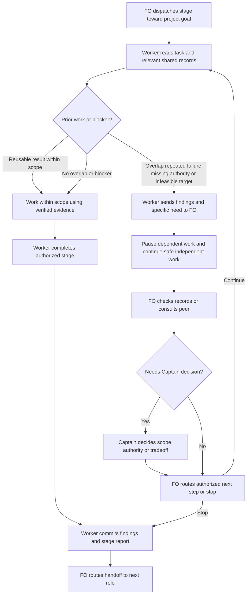

## Scope

- Source: the Captain (chat, 2026-10-26): 「一個額外的問題目前派工給worker時候沒有提醒他們是在一個多agent的合作團隊裡面，目的是合作完成專案任務？」, then, answering 「要開這張票嗎？」: 「要開。我覺得這一張跟peer有點關係，不只是讓他們知道有其他人在，他們也要知道目標是合作完成任務，所以要主動去思考，是不是有人做過是不是有人遇過，是不是有其他人在忙，特別是什麼時候應該提早問fo」.
- Outcome he named: a worker knows (1) it is one member of a multi-agent team whose goal is finishing the project task together; (2) to think actively whether someone already did this, already hit this, or is busy on it now; (3) when to ask FO early.
- Added 2026-10-26, the Captain (chat): 「要注意接手的不見得是codex但是重點是它要知道它在一個大流程的環節內，交棒是為了完成更遠大的目標，不是盲目努力完成不可能的目標」. So the wording names roles, not a vendor (whoever picks up next may be any reviewer or worker), and states that a handoff serves the larger goal: a worker that cannot finish hands back with what it found rather than pushing on toward an impossible target.
- Facts (2026-10-26): Spacedock 0.27.3 `skills/ensign` gives the completion channel and teams-mode mechanics, not the team's purpose or members; dev2 0.30.0 stage skills and the README's Dispatch facts give the worker's own boundaries only; the peers extension tells FO, not workers, how to ask another session.
- Bite: a validator ran a bare `git reset` in the shared state checkout and could have unstaged another FO's file (2026-10-24); a validator ran `git config` in a scratch clone (2026-10-25); several workers were unsure whether to signal `team-lead` or `main`; workers re-derived facts another session already held (FO relayed them by hand).
- Upstream first: Spacedock ensign skill (generic; changing it needs its owner and the Captain's approval); dev2 README `Dispatch facts` context section (read by every dispatch); `peers` EXTENSION.md; backlog new-work-checks-what-exists-first (same "check what exists first" theme for new work; ideation decides merge or order).
- Non-goals: letting workers message peer sessions directly; changing who decides.
- Added 2026-10-26, the Captain (chat, 2026-10-26): 「派工worker合作心態那張呢？考慮一個點，peers 放入 FO 合作心態，然後 paseo ext 放入如何使用 paseo cli 以及相關功能，這樣合理嗎？」, then, answering 「需要你決定：paseo 擴充放在 dev2 裡（跟 peers 放一起，比較好找），還是放在 spacedock 的 Paseo 外掛（符合 10/21 的裁定）？」: 「paseo ext 放到 dev2，而 SD+paseo 則是更高層次的人與 agent fleet 的合作關係，前者是 fleet 內怎麼合作」. The FO half of the mindset goes to `peers` (task peers-rules-name-each-host-binding); this task keeps the worker half, carried by every dispatch, since `peers` is FO-only and optional.

## FO alignment

Alignment: needed at ideation: how much a worker may do on its own (look, ask FO, ask a peer) is the Captain's.
Surfaces: none
Visible change: none
Release review: not needed: workflow maintenance, on no journey map.
Result: aligned 2026-10-26 on the outcome by the Captain's 「准」 answering this task's backlog briefing-1 question, which named the team, check-what-exists and hand-back-early text every dispatch carries; the merge or order with new-work-checks-what-exists-first and any word-budget raise are put to him at the ideation gate.

## Design

### Pilot PRFAQ

**Proposition.** Every dispatched worker understands that its stage and handoff contribute to the team's project outcome. Before substantial work or retrying a failure it checks relevant existing records; when another owner, repeated failure, missing authority/evidence or an infeasible target matters, it returns the evidence and a specific need to FO early. The next role may be any worker or reviewer. Finishing an impossible checklist is not the goal.

**Who uses this?** Workers receiving ideation, implementation or validation dispatches, including reused workers and the implementation/validation stages of the POC route. FO remains the coordinator; Captain retains scope and authority decisions.

**Where does the rule live?** One `Team` bullet in `kc-dev-flow-2/references/sd/workflow.md`, under `## Dispatch facts`, before `Signal`. Each existing stage's `context-sections` already includes that section. Stage skills need no duplicate paragraph; `peers` remains FO-facing; no Spacedock ensign change is needed for this bounded package improvement. Generic upstream adoption could be proposed later, but is not a prerequisite or an external action authorized by this design.

**How much checking?** Read the assigned task's prior reports and linked evidence, relevant local history and known shared ownership records. Check whether an old result still matches the current candidate. This is a bounded read, not a scan of every session, an obligation to ask on every routine step, or permission to edit shared state owned by another task. If the needed record cannot be accessed, name that limit to FO instead of treating absence as proof nobody did the work.

**When does the worker ask?** Before duplicating known work, retrying a known failure without a new hypothesis, touching overlapping ownership, assuming missing authority/evidence, or expanding scope to make an infeasible target appear complete. Send what was checked, found and tried, plus the specific answer or action needed. Pause only dependent work; continue independent work that is safe and already authorized. On an early stop, commit the findings/report under the ensign contract and hand back; do not label unfinished checklist items DONE.

**Who talks to whom?** The worker asks its own FO through the host's existing clarification channel; it neither discovers nor messages peer sessions. FO verifies shared facts, uses the peers extension where available, and routes a decision to the Captain when authority requires it. Transport restrictions remain real: a queued message is not a reply, and a host without an effective live channel uses its worker-thread handback. No new messaging tool, host binding, timeout, automatic retry or state field is introduced.

**What is not claimed?** Instruction delivery does not prove compliance or time saved. No host parity, behavior improvement or avoidance of every shared-index incident is established by a word-count or substring check. The ensign's existing path-scoped state-commit rule still governs commits.

### Proposed dispatch text

The following bullet is 99 whitespace-separated words, including its Markdown list marker and label, using the same `len(text.split())` method as the package lint.

```markdown
- **Team:** You are one worker in a team completing the project goal; your stage
  and handoff serve that goal. Before substantial work or retrying a failure,
  read the task's relevant prior work and available shared records: did someone
  already do this, hit this, or own it now? Ask FO early when ownership overlaps,
  a known failure repeats, authority or evidence is missing, or the target appears
  infeasible. Return what you checked, found, tried, and the specific help needed;
  pause dependent work, continue safe independent work. FO coordinates peers and
  decisions; do not message peers or change others' work.
```

### Chain and bounded existing-code check

Checked 2026-10-26 in this order:

1. **Spacedock 0.27.3:** read its own ensign shared core and Codex adapter, then `internal/dispatch/showstagedef.go` (`resolveStageContext`) and `internal/dispatch/build.go` (stage resolution and fresh/advance prompt assembly). Existing contracts already require escalation on ambiguity, committed reports and scoped state writes. They do not state this team-purpose/check-prior-work rule. The stage-context mechanism is present and usable, so replacing the dispatcher or editing its ensign is unnecessary.
2. **kc-dev-flow-2:** `git fetch origin` succeeded after the sandbox denied writing FETCH_HEAD; source pinned to `c70f1b22cb1e4a66fd15c617647c778d54c59ec9`, released manifest version **0.31.0**. Read the workflow, peers extension, three-stage dispatch transport test and the implementation principles' Existing-code capability check. The latter deliberately excludes greenfield/mechanical work and checks capability, not who already owns or attempted the work. Two bounded searches covered the context selectors/dispatcher consumers and the worker/peer instructions; no second worker collaboration mechanism was found in that boundary. The actual `show-stage-def` probe below establishes the existing delivery seam, not just a missing phrase.
3. **Sibling adopters, local read-only snapshots:** relay at `ab570dbe4125db7a57b27160a8d1c9e39591b3b9` (`beirut-dev2/docs/dev2/README.md`, marker 0.30.0), qnow at `278f79ca3eb03a8c1286817f542c4ec4b744bfed` (`qnow-adopt-dev2/docs/dev2/README.md`, marker 0.27.0), web at `29c85eabcd022462e8861c76e79f6ae5e2056cd1` (`dev2-fo/docs/dev2/README.md` and `docs/dev2-poc/README.md`, marker 0.31.0). Their Dispatch facts contain Signal/Package/Secrets and no Team bullet. qnow substitutes its own secret wrapper. These are observed local README bytes, not a claim about their remote deployed/adopted versions; they supply no third-party contract authority. Subsequent adoption preserves wrapper, extensions and other project-specific lines through the existing sync route.

Current proof: a disposable README copy with the proposed bullet, passed to the real `/Users/kent/.local/bin/spacedock dispatch show-stage-def --workflow-dir <copy> --stage <stage>`, returned exactly one complete Team bullet in all three stages. `poc_readme.py` derivation retained it in both POC worker stages. Removing the bullet (the unchanged base control) returned zero instances. The stage output grew by exactly 99 words in each case. No product source, branch, PR or external message was created.

Existing rulings read: ADR 0011 (delegated decisions), 0014 (README/trunk check), 0020 (word-budget rises), 0035 (learn/peers defaults), plus state `Override:` lines. No direct collaboration override was found. ADR 0035 corrects the Scope's older description of peers as optional: it is now required/default in the template, but is still FO-facing and does not supply worker context. The Captain's 2026-10-26 ruling already puts FO mindset in peers and fleet-internal Paseo use in a dev2 extension; do not ask that location question again. None of those rulings authorizes this 99-word budget increase.

### Flow



Rendered with the locally available Mermaid CLI into `/tmp/worker-team-ideation/flow.png`; inspected for actors, order, both continuation branches, dependent-work pause, Captain boundary and final handoff. The initial sandbox browser-launch failure was resolved by approved local rendering outside the sandbox. Rendering proves presentation, not worker behavior. Reproduce from the fenced Mermaid with `mmdc -i flow.mmd -o flow.png` in an environment with Mermaid CLI and its browser installed.

### Words FO reads at each moment

Base is the pinned 0.31.0 source above; candidate is this exact 99-word design insertion. No text is relocated to a mod, stage skill, extension or script output. Workflow budget: **5421 -> 5520 (+99)**, only if the Captain authorizes that rise. `lint-skills.py` requires exact equality, not spare capacity; the implementation adds one +99 budget step carrying his actual quote, reason and loaded moment. Do not invent the quote, edit the starting budget or silently cut unrelated safety clauses. If an earlier batch change lands first, rebase and recount the net +99 against that accepted base.

The table counts the lifecycle reading set explicitly, including generated instruction output. It is a synthetic one-task trace, not token billing or a claim about every possible FO context. Startup includes the whole README; warm idle does not reload it. The idle hook refers to the startup logic, so that passage is included at idle too. Common host bootstrap, task-specific evidence, extension-triggered peer conversations and human replies are outside this fixed trace and unchanged by the patch; additional Team-triggered conversations are variable and must be measured in the behavioral replay, not reported as zero.

| Moment and specified trace | Before | After | Counted inputs |
| --- | ---: | ---: | --- |
| Startup/resume, one open PR with checks pending | 5863 | 5962 | README 5421/5520 + package mod 48 + SD startup 365 + actual `tasks` output 29 |
| Warm idle, one green draft PR | 765 | 765 | SD idle 100 + referenced startup 365 + mod 48 + Delivery authority paragraph 215 + `tasks` output 37 |
| Warm idle, merged PR missing observer, then report committed and rerun | 718 | 718 | SD idle 100 + startup 365 + mod 48 + README merge paragraph 82 + learn FO step 35 + missing output 68 + committed output 20 |
| After archive, observer already committed | 55 | 55 | mod step 3: 12 + two `after pr-merge` output lines: 15 + archived observer output 28 |
| Merge ask, ordinary docs change and a passing synthetic gate | 415 | 415 | authority 215 + gate-command paragraphs 53 + Extensions merge-ask sentences 90 + actual `delivery_gate check` output 57 |
| FO reads the dispatch definition, ideation | 486 | 585 | actual `show-stage-def` stdout |
| FO reads the dispatch definition, implementation | 1221 | 1320 | actual stdout, same for derived POC |
| FO reads the dispatch definition, validation | 1406 | 1505 | actual stdout, same for derived POC |
| A worker returns early to FO | variable existing report | variable evidence/help request | no new fixed form, receipt or mandatory all-clear report; record actual words in replay |

The dispatcher/worker reads also cost +99 per fresh or reused stage load; none is hidden outside the README budget. The startup and dispatch rows are separate moments, not summed as if all occur once. Warm idle/merge numbers do not imply startup reads disappeared. If a runtime rereads the whole README at an idle moment, add 5421 before and 5520 after at that moment.

Measurement exercised current Python output code with synthetic provider facts and a mocked committed-observer lookup; no real GitHub request, merge, learning job or observer dispatch occurred. The snippets below reproduce the counted passages and fixture outputs against the pinned package and SD 0.27.3. The after column is derived from the exact proposed text because implementation does not exist yet. No CI trigger changes are proposed; added CI cost is not measured.

### Implementation footprint and retained claims

- `kc-dev-flow-2/references/sd/workflow.md`: the one Team bullet only; existing context selectors carry it.
- `kc-dev-flow-2/scripts/lint-skills.py`: the Captain-authorized +99 budget step only, conditional on that decision.
- `kc-dev-flow-2/scripts/test_sd_dispatch.py`: extend the existing real transport test for the Team clause, both hosts, fresh/advance loading and loss-of-context controls. Test missing Team and a missing selector separately; no new runtime gate.
- `kc-dev-flow-2/scripts/test_poc_readme.py`: exercise derivation and the two remaining worker stages with Team, without reintroducing ideation.
- `docs/adr/<FO-reserved number>-workers-check-shared-work-and-return-to-fo-early.md`: record the enduring collaboration/authority ruling and accepted cost after the gate; draft title only, no number reserved here.

No edits to the stage skills, peers or Paseo extension, Spacedock scaffolding, adopter files, workflow mods, delivery gate, package versions or CI definitions. A normal release then separately authorized README re-sync makes the change reach adopters; package installation alone cannot update their adopted README. ADR 0014's existing stale-README hold remains applicable.

### Needs decision for the Captain

FO should present these separately, one choice at a time; neither is accepted by this report.

1. **Order with `new-work-checks-what-exists-first` (new work checks upstream and decisions): recommend follow, not merge.** This task supplies the worker/FO collaboration and early-return seam now; the follow-up separately covers dependencies, third-party contracts, sibling capability and in-force ADRs, including its still-relayed ruling. Worse: there are two design/adoption steps, and the broader upstream-first gap remains until the next task lands. Merging gives one rollout but expands this task into a capability/ADR audit and delays the focused collaboration fix; it also risks treating a peer-relayed quote as this FO's Captain authority.
2. **Allow the exact +99 words: recommend yes, 5421 -> 5520 at this base.** One shared bullet reaches every worker stage, is testable through the existing transport and avoids three duplicated skill paragraphs. Worse: every full README load and stage-context load is longer, and instruction-only guidance can still be ignored. Declining means hold implementation and return a smaller design or a separately evidenced equivalent cut; do not claim a budget-neutral design by moving text to another file. ADR 0020 requires the real ruling and loaded moment alongside the positive budget step.

### Batch overlap

Checked the named task files as they stood during this run, including closure/amendment sections rather than relying on frontmatter alone. This task owns only its report; the table predicts future implementation conflicts and does not authorize edits to peers.

| Task | Same file, check or numbered-record space | Ordering implication |
| --- | --- | --- |
| `worker-knows-the-team-and-asks-early` (this worker collaboration task) | the five paths in Implementation footprint; workflow word-budget equality, dispatch transport, POC derivation, ADR allocation | own bounded change |
| `peers-rules-name-each-host-binding` (FO collaboration and host messaging) | latest concurrent design names `lint-skills.py` for extension dependencies, shared with our budget step; shared ADR allocation and design_surfaces check (its source validation changes that checker). It explicitly leaves workflow.md unchanged | refreshed its overlap section before commit: serialize lint edits, preserve our worker/its FO split, rerun design checks after its source-validation change; no sibling workflow budget step is currently proposed |
| `codex-reader-same-head-unresolved` (review reader preserves unresolved findings) | current Scope names `extensions/codex/codex_review.py` and its EXTENSION.md, none of our four package paths; shared package lint/test run and possible ADR allocation only | no code-order dependency; recheck after its design |
| `adr-required-statement` (require a reported ADR decision) | historical design touched workflow.md, ADR checks and POC tests | Captain closed it on 2026-10-20; not a live implementation predecessor despite validation frontmatter. Do not revive its old branch or ADR number |
| `journey-server-host-pilot` (shared journey server and host adapters) | kc-journey-map code has no package-file overlap; shared `docs/adr/` number allocation/check | reserve against current main and state; no server dependency |
| `ops-inbox-r1-setup-and-isolation` (operations inbox setup and isolation) | kc-ops-inbox has no package-file overlap; shared `docs/adr/` allocation/check. Its report names ADR 0031, already occupied differently on current main | FO resolves its reservation in that task; this task neither edits nor renumbers it |
| `pr-review-lite-value-pilot` (attended lightweight PR review) | separate review/map work and task artifacts; no Dispatch facts, lint-skills, dispatch transport or POC-derivation edit found in its recorded scope/current reports | no dependency; shared repository release checks only |
| `adr-silent-undo-probe` (experiment on silently reversing decisions) | experiment harness in state, no product edit authorized; Captain amendment moves it to POC | no overlap with this design; do not absorb its experiment |
| `comment-check-reaches-delivery-gate` (bind comment checks to delivered head) | historical proposal touched delivery_gate, its test and validation principles, none of our package files | Captain closed it on 2026-10-20; archive is blocked upstream, not live implementation work |
| `journey-canvas-hosted-poc` (hosted canvas experiment) | journey canvas/server proof; no shared package path or dispatch check in recorded scope | no dependency |
| `new-work-checks-what-exists-first` (upstream and existing-decision check) | future worker instructions may touch this same Dispatch facts paragraph/transport tests, or capability principles; exact files not designed yet | follow this task, reuse its check/ask seam, do not duplicate the team paragraph |

Recommended order: peers/host-binding design boundary first; serialize its lint change and this collaboration implementation, recount after any accepted sibling workflow/budget edits, then the separate upstream-first task. The review-reader task can proceed independently unless its later design adds one of these shared files. Recount and recheck reservations at each implementation dispatch; a common `docs/adr/` directory is an allocation dependency, not permission to reuse another task's number.

## Acceptance criteria

**AC-1**: The Team rule reaches every dispatched worker stage once through Dispatch facts, including fresh and reused dispatches on Claude Code and Codex and the derived POC route's two worker stages.
Verified by: extend `python3 kc-dev-flow-2/scripts/test_sd_dispatch.py --sd-plugin-root <SD 0.27.3>` to build real dispatch artifacts, execute their exact generated fetch commands and compare the complete clause in the output; exercise fresh and advance/reuse, and run `test_poc_readme.py`. Delete Team, delete one context selector, or restore ideation in POC and require the corresponding test to fail. Current evidence: show-stage-def and POC prototype passed; generated fresh/advance candidate tests and live host execution are not yet verified.

**AC-2**: In a bounded worker replay, an existing relevant result is checked and reused, and current overlapping ownership is returned to FO before dependent mutation; normal independent work continues without an unnecessary question.
Verified by: for each supported host, run the same read-only task fixture once with base context and once with candidate context, recording model, tools, input, transcript and file-state before/after. Fixture includes a current reusable result plus a clearly named active owner, and a no-overlap control. Score evidence inspection, owner check and first clarification relative to first attempted dependent write; a hint-only response without inspecting the supplied record fails. Falsifiers: removing the existing-result record changes the reuse claim; replacing the owner with a completed record should remove the ownership hold. Current evidence: future implementation replay, not run in ideation; source/transport alone do not satisfy it.

**AC-3**: The worker returns a repeated failure or infeasible/unauthorized target early with checked sources, findings, attempts and a specific need, preserving partial evidence and avoiding peer messages or scope expansion.
Verified by: the same host replay matrix includes a recorded failed attempt with no new hypothesis and a target requiring authority the task expressly lacks. Capture the ordered actions: clarification/handback precedes repetition or expansion; no peer send, no shared-index reset/config write, and any final incomplete checklist is honestly SKIPPED/FAILED. A separate safe independent action should still run. Falsifier: remove the prior failure or provide explicit scoped authority and the worker must reassess rather than issue the same blanket refusal. A callback mock is not live-host proof. Current evidence: future replay, not run; exact host conversation channel follows its ensign adapter.

**AC-4**: The accepted workflow budget and per-moment reading cost match the shipped change, without moving instructions elsewhere to hide the increase.
Verified by: run package lint and the lifecycle recount below at base and candidate; independent validation recounts from source and actual captured outputs, including any newly introduced helper output. Expected at this base: README 5520; fresh/reused stage-context +99; fixed warm lifecycle readings unchanged; report actual clarification/reply words and elapsed/tool usage from AC-2 and AC-3 separately, without promising savings. Falsifiers: add one README word, omit the Captain quote/loaded moment, or put a new instruction into a mod/output without counting it. Current evidence: exact 99-word draft and current lifecycle fixture counts measured; no Captain budget ruling or candidate lint exists.

**AC-5**: The change preserves authority, project customization and retained-document truth; its ruling lands under a newly reserved ADR number and adopters receive it through normal release/sync.
Verified by: validate the exact candidate diff against the five named files, run `adr_lint.py docs/adr --since <base> --require <reserved number>`, and exercise POC derivation plus a disposable three-way README merge containing qnow-style wrapper and adopter extension customizations. The result must carry Team and preserve the custom lines. Falsifiers: replace the wrapper with the template, grant worker-to-peer messaging, reuse an occupied ADR number, or claim installation alone updates the adopted README. Current evidence: read-only adopter/ADR inspection complete; new ADR, merge exercise and actual adoption are future work, with external sync outside this task's implementation unless separately authorized.

**AC-6**: The pilot ends with an evidence-bound accept/repair/stop recommendation rather than a universal behavior claim.
Verified by: implementation reports each AC's actual evidence and every base/candidate replay outcome; validation independently checks transcripts against the action-order score and lists unavailable host paths as unverified. If a required host cannot run or the new prompt still repeats the prohibited action, return that gap to FO rather than substitute a keyword match or add an unapproved enforcement mechanism. Falsifier: a candidate that prints the right words but sends to a peer, changes shared ownership or attempts an impossible step must be rejected. Current evidence: acceptance plan only; no behavior or cost result claimed.

## Measurement reproduction

The transport probe is reproducible without repository mutation: obtain `workflow.md` with `git show c70f1b22cb1e4a66fd15c617647c778d54c59ec9:kc-dev-flow-2/references/sd/workflow.md`, insert the exact Team bullet under Dispatch facts in a temporary README, run SD 0.27.3 `dispatch show-stage-def` for ideation/implementation/validation, derive a second copy with `poc_readme.py derive`, and repeat implementation/validation. Count each stdout with `len(text.split())`; expected pairs are in the table. Keep these disposable probes outside the code and state checkouts.

For the lifecycle recount, save this code as a disposable file and run `python3 recount.py <package-0.31.0> <SD-0.27.3> <temporary-directory>`. It imports the package's existing output code and its delivery-gate fixture; provider facts and observer commitment are synthetic. All files it writes are inside temporary directories; it sends no network request and creates no repository branch or commit. The mock hides real provider/host behavior intentionally: this proves reading-cost arithmetic only. The input package must match the pinned source; a later package requires a new baseline.

```python
from pathlib import Path
import sys, io, contextlib, subprocess, json
from unittest.mock import patch
P=Path(sys.argv[1]);sys.path.insert(0,str(P/'scripts'))
import pr_watch as w, observer_check as o, test_delivery_gate as g
root=Path(sys.argv[3]);root.mkdir(parents=True,exist_ok=True);words=lambda x:len(x.split())
wf=(P/'references/sd/workflow.md').read_text();mod=(P/'references/sd/mods/kc-dev-flow-2.md').read_text();sd=(Path(sys.argv[2])/'mods/pr-merge.md').read_text()
def sec(t,start,end):return t.split(start,1)[1].split(end,1)[0]
def passage(t,start,end):return start+t.split(start,1)[1].split(end,1)[0]+end
pmstart='## Hook: startup'+sec(sd,'## Hook: startup','\n## Hook: idle');pmidle='## Hook: idle'+sec(sd,'## Hook: idle','\n## Hook: merge')
authority=passage(wf,'Project and Captain authority constrain hook','explicit choice.')
merge=passage(wf,"Under the Captain's grant quoted in its dispatch",'references/sd/mods/`.')
ask=passage(wf,'Before the validation `gate prepare`','Captain what it printed.')
ext=passage(wf,'A merge ask names each listed reviewer','is not named as unread.')
learn=passage((P/'extensions/learn/EXTENSION.md').read_text(),'- **FO step:**','\n- **Read:**').rsplit('\n- **Read:**',1)[0]
probe=root/'lifecycle';probe.mkdir(exist_ok=True);st=probe/'.spacedock-state';st.mkdir(exist_ok=True)
(probe/'README.md').write_text('---\nstate: .spacedock-state\nextensions: [learn, peers]\n---\n')
(st/'task.md').write_text('---\ntitle: task\nstatus: validation\npr: o/r#9\n---\n')
snap=dict(state='OPEN',draft=False,mergeable='MERGEABLE',checks='pending',head='a'*40,title='feat: task',codex='-',copilot='-',**{'codex-evidence':'-','copilot-evidence':'-'})
results={}
for mode in ['pending','green','missing','committed']:
 watch=root/(mode+'-watch.json')
 if watch.exists():watch.unlink()
 now={**snap,**({'checks':'green','draft':True} if mode=='green' else {}),**({'state':'MERGED'} if mode in ['missing','committed'] else {})}
 def run(argv,**kw):
  if 'observer_check.py' in str(argv[1]):
   with patch.object(o,'locate',return_value=False),patch.object(o,'git',return_value=(1,'') if mode=='missing' else (0,'ok')):
    code,out=o.check(st,'task','HEAD')
   return subprocess.CompletedProcess(argv,code,out,'')
  return subprocess.CompletedProcess(argv,0,'','')
 out=io.StringIO()
 with patch.object(w,'ready_rows',return_value=[]),patch.object(w,'review_rounds',return_value=(0,None)),patch.object(w.subprocess,'run',side_effect=run),contextlib.redirect_stdout(out):
  code=w.main(['--state',str(watch),'tasks',str(probe)],look=lambda *a,**k:now)
 assert code==0,out.getvalue()
 results[mode]=out.getvalue();(root/(mode+'-output.txt')).write_text(out.getvalue())
with patch.object(o,'locate',return_value=True),patch.object(o,'git',return_value=(0,'ok')):code,arch=o.check(st,'task','HEAD')
res=g.run_check();assert res.code==0,res.out
results['archive']=arch;results['gate']=res.out
step3='3. After the `pr-merge` hook, do each `after pr-merge:` line it printed.'
after='\n'.join(x for x in results['committed'].splitlines() if x.startswith('after pr-merge:'))
static={k:words(v) for k,v in dict(readme=wf,mod=mod,pmstartup=pmstart,pmidle=pmidle,authority=authority,merge=merge,ask=ask,extensions=ext,learn=learn,step3=step3).items()}
print('static',static);print('outputs',{k:words(v) for k,v in results.items()})
rows={
'startup':sum(map(words,[wf,mod,pmstart,results['pending']])),
'idle-open-green':sum(map(words,[pmidle,pmstart,mod,authority,results['green']])),
'idle-merged-missing-then-committed':sum(map(words,[pmidle,pmstart,mod,merge,learn,results['missing'],results['committed']])),
'after-archive':sum(map(words,[step3,after,arch])),
'merge-ask':sum(map(words,[authority,ask,ext,res.out]))}
for name,n in rows.items():print(name,n,n+(99 if name=='startup' else 0))
(root/'counts.json').write_text(json.dumps(dict(static=static,outputs={k:words(v) for k,v in results.items()},moments=rows),indent=2))
```

## Stage Report: ideation

- DONE: A design for the worker collaboration text every dispatch carries (team purpose, check whether someone already did, hit or is busy on this, hand back to FO early with what was found), naming where it lives (README Dispatch facts, stage skills or the ensign skill) and its word cost against the 5421-word workflow budget; and a recommendation whether new-work-checks-what-exists-first merges in or follows, with what gets worse either way
  `Design` proposes one 99-word Team bullet in Dispatch facts (5421 -> 5520, pending Captain ruling), keeps FO/peer authority intact and recommends the separate upstream-first task follow; tradeoffs are recorded.
- DONE: A `### Batch overlap` section naming each file the design would change and each other batch task (peers-rules-name-each-host-binding, worker-knows-the-team-and-asks-early, codex-reader-same-head-unresolved) and live task of other sessions (adr-required-statement, journey-server-host-pilot, ops-inbox-r1-setup-and-isolation, pr-review-lite-value-pilot, adr-silent-undo-probe, comment-check-reaches-delivery-gate, journey-canvas-hosted-poc (driven by other sessions; read only)) that changes the same file or check, so FO can order implementation
  `Batch overlap` enumerates all named tasks and all five prospective files/checks; adr-required-statement and comment-check-reaches-delivery-gate are closed despite retained nonterminal frontmatter, and shared ADR allocation needs rechecking.
- DONE: The words FO reads at each lifecycle moment, before and after, per root learning.md "Measure the words FO reads at each moment, not one file's size"
  `Words FO reads at each moment` plus the embedded executable recount: startup 5863 -> 5962; warm open idle 765 -> 765; merged idle 718 -> 718; archive 55 -> 55; merge ask 415 -> 415; synthetic output limits and variable handback costs explicit.
- DONE: Acceptance criteria with reproducible evidence clauses and falsifiers, and unresolved decisions for the Captain, each with a recommendation and what gets worse under it
  AC-1 through AC-6 each name reproducible evidence, a falsifier and current limits; two separately presented decisions recommend follow-up ordering and an explicitly authorized +99 budget step.
- DONE: Current evidence mapped separately to each acceptance criterion
  AC-1: real show-stage-def copies delivered one Team clause in all five active route/stage cases, base deletion control delivered none; fresh/advance candidate tests and live-host execution remain unverified.
  AC-2: replay inputs and action-order score defined; no behavioral replay run, so reuse or early ownership escalation is not claimed passed.
  AC-3: repeated-failure, missing-authority and independent-work replay/falsifiers defined; no live-host messaging or worker-compliance result claimed.
  AC-4: exact source bytes matched pinned c70f1b22; embedded recount executed successfully with the printed table values; one extra README word or an uncounted output instruction breaks the accepted arithmetic.
  AC-5: adopter reads and relevant ADRs checked; new ADR, customization merge probe and adoption remain future work, not represented as delivered.
  AC-6: evidence-based accept/repair/stop rule specified; no improvement, savings or host parity verdict exists before implementation and validation.
- DONE: Required current-stage design proof
  `design_surfaces.py check` exits 0: `worker-knows-the-team-and-asks-early.md: design surfaces presentable`; Mermaid rendered and visually checked; the existing task prefix/frontmatter stayed byte-identical. The surface checker alone does not prove diagram semantics or worker behavior.

### Summary

The existing Dispatch facts transport can carry one 99-word collaboration instruction through all worker stages without an upstream change or duplicate skill paragraphs. Recommend authorizing that explicit reading cost and keeping the broader upstream/ADR inspection task as the next separate task; actual worker behavior remains a later replay obligation. Only this task's design/report was written; no product implementation, code branch, PR action or peer message was performed.
