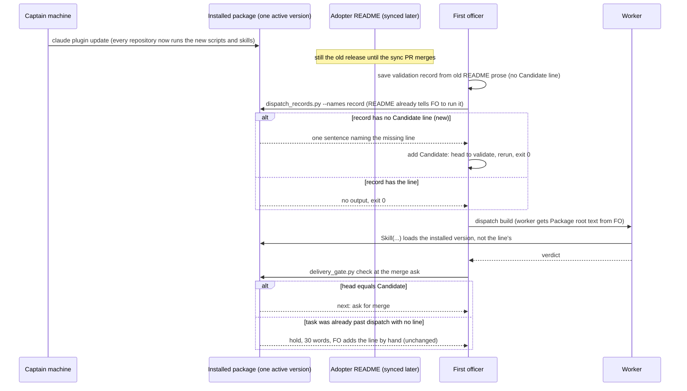

Filed on the Captain's 「兩問題照這樣做」 (chat, 2026-10-17), to FO's question whether to file the subspace-relay FO's report as a kc-dev-flow-2 task.

## Scope

- Reported by the relay FO (dhaka-70, 2026-10-17), task `owner-link-sign-in-to-claim` (relay PR spacedock-dev/subspace-relay#381): relay's `docs/dev2/README.md` declares 0.22.1 and dispatch scope notes name `Package root: .../kc-dev-flow-2/0.22.1`, yet its cycle-2 and cycle-3 validators reported "the loaded skill is 0.23.0" and ran 0.23.0 scripts. Evidence on relay's spacedock-state/dev2: `_archive/owner-link-sign-in-to-claim/dispatch/validation-{1,2,3}.md` and the cycle-2/3 stage reports.
- Cause (FO, 2026-10-17): the Claude plugin install is per user, not per workflow. The Captain's machine moved to 0.23.0 on 2026-10-16 (`claude plugin update kc-dev-flow-2@kc-claude-plugins`), so every repository's workers load 0.23.0 whatever its README declares. `package_version.py` checks FO's own load only.
- Effect: 0.23.0's `delivery_gate.py` requires a `Candidate: <40-hex head>` line in the latest validation dispatch record; 0.22.1 records have none, so in-flight tasks in a 0.22.1 workflow hold at the merge ask. Relay's FO now adds the line by hand.
- Candidate routes for ideation: workers load the Package root the dispatch names (the skill already states one), a check that a worker's loaded version equals the README's, or upgrade notes plus a `dispatch_records.py` part that require the Candidate line before release; and whether FO's "sync later" for an adopter is meaningful at all while installs are per user.

## FO alignment

Alignment: not needed before ideation; the Captain approved filing it (his words are at the top of this file).
Release review: not needed: workflow maintenance, on no journey map.
Surfaces: none
Visible change: none

## Design

Design (ideation, 2026-10-17, profile pilot, against kc-dev-flow-2 0.24.0 at origin/main 19fe3b5b). Surfaces: none, so the PRFAQ and the diagram below are the whole artifact.

### Ruling in one paragraph

A worker cannot load a declared version, and no change in this package can make it: the worker's skill resolves to the one installed version, so the dispatch's `Package root:` line names where FO's scripts run, not a pin. The worker side is already right (README Dispatch facts: "if they differ, use the skill's"). What broke at relay was FO side: a 0.23.0 script (`delivery_gate.py`) began requiring a `Candidate:` line that only the 0.23.0 README tells FO to write. Recommended route: route 3 narrowed. `dispatch_records.py --names`, the one script relay's 0.22.1 README tells FO to run on the saved record before `dispatch build`, also names a validation record that lacks the line, at the moment it is cheap to add. No README word is added, no hold is added.

### Chain check (done before designing)

- Spacedock 0.27.2: `spacedock dispatch build --help` has no package or plugin-version field (read 2026-10-17); the worker bootstrap is `Skill(skill=...)`, which the Claude plugin loader resolves. A Spacedock-side pin check is a named non-goal (upstream, not ours to build here).
- kc-dev-flow-2: `package_version.py` compares only FO's loaded package with the README and exits 1 only when the package is OLDER; README-behind prints "re-sync it" and exits 0 (reproduced below). ADR 0014 rejected a second mode on that script, and kept exit 1 to "load a newer package". `references/sd/adoption.md` already orders the pair: "Update the plugin before re-syncing a README". Precedent for where a new check goes: archived task extension-instruction-reaches-dispatch (D1) joined checks to the pre-send `--names` mode instead of adding an FO command a stale README does not teach.
- Siblings (read-only, local refs, not fetched): README release markers 2026-10-17: relay origin/main 0.22.1, qnow origin/next 0.23.0, subspace-web origin/main 0.23.0, this repo 0.24.0; the install is 0.24.0. Three of four adopters are behind the install right now, so README-behind-package is the normal window, not an exception.

### What was measured (2026-10-17)

- Install: `~/.claude/plugins/installed_plugins.json` holds one `kc-dev-flow-2@kc-claude-plugins` entry, installPath `.../0.24.0`. `0.22.1/` and `0.23.0/` still exist and carry `.orphaned_at` (marked orphaned; when the harness removes them was not measured).
- Relay task owner-link-sign-in-to-claim (state branch spacedock-state/dev2, `_archive/owner-link-sign-in-to-claim/dispatch/validation-{1,2,3}.md`): all three records say `Package root: .../0.22.1`, while the cycle-2/3 stage report says "the dispatch names package 0.22.1, the loaded skill says 0.23.0; all package scripts above ran from 0.23.0" and that its checks exit 0 under both. So the worker followed the existing rule, nothing failed on the worker side, and the line `Package root:` in validation-2/3 was copied text, not a record of what ran. The cost was the merge-ask hold below.
- Reproduction on an extracted copy of origin/main's package (scratch folder outside the repository, since removed), a validation record with the 0.22.1 header shape and no `Candidate:` line: `dispatch_records.py --names <record>` exit 0 and no output; `delivery_gate.py check` exit 2, 30 words, `next: hold the ask; dispatch validation of this head with a Candidate line, or tell the Captain.` `package_version.py` on a README marked 0.22.1: `README synced from 0.22.1 is behind the loaded package 0.24.0: re-sync it`, exit 0, 12 words.
- Cause of the hold, stated exactly: the step is taught by README prose (`workflow.md` "`Candidate: <full head SHA>` line per head validated") while the check that needs it ships with the package. No script FO runs at the validation dispatch prints it; the first script that does is the merge-ask check, after the validation has run.

### PRFAQ

**Press release (future).** An adopter whose README is a release behind no longer finds out at the merge ask. When its first officer saves a validation dispatch record without the `Candidate:` line the installed scripts need and runs the `--names` check it already runs, the check names the missing line in one sentence; FO adds the head it is about to validate and dispatches. The merge ask finds the line in place.

**FAQ.**
- Which version does a worker load? The installed one, always (one entry in `installed_plugins.json`; relay's validators reported 0.23.0 against a dispatch naming 0.22.1). Not measured: Codex hosts.
- Why not make workers read the dispatched root (route 1)? The root is FO's session version (relay's records show it can be stale text); the old install is marked orphaned and may disappear; the README already tells workers to use their skill's root; a pinned worker would also skip the fixes the update was made for. Rejected, no mechanism to build.
- Why not hold dispatch when the README is behind (route 2)? It would hold relay, qnow and subspace-web today, and after every release until each sync PR is merged, because the documented order is plugin first, README second. It also needs a signal distinct from `package_version.py` exit 1 (ADR 0014). It is the only route that closes the whole class mechanically; it is offered as the alternative in the decision below.
- Why not upgrade notes? Prose nobody reads at the moment the step is due; relay's FO needed none because the script named the remedy. `adoption.md` already carries "until re-synced" notes of this kind, and no step reads them at dispatch.
- Does "sync the adopter later" still mean anything? Yes, narrowed. Skills, scripts, extensions and stage references reach every repository the moment the user updates the plugin; only the README prose, its frontmatter and `_mods` copies wait for the sync PR. There is no older release an adopter can keep running, so "later" means a window in which old FO prose runs against new scripts. Release rule that follows: a script that newly needs an FO-written line or step must also print it from a script the previous README's FO already runs at that step's moment.
- Does the Candidate line cover the next break? No; the rule above does, as a maintainer sentence only (no check enforces it; stated as a limit). Known next consumer: special-role-triggers' proposed `Reviewer:` line.
- Does the validator owe a loaded-version line? No: relay's validator wrote one unprompted, it changed no outcome, and no failure traces to its absence.
- What about tasks already past dispatch? They still meet the 30-word hold at the merge ask once; FO adds the line by hand, as relay's did.

### Diagram

### Bounded existing-code check

Existing capability used: the pre-send `--names` mode (`check_names` in `dispatch_records.py`) and `delivery_gate.CANDIDATE`. Replaced: nothing. Observation showing the change is needed: the reproduction above (exit 0 at dispatch, exit 2 at the merge ask for the same record). Conclusion: extend `check_names`' `--names` path with one validation-record part; do not touch `check_newest`, because `pr_watch.py tasks` turns any non-name failure of `--newest` into `next: report <slug> to the Captain` on every idle pass for each in-flight old task (read in `pr_watch.py`, `tasks`).

### Words FO reads at each moment (before / after; measured 2026-10-17 with `wc -w` on origin/main text and on script output from the extracted package)

| Moment | Before | After |
| --- | --- | --- |
| README text on version and dispatch (workflow.md lines 89-95 and 109-111) | 99 + 42 | 99 + 42 (no README word changes; `workflow.md` stays 5495, `WORKFLOW_WORD_BUDGET` stays 5511) |
| startup, and before each dispatch: `package_version.py`, `workflow_checkout.py` | 12 (README-behind) | 12, same script |
| validation dispatch, record has the line | 0 | 0 |
| validation dispatch, record lacks the line | 0 (exit 0) | 23, once, then 0 after FO adds it |
| idle on open or merged PR, after the archive (`pr_watch.py`, `observer_check.py`) | unchanged | unchanged (no file touched) |
| merge ask, task with the line | 0 hold words | 0 |
| merge ask, record lacked the line | 30 | 0 when caught at dispatch; 30 for a task already past dispatch |

The 23 words are the proposed line (`<record>:1: no 'Candidate: <40-hex head>' line; add one per head to validate above the first '## ' heading, then run this check again`), counted with `wc -w`.

### Batch overlap

Files this design would change: `kc-dev-flow-2/scripts/dispatch_records.py` (the `--names` path), `kc-dev-flow-2/scripts/test_dispatch_records.py`, one sentence in `kc-dev-flow-2/skills/maintain-flow/SKILL.md`. Not changed: `references/sd/workflow.md`, any adopter README, `lint-skills.py`, `package_version.py`, `delivery_gate.py`, `pr_watch.py`.
- workflow-budget-ratchet: same check, `dispatch_records.py`'s failure messages (its Shrink rule reads them to decide which README sentences become pointers; the new line is one more message it must read) and `WORKFLOW_WORD_BUDGET`/`workflow.md` only if the route were changed to add README prose, which this design does not. Land mine first or second; either order merges.
- special-role-triggers: same file `dispatch_records.py` if its `Reviewer:` line becomes a part, and the same class (a script requiring an FO-written line); it is the first consumer of the maintain-flow sentence and should add its own `--names` message.
- merge-gatekeeper: `delivery_gate.py` and the merge-ask passage of `workflow.md`; this design reads `CANDIDATE` from `delivery_gate.py` but does not edit it, so a rename there breaks the parity test (AC-3).
- worker-loads-declared-package: this task.
- prod-security-validation-gate, ui-design-review-in-ideation: none (they touch `design_surfaces.py`, the validation/ideation skills and agent definitions).

## Acceptance criteria

Evidence commands run from the repository root of a checkout of the implementation PR head, with `python3 -B`; `FIXTURE` is a scratch state folder outside the checkout holding `demo.md` and `demo/dispatch/validation-1.md` in the 0.22.1 header shape (a `Dispatched:` SHA, `Model:`, `## Checklist`, `## Scope notes` with an absolute `Package root:` and the completion line), the one that exits 0 on origin/main today.

**AC-1** `dispatch_records.py --names <validation-N.md>` exits 1 and prints one line naming the file and the missing `Candidate: <40-hex head>` line when the record has none above its first `## ` heading, and exits 0 with no output when it has one. Evidence: `python3 -B kc-dev-flow-2/scripts/dispatch_records.py --names FIXTURE/demo/dispatch/validation-1.md; echo $?` prints the line and 1; after adding `Candidate: d2c96f5152e51de4efdd0ff78f420b9a0238d874` it prints nothing and 0; the baseline run on origin/main printed nothing and 0 (2026-10-17). Falsifier: remove the new part and the first run exits 0.

**AC-2** The part applies only to files named `validation-<N>.md`; an `ideation-1.md`, `implementation-1.md` or a path outside a `dispatch/` folder with no Candidate line still exits 0. Evidence: a unit test over those three names. Falsifier: apply the part to every record and the implementation fixture exits 1.

**AC-3** One definition of a valid Candidate line serves both scripts: `dispatch_records.py` imports or references `delivery_gate.CANDIDATE` and the same above-first-heading scope, and a test feeds each of these lines to both and asserts the same verdict: a 40-hex line, a 39-hex line, an uppercase-hex line, a line with trailing text, the same valid line below the first `## ` heading. Evidence: `python3 -B kc-dev-flow-2/scripts/test_dispatch_records.py`. Falsifier: a second regex that accepts the line below the heading makes the last case differ.

**AC-4** `--newest` and `pr_watch.py tasks` behave as before: with a Candidate-less `validation-N.md` as the newest record, `pr_watch.py tasks` prints no `next: report <slug> to the Captain` line and `dispatch_records.py --newest` exits 0. Evidence: a test in `test_dispatch_records.py` or `test_pr_watch.py` on a scratch git state with that record. Falsifier: put the part inside `check_names` and the test fails.

**AC-5** No README word changes and the lint stays green: `git diff origin/main -- kc-dev-flow-2/references/sd/workflow.md kc-dev-flow-2/scripts/lint-skills.py kc-dev-flow-2/scripts/package_version.py kc-dev-flow-2/scripts/delivery_gate.py` is empty, and `python3 -B kc-dev-flow-2/scripts/lint-skills.py` exits 0. Falsifier: any edit to those files.

**AC-6** The two scripts agree across the real sequence. Evidence, one scratch run: write the 0.22.1-shaped record, `--names` exits 1; add `Candidate: <head>`, `--names` exits 0; `delivery_gate.py check demo.md --pr o/r#1 --head <head> --text-file <empty file>` exits 0 and prints `next: ask for merge with this text.`; with a different `--head` it exits 1 and prints `differs from dispatched candidate`. Falsifier: `--names` accepting a line `delivery_gate.py` rejects leaves the last step at exit 2.

**AC-7** `package_version.py` is untouched and its exit codes (0 match or behind, 1 older, 2 usage) are unchanged. Evidence: `python3 -B kc-dev-flow-2/scripts/test_package_version.py` passes and the file is byte-identical to origin/main. Falsifier: add a README-behind exit 1 and `test_package_version.py` fails.

**AC-8** `skills/maintain-flow/SKILL.md` gains one bounded sentence: a script that newly needs an FO-written line or step also prints it from a script the previous README's FO already runs at that moment, shown by running the new scripts over the previous release's record shape. It says no check enforces it. Evidence: `git diff origin/main -- kc-dev-flow-2/skills/maintain-flow/SKILL.md` is that sentence only, and `lint-skills.py` exits 0. Falsifier: the sentence uses "always", "never" or "every" with no enforcement named (the repository rule on absolutes), or is absent.

Not verified now, and not claimed: that an FO following the 0.22.1 README acts on a printed line that is not a script name (the README says "rewrites each name it lists"; an FO-only step cannot be replayed under `maintain-flow` Behaviour replay); Codex hosts; when orphaned installs are removed. Backstop if the line is ignored: the unchanged merge-ask hold.

## Needs decision

**D1. Route (one decision; the options exclude each other).** Plainly: pick how an adopter whose README is behind the installed package learns about a step the new scripts need.
- (a) Recommended: route 3 narrowed as designed (AC-1..AC-8). Costs about one script part, one test and one sentence; adds no hold and no README word. Worse under it: the name `--names` now also checks one record part; a task already past dispatch still meets the hold once; whether an old-README FO acts on a non-name line is unmeasured; the class stays guarded by a maintainer sentence, not a check.
- (b) Hold dispatch when the README is behind the package, signalled apart from `package_version.py` exit 1 (ADR 0014). Closes the class by construction. Worse under it: relay, qnow and subspace-web hold now, and every adopter holds after each release until its sync PR merges, which the documented plugin-first order makes unavoidable; each hold needs the Captain's sync merge.
- (c) Do nothing. Worse under it: each future FO-line requirement costs a late merge-ask hold; the next known consumer is special-role-triggers.
Past rulings read: ADR 0014 (kept `package_version.py` a pure file read) and archived extension-instruction-reaches-dispatch D1 (checks join the pre-send mode); the first 20 lines of `git -C <state> grep -n 'Override:'` (2026-10-17, cut at 260 characters) show no override on version, dispatch records or merge-ask checks; later hits were not read. Pilot note: option (a) adds no profile obligation; option (b) would add a hold after every release, which the Captain must accept or decline as a new obligation.

## Stage Report: ideation

- DONE: A design (PRFAQ and Mermaid) for which kc-dev-flow-2 version a dispatched worker loads when the per-user plugin install is newer than the workflow README declares (relay task owner-link-sign-in-to-claim, read only), and the route: workers read the dispatched Package root, a version check at dispatch or validation, or upgrade notes plus a kc-dev-flow-2/scripts/dispatch_records.py part; and whether 'sync the adopter later' still means anything
  `## Design`: a worker loads the installed version, no route can pin it; recommends `dispatch_records.py --names` printing a missing Candidate line (route 3 narrowed); route 1 and an upgrade-note file rejected; "sync later" answered in the FAQ. Relay read via `git show` on spacedock-state/dev2 only.
- DONE: A `### Batch overlap` section naming each file the design would change and each other batch-2 task (workflow-budget-ratchet, special-role-triggers, worker-loads-declared-package, prod-security-validation-gate, ui-design-review-in-ideation, merge-gatekeeper) that changes the same file or check, so FO can order implementation
  `### Batch overlap`: three files changed; overlaps named for workflow-budget-ratchet, special-role-triggers, merge-gatekeeper; none for the other two.
- DONE: The words FO reads at each lifecycle moment, before and after, per root learning.md "Measure the words FO reads at each moment, not one file's size"
  `### Words FO reads at each moment`: per-moment table, wc -w counts of origin/main text and script output (2026-10-17); README words unchanged, one 23-word line added only when a record lacks the line.
- DONE: Acceptance criteria with reproducible evidence clauses and falsifiers, and unresolved decisions for the Captain, each with a recommendation and what gets worse under it
  `## Acceptance criteria` AC-1 to AC-8 each carry a command and a falsifier; `## Needs decision` D1 carries three options with cost. `design_surfaces.py check` (Package root 0.24.0): "design surfaces presentable", exit 0.
- DONE: AC-1 (--names names a missing Candidate line)
  Not yet verified; baseline reproduced on origin/main 2026-10-17: exit 0, no output, for a record without the line.
- DONE: AC-2 (only validation-N records)
  Not yet verified; implementation test planned.
- DONE: AC-3 (one Candidate definition for both scripts)
  Not yet verified; parity test planned.
- DONE: AC-4 (--newest and pr_watch tasks unchanged)
  Not yet verified; test planned. Basis: `pr_watch.py` `tasks` read, turns a non-name `--newest` failure into a report line.
- DONE: AC-5 (no README, lint, package_version or delivery_gate change)
  Not yet verified; diff-empty check planned.
- DONE: AC-6 (two scripts agree across the real sequence)
  Not yet verified; the gate half reproduced: `delivery_gate.py check` exit 2, 30 words, on the same record (2026-10-17).
- DONE: AC-7 (package_version.py untouched)
  Not yet verified; baseline: README 0.22.1 against package 0.24.0 prints the re-sync line, exit 0.
- DONE: AC-8 (one bounded maintain-flow sentence)
  Not yet verified; diff check planned.

### Summary

Workers load the installed package whatever the README or the dispatch line says, and the worker side already follows its rule; the relay hold came from a package script ahead of README prose. Recommended: make the pre-send `--names` check print the missing Candidate line, with no README words and no new hold; the alternative is a hold whenever the README is behind, which stops three of four adopters now. D1 asks the Captain to choose.
