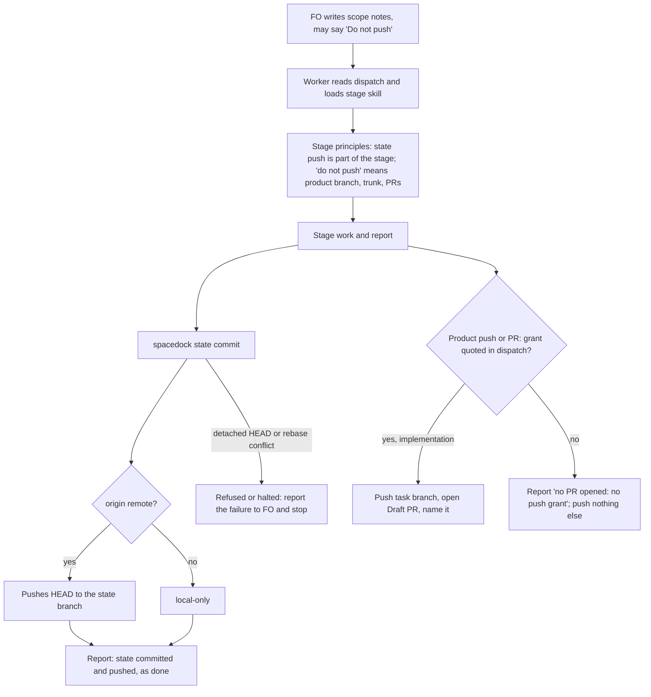

## Scope

- Source: item 2 of a peer report from the qnow dev2 FO (Paseo 519ab4c8, 2026-11-10), which states its Captain approved handing it over (「要」, relayed, not a ruling here).
- Selected for batch 21: the Captain chose 「放 1 到 5（建議）」 (host question dialog, 2026-11-11), answering 「第 21 批要放哪幾張？我建議放清單的 1 到 5：故事做完回報切片進度、發版後鋪開到採用 repo 與法規檢查、超預算要停與重大發現先對照不做清單、狀態提交自動推送與派工單矛盾、拒絕一個指令不等於全停。選完後我只為被選中的建任務檔，再一次請你過待辦關卡；選進來不代表接受任何設計。」.
- Bite (qnow FO's report; the two commits read by FO 2026-11-10): `spacedock state commit` pushes the state branch, while dispatches tell workers not to push. On iamcxa/qnow `spacedock-state/dev2` a validator committed its report in a0d280f3b and 71 seconds later amended it in ee7a248ab ("state: record validation helper publication") to disclose a publication it had not intended. That amendment then tripped `rewritten-report` in kc-dev-flow-2 0.38.0, fixed for that shape in 0.38.1 (PR #834).
- Same class in this workflow (the retiring FO's handoff note of 2026-11-10, not re-run): Codex workers under auto-review stopped at the state push with "internal reports need explicit publication approval", and one asked the Captain with a UI button.
- FO's own dispatch text (this FO's helper, 2026-11-11) says both "do not push the product branch" and "the state-branch push that `spacedock state commit` makes is expected and allowed", in the validation dispatch only.
- Non-goals: changing Spacedock's state commit; the 0.38.1 rewrite rule.

## Budget
- One package PR to the worker-facing words (stage skills or the workflow reference), with the documented-invocation test if a command line changes.

## Stop condition
- A replayed implementation and validation dispatch at the candidate each state which push is the worker's and which is not, and a worker run on each reports its state commit without calling it an unintended publication; or the design shows why not and says what was learned.

## FO alignment

Alignment: not needed before ideation; the Captain approved filing it and the direction is to make two existing statements agree.
Surfaces: none
Visible change: none
Release review: not needed: workflow maintenance, on no journey map.

## Design

### PRFAQ

From the next kc-dev-flow-2 release, an implementation or validation worker reads in its stage principles that the state-branch push its state commit makes is part of its stage, and that a dispatch's "do not push" means the product branch, the trunk and PRs. A worker told "Do not push" and "commit with `spacedock state commit`" in the same dispatch reports its state commit as done, without amending its report to disclose a publication or asking for publication approval.

- **Who reads it:** every implementation and validation worker in every adopter, on any host, because both stage skills route the worker to their `principles.md`. FO reads no new word.
- **Why principles and not the README's Dispatch facts:** ADR 0020 records the Captain's rule that the README, which FO and every dispatch load whole, should not grow 「除非可以證明文件內容不是一次性載入」. Stage principles load once per stage, in the worker only. The README option is the decision below.
- **Why not change Spacedock:** a non-goal. Its push is designed: `runStateCommit` (Spacedock v0.27.2 `internal/cli/state_sync.go`) commits path-scoped and publishes with `statesync.Publish`, and the ensign contract (spacedock 0.27.3 `ensign-shared-core.md`, "Multi-writer sync") tells the worker to push the state branch itself.
- **Does it widen authority?** No. Product branch, trunk and PR rules stay as they are: implementation opens a Draft PR only under a quoted grant (ADR 0015), and validation pushes nothing else.
- **Ideation workers?** Not covered: no ideation incident was found (searches below). Without that bite the sentence is not added there.
- **Codex auto-review refusing the push?** Words in the transcript may or may not change its judgment; unmeasured. What a denial covers is the sibling task denied-command-denies-only-that-command.

### Facts checked (chain order)

1. **Spacedock** (source at tag v0.27.2, the installed binary's version; `spacedock --help` lists no `state commit`). On a split-root workflow, `state commit <slug>` runs a preflight, a path-scoped `git commit -- <paths>`, then `git push origin HEAD:refs/heads/<state-branch>` (`internal/statesync/publish.go` `Publish`), with one pull-rebase retry and a halt on a same-entity conflict. It prints `Committed and pushed <slug> to <branch>.` With no `origin` it returns `local-only`. On an inline workflow it pushes nothing (`commitInlineEntity`). On a detached HEAD the preflight refuses (`state checkout HEAD is detached HEAD; expected branch ...`) before any commit.
2. **kc-dev-flow-2 at origin/main e8664a72 (0.38.1).** Worker-facing sentences about pushing:
   - `skills/implementation/principles.md`: "Where the dispatch scope notes quote the Captain's grant to push the task branch and open a Draft PR, open that PR before the stage report and name it there; otherwise report `no PR opened: no push grant`. Do not invoke local fallback, push the trunk, merge, or clean up an owned worktree unless that specific action is authorized."
   - `skills/validation/principles.md`: "Do not invoke local fallback, push the trunk, merge, or clean up an owned worktree unless the specific action is authorized."
   - `extensions/paseo/EXTENSION.md` scope-notes line: "Commit locally and report the branch, base, candidate SHA and prepared PR text; do not push the product branch or open its PR. ... Split-root state commits and sync still follow the ensign contract."
   - `references/sd/workflow.md` (FO-facing; workers get its Dispatch facts): no sentence about the worker's state push. FO commits follow-up records with `spacedock state commit` (Stages).
   - `scripts/replay_dispatch.py` `HARNESS`: "Do not push, merge or commit to any remote."
   - Nothing in the package tells a worker that its state commit pushes or that the push is its own. The paseo line says it only by reference, and only in paseo adopters' implementation dispatches.
3. **Adopters (read-only).**
   - qnow, which does not list `paseo`: `owner-cancels-booking/dispatch/validation-1.md` says "Do not push, open a PR, comment, or change hosted services." and "Commit with spacedock state commit owner-cancels-booking ...". The worker then amended its report in ee7a248ab: "the explicitly prescribed `spacedock state commit` helper automatically pushed ... despite the dispatch no-push boundary".
   - qnow implementation, the same class: `_archive/pending-booking-cap/dispatch/implementation-1.md` says "commit it with spacedock state commit ... Hard limits: no push". Its report in 4e1791e91 says "this violated the dispatch no-push limit".
   - This workflow: 4 follow-up messages "clarifying that the state-branch push is allowed" (`*/dispatch/validation-*-message-1.md`). After them, 24 validation dispatches carry FO's hand-written clause "the state-branch push that `spacedock state commit` makes is expected and allowed". The paseo line is in implementation dispatches (for example `observer-lists-unasked-merges/dispatch/implementation-1.md`) and missing from validation ones. No implementation follow-up was found. The comparison is weak and confounded, but it agrees with the claim.
   - subspace-web: listed in `.notes/fo-feedback/round-005.md` ("\"Do not push\" scope wording vs the state push (web)"); not read further.

### Existing-code check

- **Capability:** worker guidance on the state push.
- **Completeness:** the paseo line covers this only by reference, and only in paseo adopters' implementation dispatches. It is absent from validation dispatches here and from qnow entirely.
- **Need:** the three adopter incidents above.
- **Smallest change:** one sentence beside each stage's existing push sentence. It adds no new mechanism and leaves the paseo line unchanged.
- **Searches:**
  - `git grep -i push` over `kc-dev-flow-2` at origin/main.
  - `git grep -i 'state commit|state branch'` over the same tree.
  - Both state branches, searched for the publication or deviation wording.
- **Exclusions:** relay was not read.

### Change

Add this sentence after the existing "Do not invoke local fallback, push the trunk, ..." sentence in `kc-dev-flow-2/skills/implementation/principles.md` and in `kc-dev-flow-2/skills/validation/principles.md` (43 words each):

> The state-branch push that `spacedock state commit`, or the ensign contract's state sync, makes for your report is part of your stage: report it as done, not as a deviation. A dispatch's "do not push" means the product branch, the trunk and PRs.

- No other file changes.
- `references/sd/workflow.md` is unchanged, so its word budget and `lint-skills.py` steps are unchanged.
- No command line changes, so no documented-invocation test is owed.
- No wording test is added. Behaviour replay is the proof (maintain-flow, "wording tests prove only that the text is there").

### The two statements a worker reads, after the change

- Spacedock (dispatch body and ensign contract): commit path-scoped, then "push the state branch so peers see your entity/report"; `spacedock state commit` prints "Committed and pushed <slug> to <branch>."
- kc-dev-flow-2 stage principles: the sentence above, which names that push as part of the stage and limits "do not push" to the product branch, the trunk and PRs.

These no longer disagree. Before the change, the package said nothing, and FO's "Do not push" was the only statement the worker could weigh against Spacedock's.

### Flow

### Words read at each lifecycle moment (before -> after)

FO reads neither principles file, so FO's moments do not change: startup/resume, dispatch build, idle on an open PR, idle on a merged PR, after the archive, and the merge ask all stay 0 -> 0 added words. Counted with `wc -w` at e8664a72.

| Moment | Before | After |
| --- | --- | --- |
| Implementation worker, after loading `principles.md` | 707 | 750 (+43) |
| Validation worker, after loading `principles.md` | 849 | 892 (+43) |
| Ideation worker | unchanged | unchanged |
| FO-written validation scope notes in this workflow | +12-word hand clause | the clause becomes optional; not claimed as removed |

### Batch overlap

- **denied-command-denies-only-that-command (batch 21, ideation):**
  - Its Budget adds worker-facing words "where a dispatched worker reads them". It names `extensions/paseo/EXTENSION.md` and possibly the README's Dispatch facts with a word-budget raise.
  - Shared check: both rely on Behaviour replay with `scripts/replay_dispatch.py`.
  - Shared files: possibly the same principles files, if it chooses them.
  - This design changes neither the paseo extension nor the README.
- **budget-overrun-holds-and-findings-meet-non-goals (batch 21):** changes `references/sd/workflow.md` and a cycle-reading script. No shared file.
- **story-done-reports-release-remaining, release-rollout-reaches-adopters-and-laws-pin (batch 21):** no shared file. The scope files mention neither principles file.
- **adr-required-statement:** closed by the Captain's 「那就關掉」 (2026-10-20) in its gate record. No shared file.
- **dispatch-carries-reserved-adr-number:** changes `scripts/dispatch_records.py`. No shared file.
- **merge-guard-stops-unasked-merges (PR #794):** changes `references/sd/adoption.md`, `delivery_gate.py`, `merge_guard.py`, their tests, ADR 0063 and CI. No shared file.
- **journey-server-host-pilot, ops-inbox-r1-setup-and-isolation, pr-review-lite-value-pilot:** other plugins, read only. No kc-dev-flow-2 principles file.
- Recommended order: any order with every task except denied-command-denies-only-that-command. Land this task first if that task also edits a principles file, so its replay builds on this sentence.

### Decision for the Captain

- **Where the sentence lives.**
- **Recommended:** the implementation and validation stage principles, as above. This adds 0 README words and follows ADR 0020.
- **What gets worse:** FO is not told. FOs in qnow and web keep writing a bare "Do not push", so the dispatch text still reads as a contradiction until the worker loads its skill. The stop condition's "a replayed dispatch states which push is the worker's" is then read as "the replayed dispatch together with the stage skill it loads states it".
- **Alternative:** one `- **Pushes:**` bullet in the README's Dispatch facts, which ideation, implementation and validation dispatches inline:

  > the state-branch push that `spacedock state commit`, or the ensign contract's sync, makes for your report is yours and expected. Any other push or PR needs a grant your dispatch quotes; "do not push" means those.

  It adds 38 words at FO startup/resume and in every worker dispatch, and needs a `WORKFLOW_BUDGET_STEPS` raise with the Captain's words.

## Acceptance criteria

**AC-1** At the candidate, the sentence appears once in `kc-dev-flow-2/skills/implementation/principles.md` and once in `kc-dev-flow-2/skills/validation/principles.md`, right after each file's "Do not invoke local fallback, push the trunk" sentence. No other kc-dev-flow-2 file changes.
- Evidence: `git diff --stat <base> <head> -- kc-dev-flow-2` lists exactly those two files, and `grep -c 'is part of your stage: report it as done' <file>` prints 1 for each.
- Falsifier: a diff touching `references/sd/workflow.md` or the paseo extension, or a count other than 1.

**AC-2** `python3 kc-dev-flow-2/scripts/lint-skills.py` exits 0 at the candidate, with `WORKFLOW_BUDGET_STEPS` unchanged.
- Falsifier: moving the sentence into `references/sd/workflow.md` makes lint exit 1 with "exceeds the budget".

**AC-3** The sentence is true of Spacedock v0.27.2 on a scratch split-root workflow whose state `origin` is a disposable bare repository. `spacedock state commit <slug>` prints `Committed and pushed`. The bare repository's `refs/heads/<state-branch>` moves to the new commit, and no other ref changes. With `origin` removed, the same command prints `local-only`.
- Evidence: a validation scratch script plus `git for-each-ref` on the bare repository before and after.
- Falsifier: any other ref changing, or no push at all, makes the sentence false.

**AC-4** Behaviour replay per `skills/maintain-flow/SKILL.md`. Build two dispatches with `scripts/replay_dispatch.py build` at tag `kc-dev-flow-2-v0.38.1` and at the candidate, from the same state and code commits:
- qnow `pending-booking-cap` implementation-1, from state commit d0270c05 with its recorded scope notes;
- qnow `owner-cancels-booking` validation-1, from the state commit that added its record (the record names only its workflow checkout, 429b4673), with its recorded scope notes.

Each checklist names no rule under test. Run each on its recorded model (Codex gpt-6.1-sol and gpt-6-astra, xhigh, via Paseo): once at the release, twice at the candidate.

Set up the replay state checkout on the state branch, with `origin` pointing at a disposable bare repository. Then `spacedock state commit` reaches its push, and the real qnow remote is untouched. Without this, a detached replay worktree refuses at preflight and never shows the push. Before and after the runs, `git ls-remote` of the real origin must be unchanged.

- Pass: in all four candidate runs, the report states the state commit and push as done, does not call it a deviation, violation or unintended publication, does not ask for publication approval, and pushes nothing else.
- Report: a table of runs by outcome, with the release arm's outcome.
- Falsifier: one candidate run that calls the push a deviation or asks for approval stops the change. After two rewordings that still fail, a structural option goes to the Captain.
- Release arm: if it also shows no deviation, the replay does not show a change. Report that, and do not claim effect.
