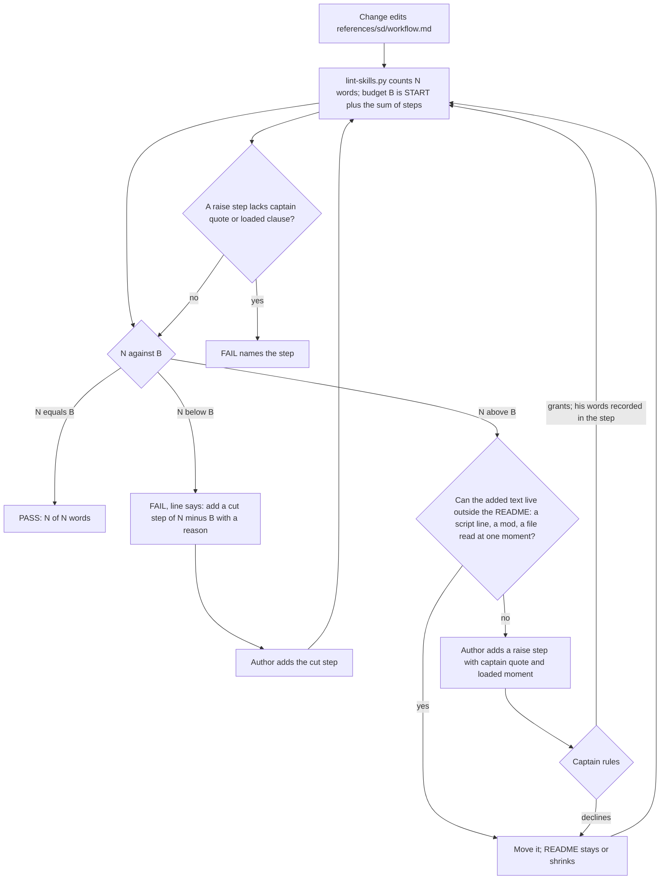

Filed on the Captain's words (chat, 2026-10-17): 「棘輪上限＋規則縮短建檔，文件不應該一直變長，除非可以證明文件內容不是一次性載入，這裡的意義是文件如果一次載入太長，那 llm 的注意力八成會失焦」.

## Scope

- Measured on origin/main 2026-10-17: `references/sd/workflow.md` 5495 words, `WORKFLOW_WORD_BUDGET` 5511 in `scripts/lint-skills.py`; at the budget's creation (7b84465e, 2026-10-09) 4414 words and budget 4420. Between those dates the budget was raised in about 22 commits, each to the new word count; the largest cut (#643) removed 70 words. Stage principles and SKILL files for ideation, implementation, validation and dev: 3127 to 3679 words over the same span.
- Ratchet: when a change shortens `workflow.md`, the budget falls to the new count in the same change; a raise needs a Captain ruling recorded with it, and is allowed only with evidence that the added text is not loaded at once (for example a passage moved to a mod, a script's output, or a file read only at one moment).
- Shrink: a rule that a script now checks (laws.md L1 and L2, `dispatch_records.py`, `delivery_gate.py`, `design_surfaces.py`, `observer_check.py`) is reduced in the prose to one pointer sentence when the script's failure message tells the reader what to do; ideation measures the words saved and checks each failure message first.
- Measure, not assert: the attention claim is the Captain's premise; the measure kept by this task is words loaded at once and the observer's count of rules stated in the README but not followed per task (the repeated pattern in observer reports since 2026-10-13).
- Two homes (FO, 2026-10-17, Captain asked 「law跟原則會重複嗎？」): each law in `references/sd/laws.md` opens with a **Rule.** line that restates a README rule (L1: the observer report before the merge sentinel, README `## Extensions` learn and `### done`; L2: the dispatch-record parts, README `## Stages`). No check compares them; `test_laws_check.py` compares laws.md with the runner's registry only. Candidate: the README stays the one home of each rule, laws.md's Rule line names the README section instead of restating it, and the README prose of a law-checked rule shrinks to a pointer.

## FO alignment

Alignment: not needed before ideation; the Captain approved filing it (his words are at the top of this file).
Release review: not needed: workflow maintenance, on no journey map.
Surfaces: none
Visible change: none

## Design

Every figure was measured on origin/main of iamcxa/kc-claude-plugins fetched 2026-10-17 (kc-dev-flow-2 0.24.0, `ca368cee`), by exporting `kc-dev-flow-2/` to a scratch directory and running its scripts there. Nothing was written to the repository.

### Chain check

- Spacedock 0.27.0 (installed plugin): `grep -rIl -i 'word.budget\|max_words\|word_limit'` over its tree finds nothing. It has no document-length rule, so the check belongs to this package.
- kc-dev-flow-2 already states the shrink rule in prose: `skills/maintain-flow/SKILL.md` says that for each rule added to the README one states "whether a package script, test or SD command already enforces it, in which case write one sentence naming that enforcer instead of restating it", and that "raising the budget or listing an overlap is a change that says why". Nothing enforces it: `git log -G'^WORKFLOW_WORD_BUDGET = '` on `lint-skills.py` shows 24 commits from 2026-10-09 to 2026-10-15, 21 raises and 2 cuts (4420 to 5511). So this design adds no new prose rule. It adds the enforcement for a rule that exists, and amends one sentence of it.
- The budget's only reader is `kc-dev-flow-2/scripts/lint-skills.py`, run by `.github/workflows/kc-dev-flow-2-tests.yml` (steps `lint-skills.py` and `test_lint_skills.py`). Adopter READMEs are copies synced by refit and run no budget; not checked in the adopters' repositories.
- Sibling packages in this repository: `git grep -i 'WORD_BUDGET'` finds the constant only in kc-dev-flow-2 and its test.

### Why the budget has not held

`lint-skills.py` fails only when the count is above the budget. A cut leaves the budget where it was, so the slack is spent by the next addition: today the README has 5495 words against 5511, and the candidate below (5447) would leave 64 words of room if nothing else changed. A raise is one number edited with a comment line, and 21 of them have gone in unchallenged in six days.

### Where the words are

The README is read whole at start and resume (`skills/dev/SKILL.md`: "Read the framework"). Words per section on origin/main: Stages 534, `backlog` 620, `ideation` 342, `validation` 241, Review-finding disposition 259, FO steps: review findings 690, Captain amendments 414 with its template, Number guards 277 + FO steps: number guards 468, Delivery authority 465, Extensions 224. The three passages this task can shorten save 48 words (0.9%); the sections that carry the mass state FO procedures a script cannot perform. The ratchet, not the shrink, is what changes the trend.

### PRFAQ

**Press release.** From this release the workflow README cannot grow by accident. `lint-skills.py` holds the word budget as a start value plus a list of steps, and refuses the README whenever its count differs from that sum, in either direction, with the line to add. A step that raises the budget must quote the Captain's words and name the one moment FO reads the added text; a step that lowers it needs only a reason. Rules a script already checks stop being retold in the README: the dispatch-record parts and the defects of a task's acceptance criteria and amendment entries are stated once, by the script's own failure line.

**FAQ**

- *Why equal, not at most?* At most is today's rule, and it banked 79 words of slack within one review. Equal makes a cut lower the budget in the same change, which is the Captain's ratchet. Cost: two PRs that both edit the README conflict on the budget steps and the later one recounts.
- *What counts as proof that added text is not loaded at once?* The README is read whole, so for README text it cannot be proved, only claimed. The `loaded:` clause names the single moment and the Captain rules on it; text that can move to a mod, a script's output or another file needs no raise. The script checks the clause is there, not that it is true.
- *Why keep the observer, delivery and law texts?* Their failure messages are complete, but the README sentence is what the observer quotes and a Captain ruling put it back (see Measured pointer candidates).
- *Does FO now run the dispatch-record check?* The README says to, before committing a record. Whether FO does is not tested here; it is measured after release (AC-9), and the same step for `--names` has a before and after.



### Mechanism

- `lint-skills.py`: replace `WORKFLOW_WORD_BUDGET = 5511` and its 10 comment lines of raise history by `WORKFLOW_BUDGET_START = 5511` and `WORKFLOW_BUDGET_STEPS`, a list of `dict(delta, why, captain, loaded)`; `WORKFLOW_WORD_BUDGET` is computed as START plus the deltas, so no second number can disagree. `captain` and `loaded` are required, non-blank, with `captain` containing a 「…」 quote, only when `delta > 0`.
- Messages, each with its remedy: over ("N words exceeds the budget of B; move the added text out of the README, or add a raise step with `captain` and `loaded`"), under ("N words is k under the budget of B; add a cut step of -k with a reason"), raise step without ruling (names the step index and the missing key).
- The candidate carries one step: `delta=-64`, reason "dispatch_records.py and design_surfaces.py print the parts and defects; the README points to them", so the budget is 5447 and the pass line reads `5447 of 5447 words`.
- Bound: the script checks form and arithmetic. It cannot tell that a quote is the Captain's or that `loaded` is true, and an author who edits START itself evades the ratchet; the diff shows a changed constant named START, and validation compares each quote with the gate record.
- ADR (draft, no number): "A rise in the workflow word budget needs a Captain ruling recorded with it." Words line: 「文件不應該一直變長，除非可以證明文件內容不是一次性載入，這裡的意義是文件如果一次載入太長，那 llm 的注意力八成會失焦」 (chat, 2026-10-17). FO reserves the number when it dispatches implementation.

### Measured pointer candidates

Each script's failure output was read first (run on fixtures in a scratch copy, 2026-10-17).

| Rule restated in the README | Script and what it prints | Decision | Words |
|---|---|---|---|
| Dispatch-record parts (Dispatched line, Model line, Checklist and Scope notes sections, follow-up record parts) | `dispatch_records.py <task>` prints one line per missing part, for example `implementation-1.md: needs a 'Model:' line`, and `needs a checklist of its own, not only a reference to another dispatch record` | shrink to a pointer sentence plus the run step; a resumed worker's record keeps "a checklist of the items that message asks, never a pointer to another record", because `is_pointer` rejects only a limited word list and lets "Reuse the checklist of validation-1." pass (Codex P2, #658) | 114 to 101 (-13) |
| Bare script names | `--names` prints `<file>:<line>: bare package script name X` with no remedy; `laws_check.py` parses it with `re.fullmatch(r"(.+\.md):(\d+): (bare package script name \S+)", line)` and fails closed on any other line, and `pr_watch.py` with an anchored `findall` | keep the README sentence; changing the line means changing both parsers and their tests | 0 |
| Completion line to `main` | `needs a scope-notes line naming main as the completion recipient` names the part, not the sentence; it was the most frequent miss (7 of 15 parts, laws.md L2 Bit) | keep the exact line in the README | 0 |
| Acceptance criteria present (ideation Gate content: "including a missing `## Acceptance criteria` section or one that declares no criterion") | `missing '## Acceptance criteria' section` and `'## Acceptance criteria' declares no criterion (a '**AC-<id>**' bold line)` | shrink | 32 to 19 (-13) |
| Amendment entry defects (Captain amendments, last paragraph) | five lines, for example `'### Amendment 1' has no 'Captain:' line with his words`, `supersedes AC-2 but it is still declared in '## Acceptance criteria'` | shrink; keep the sentence on what the check cannot see | 56 to 34 (-22) |
| Surfaces and Visible change syntax (backlog) | `'Surfaces:' has unknown value(s) X` does not list the known values | no shrink: rewriting the sentence to name the seed check came out 5 words longer | 0 |
| Head equals validated candidate, and the run of `delivery_gate.py` (Delivery authority) | prints a `next:` line per exit | keep: the first sentence is quoted by the observer and pinned (`readme-keeps-delivery-rules`); the second returned to the README by the Captain's amendment 6 of `fo-lifecycle-mod` | 0 |
| Sentinel waits for a committed observer report | `observer_check.py` prints the dispatch and save steps as `next:` lines | keep: one sentence of 13 words, quoted by the observer | 0 |
| `laws.md` L1 Rule line (31 words) | the README holds one sentence of it (Delivery authority), not "`## Extensions` and `### done`" as filed: `grep -n -i observer references/sd/workflow.md` finds only that sentence and the reviewer-model sentence | see decision D3 | 5 in a file no agent loads |
| `laws.md` L2 Rule line | already points at the script and restates no README text | none | 0 |
| `package_version.py`, `workflow_checkout.py` exit sentences (Stages) | messages are complete | not in this change: `worker-loads-declared-package` edits that paragraph | 88 (the whole paragraph) |
| Number guards (277 + 468 words) | `number_guards.py check` prints `FAIL R<n>: <path>: <reason>` | not measured here; its FO steps (Reserve, Applied, Collision) are procedures a script cannot do | unknown |

Total removed: 48 words; README 5495 to 5447. `lint-skills.py` on the candidate README prints `5447 of 5511 words; no unlisted passage repeats it`, and `test_sd_dispatch.py` reports exactly one pin failing, `dispatch-record`, whose three `need` strings name the removed parts.

### Words FO reads at each moment

Counting rule: `len(text.split())`, the same for base and candidate. README passages are the span FO acts on at that moment; script output is the clean-run output. Recount script (run on any two files):

```
import sys
BASE, CAND = (open(p).read() for p in sys.argv[1:3])
SPANS = [("startup: whole README", None, None),
         ("dispatch build: Stages paragraph", "FO resolves `<package>` in this workflow", "### `backlog`"),
         ("ideation gate: ### ideation", "### `ideation`", "### `implementation`"),
         ("amendment entry: ## Captain amendments", "## Captain amendments\n\nA change", "## Affected documents"),
         ("merge ask: ## Delivery authority", "## Delivery authority", "## Extensions")]
def words(text, a, b):
    if a is None:
        return len(text.split())
    i = text.index(a)
    return len(text[i:text.index(b, i)].split())
for name, a, b in SPANS:
    print(f"{name}\t{words(BASE, a, b)}\t{words(CAND, a, b)}")
```

Run as `python3 recount.py <README at base> <README at candidate>`; design-time output on origin/main and the draft: 5495/5447, 380/368, 342/329, 414/391, 465/465.

| Moment | Base | Candidate | Output of the moment's script (clean run) |
|---|---|---|---|
| Startup and resume (README read whole, plus the 48-word mod) | 5543 | 5495 | mod and `pr_watch.py tasks` unchanged |
| Dispatch build (Stages paragraph) | 380 | 368 | base 0 words (`--names` is silent when clean); candidate 4 (`1 dispatch record(s) complete`), so 380 to 372 |
| Ideation gate prepare (`ideation` section) | 342 | 329 | `design_surfaces.py check` unchanged |
| Recording an amendment (Captain amendments section) | 414 | 391 | prints defects only when there are some |
| Merge ask (Delivery authority) | 465 | 465 | `delivery_gate.py` unchanged |
| Idle on an open PR, idle on a merged PR, after the archive | unchanged | unchanged | `pr_watch.py`, `observer_check.py` unchanged |

Every touched moment falls; untouched moments are equal by construction, a deliberate departure from learning.md's "each moment below its base" because this change does not touch them.

### Batch overlap

Files this design changes: `kc-dev-flow-2/scripts/lint-skills.py`; `kc-dev-flow-2/scripts/test_lint_skills.py`; `kc-dev-flow-2/references/sd/workflow.md` (three hunks: the Stages paragraph sentences on saving a dispatch record, the ideation Gate content bullet, the last paragraph of Captain amendments); `kc-dev-flow-2/scripts/test_sd_dispatch.py` (the `dispatch-record` entry of `FIXES`); `kc-dev-flow-2/scripts/test_design_surfaces.py` (pin two message texts); `kc-dev-flow-2/skills/maintain-flow/SKILL.md` (one sentence); `docs/adr/<reserved>.md`; the adopters' `docs/dev2/README.md` copies by refit. Not changed: `delivery_gate.py`, `observer_check.py`, `dispatch_records.py`, `design_surfaces.py`, `laws.md` (if D3 is as recommended).

Other batch-2 tasks, read as they stand on 2026-10-17 (all five hold only their backlog text, no design yet):

| Task | Same file or check | What collides |
|---|---|---|
| special-role-triggers | `workflow.md` Stages paragraph (the `Reviewer:` line sits in its first lines) and Review-finding disposition; possibly `observer` or check scripts | its added words meet the budget steps; its hunk is next to mine in the Stages paragraph |
| worker-loads-declared-package | `workflow.md` Stages paragraph (`package_version.py` sentence, directly before my dispatch-record hunk); `dispatch_records.py` (a Candidate part) and the `dispatch-record` pin in `test_sd_dispatch.py` | same paragraph, same pin, possibly the same script; highest overlap |
| prod-security-validation-gate | `workflow.md` `validation` section; `design_surfaces.py` (refusal handling) and `skills/ideation/profiles/prod.md` | it adds validation text under the budget; my ideation-bullet hunk and its `design_surfaces.py` change do not share lines |
| ui-design-review-in-ideation | the ideation Gate content bullet that names `design_surfaces.py check` (my hunk B edits the same bullet); `design_surfaces.py`; `test_design_surfaces.py` | same bullet, same checker and test file |
| merge-gatekeeper | `workflow.md` Delivery authority; `delivery_gate.py`; ADR 0011 | I leave Delivery authority and `delivery_gate.py` alone; its added README words meet the budget |
| (all five) | `lint-skills.py` budget steps | whichever lands second recounts and appends its own step; a raise needs the Captain's ruling |

Order for FO (recommendation, D2): this task first, then worker-loads-declared-package, ui-design-review-in-ideation, prod-security-validation-gate, special-role-triggers, merge-gatekeeper. Landing first means each later README change either moves text out of the README or arrives with a ruling; landing last would let all five raise the budget unchallenged and set the ratchet at their total.

### Decisions for the Captain

- **D1 — the raise rule.** Recommendation: a raise step carries his quoted words and one `loaded:` moment, checked for presence only, as in Mechanism. Gets worse: the README is read whole, so `loaded:` can only be a claim he rules on, and the five other batch-2 tasks each need either an offset or a ruling; in the 6 days measured, 21 raises would have meant 21 rulings.
- **D2 — landing order.** Recommendation: first (list above). Gets worse: the other five rebase onto budget steps and must offset or ask; the first of them waits for this task's merge.
- **D3 — `laws.md` L1 Rule line.** Recommendation: leave it. It states the commit-order the runner judges ("no later than the commit that writes `pr: pr-merge:<N>`"), which the README sentence ("waits for") does not; a pointer would save 5 words in a file no agent loads (`laws.md` is named only by `adoption.md`, `laws_check.py` and its test), and nothing has drifted. Gets worse: two homes stay, and if the README sentence changes only the existing `readme-keeps-delivery-rules` pin warns, not `laws.md`.
- **D4 — Number guards.** Recommendation: file a follow-up task and keep it out of this one. It is 745 words (13.6% of the README), the biggest candidate, and its messages were not read here. Gets worse: this change removes 48 words, about 1%, and the attention argument is mostly unanswered until the follow-up lands.

## Acceptance criteria

Today's figures are origin/main `ca368cee`. Commands run from the repository root at the candidate, under `python3 -B`.

**AC-1**: The budget ratchets in both directions and says what to do. Evidence: `python3 kc-dev-flow-2/scripts/test_lint_skills.py` has three cases on a fixture README: one word over exits 1 with a line containing `exceeds the budget` and `raise step`; one word under exits 1 with a line containing `under the budget` and `cut step`; equal exits 0 and prints `N of N words`. At the candidate `python3 kc-dev-flow-2/scripts/lint-skills.py` prints `references/sd/workflow.md: 5447 of 5447 words` (design-time: 5447 of 5511 on the draft before the budget steps), and `grep -c '^# 5[0-9][0-9][0-9]:' kc-dev-flow-2/scripts/lint-skills.py` prints 0. Falsifier: restoring `count > budget` as the only comparison makes the under case exit 0 and the test fail.
**AC-2**: A raise needs the Captain's words and a loaded moment. Evidence: `test_lint_skills.py` cases: a step with `delta > 0` and no `captain` exits 1 naming the step index; one with `captain` lacking a 「…」 quote exits 1; one with `captain` and `loaded` and a README of exactly the new count exits 0; a step with `delta < 0` and neither key exits 0; a ledger whose sum differs from the README count exits 1. Falsifier: deleting the `delta > 0` branch makes the first case exit 0. Limit: form and arithmetic only; the quote's truth and the `loaded` claim are read by validation against the gate record, and editing START evades the check (the diff shows it).
**AC-3**: The three passages shrink and no touched moment rises. Evidence: `python3 recount.py <base README> <candidate README>` (the script in Words FO reads, kept in this task's validation folder at implementation) prints, per moment, candidate below base for startup, dispatch build, ideation gate and amendment, and equal for merge ask; the dispatch-build total with the 4-word clean output is below 380. Design-time: 5495 to 5447; 380 to 368 (372); 342 to 329; 414 to 391; 465 to 465. Falsifier: any touched moment at or above its base fails the criterion; an independent recount by validation, not the implementer's script, is required (learning.md: the first recount script once under-counted).
**AC-4**: The dispatch-record pin follows the move and the full check is a README step. Evidence: the README holds `runs `python3 <package>/scripts/dispatch_records.py <task folder>`` and `A follow-up message to a worker FO resumes is a dispatch too`; `test_sd_dispatch.py --sd-plugin-root <active Spacedock plugin root>` passes with the `dispatch-record` entry's `need` strings re-pointed to that text and its `swaps` regenerated; `git diff origin/main -- kc-dev-flow-2/scripts/dispatch_records.py kc-dev-flow-2/scripts/laws_check.py kc-dev-flow-2/scripts/pr_watch.py` is empty. Falsifier: reverting the README sentence to its base text makes the re-pointed `need` fail under `fix_gaps`; a change to the `--names` line breaks `laws_check.py`, which fails closed (`does not parse`), so the diff command is the guard.
**AC-5**: The two messages the README stops restating are pinned. Evidence: `test_design_surfaces.py` gains assertions that a task with no `## Acceptance criteria` prints `missing '## Acceptance criteria' section` and one with the heading and no `**AC-` line prints `declares no criterion`, and that the amendment-entry messages quoted in the table appear for their fixtures. Falsifier: rewording either message fails the assertion (run the mutation under `python3 -B`).
**AC-6**: Rules a script and the Captain keep are untouched. Evidence: `git diff origin/main -- kc-dev-flow-2/scripts/delivery_gate.py kc-dev-flow-2/scripts/observer_check.py kc-dev-flow-2/references/sd/laws.md` is empty, and the README still holds `the sentinel waits for a committed observer report` and `a head other than the latest validation record's `Candidate:` is revalidated or its difference told to the Captain` (the `readme-keeps-delivery-rules` pin passes). If the Captain rules D3 otherwise this criterion is replaced by amendment.
**AC-7**: The prose rule names its enforcement. Evidence: `grep -n 'raising the budget or listing an overlap is a change that says why' kc-dev-flow-2/skills/maintain-flow/SKILL.md` prints nothing, and the sentence that replaces it says a raise needs a Captain ruling in the budget steps while an overlap listing says why; `python3 kc-dev-flow-2/scripts/doc_impact.py origin/main <candidate>` lists each document that mentions the budget and the stage report gives `updated` or `unaffected: <reason>` for each. Falsifier: the old sentence still present.
**AC-8**: The Captain's ruling lands as a record. Evidence: `python3 kc-dev-flow-2/scripts/adr_lint.py docs/adr --since origin/main --require <reserved number>` exits 0 for an ADR titled for the ruling in Mechanism with the Captain's quoted words in its Words line; the design names it without a number. Falsifier: `--require` exits 1 without the file.
**AC-9**: After release, whether the pointers and the ratchet change what FO does is measured, not assumed. Evidence at ideation (baselines, 2026-10-17): `git -C <state checkout> grep -c '^violation' -- '*observer.md'` totals 32 violation lines over the 15 observer reports archived since 2026-10-13; the rule "a checklist or scope-notes line that names a package script writes ..." is the most repeated, in 5 of the 10 reports dated 2026-10-13 to 2026-10-15 and in 0 of the 5 dated 2026-10-16 to 2026-10-17 (the `--names` step shipped 2026-10-16, not a controlled comparison); `laws.md` L2 Bit records 15 missing parts in 10 of 48 dispatch records. After the release is synced, `python3 <package>/scripts/laws_check.py` L2 over the next 20 records added, and the observer's `violation` lines on the next 5 archived tasks, are compared with those baselines at the `learn` step and reported to the Captain. Limit: this is a measurement, not a ship gate; no run here shows FO runs the new step, and the claim shipped is only what AC-1 to AC-8 prove.

## Number guards

ADR: 0020

### Feedback Cycles

- Cycle 1 (FO, 2026-10-17): Codex review on #658 57673bfd (review:5557548181) left one P2, to fix (rounds 1 and 2 fix every finding); investigation first, then FO fix authorization, then a fresh validation recheck.
  - P2 `kc-dev-flow-2/references/sd/workflow.md`: the shrunk Stages sentence for resumed dispatches dropped 'never a pointer' and says only 'the same check', but `kc-dev-flow-2/scripts/dispatch_records.py` is_pointer rejects only its POINTER_WORDS list and documents 'Reuse the checklist of validation-1.' as passing, so the README no longer forbids a pointer the script lets through.

## Stage Report: ideation

- DONE: A design (PRFAQ and Mermaid) for a word budget for kc-dev-flow-2/references/sd/workflow.md that only goes down (enforced in kc-dev-flow-2/scripts/lint-skills.py), with a raise allowed only on a recorded Captain ruling and evidence that the added text is not loaded at once; and which rules a script already checks shrink to one pointer sentence, each script's failure message read first, with the words saved measured; plus the laws.md Rule lines that restate README rules
  `## Design`: PRFAQ, flowchart, Mechanism (budget = START plus steps, equal not at-most), Measured pointer candidates table (63 words removed, README 5495 to 5432). Corrections found: maintain-flow already states the pointer rule in prose; the README does not restate L1 under `## Extensions`/`### done`; `--names` output is parsed by `laws_check.py` and `pr_watch.py`, so it stays.
- DONE: A `### Batch overlap` section naming each file the design would change and each other batch-2 task that changes the same file or check, so FO can order implementation
  `### Batch overlap`: file list, five-task table, order recommended (this task first), D2.
- DONE: The words FO reads at each lifecycle moment, before and after, per root learning.md "Measure the words FO reads at each moment, not one file's size"
  `### Words FO reads at each moment`: startup 5543 to 5480, dispatch build 380 to 356, ideation gate 342 to 329, amendment 414 to 392, merge ask 465 unchanged; recount script inline, run on the draft.
- DONE: Acceptance criteria with reproducible evidence clauses and falsifiers, and unresolved decisions for the Captain, each with a recommendation and what gets worse under it
  `## Acceptance criteria` AC-1 to AC-9 (AC-9 is a post-release measure with baselines 32 violation lines in 15 observer reports, 15 missing parts in 10 of 48 records); decisions D1 to D4. `design_surfaces.py check` exits 0 on this file.

### Summary

The ratchet is one change in `lint-skills.py`: the budget becomes a start value plus recorded steps, the README count must equal it, and a raise step must quote the Captain and name the moment FO reads the added text. The shrink is small (63 words, 1.1%) because most README mass is FO procedure; the pointers are limited to the dispatch-record parts, the acceptance-criteria and amendment defects. Not measured: whether FO runs the new dispatch-record step (AC-9 measures it after release); Number guards (745 words) was not read and is proposed as a follow-up (D4).

## Stage Report: implementation

- DONE: One Draft PR (feat(kc-dev-flow-2): ...) from a branch off origin/main implementing D1 to D4 as recommended: the recorded budget steps in kc-dev-flow-2/scripts/lint-skills.py (a raise carries the Captain's quoted words and a loaded: moment; a cut lowers the budget in the same change) and the three pointer shrinks in kc-dev-flow-2/references/sd/workflow.md (63 words); the ADR is the one under ## Number guards; every acceptance criterion in the task file green, each falsifier shown failing by a mutation you run (python3 -B, caches cleared)
  PR https://github.com/iamcxa/kc-claude-plugins/pull/658 (Draft), head 57673bfd0a51 on base 19fe3b5b3d34 (origin/main); README 5495 to 5432 = 63 words; ADR 0020 (`adr_lint.py --since origin/main --require 20` exit 0). AC-1 `lint-skills.py` prints `5432 of 5432 words`, no `# 5xxx:` comment lines. AC-1/2 mutations (python3 -B, caches cleared): dropping the under branch fails 2 cases; dropping `delta > 0` fails the 4 raise-step cases. AC-4 reverting the README sentence fails the `dispatch-record` pin; `test_sd_dispatch.py --sd-plugin-root <spacedock 0.27.0>` exit 0 at head. AC-5 rewording either message fails `test_design_surfaces.py` (new test `test_the_two_messages_the_readme_does_not_restate_are_worded_as_pointed_at`; the four amendment messages were already pinned by existing AmendmentTests substrings). AC-6 `git diff origin/main` on dispatch_records.py, laws_check.py, pr_watch.py, delivery_gate.py, observer_check.py, laws.md is empty. AC-7 old maintain-flow sentence gone. AC-8 see ADR. AC-3 per-moment recount (my script, saved at `workflow-budget-ratchet/validation/recount.py`; validation must recount independently): 5495/5432, 380/353 (357 with the 4-word clean output), 342/329, 414/391, 465/465. AC-9 is post-release, not run.
- DONE: No FO-read word added beyond the design; the candidate's own kc-dev-flow-2/scripts/lint-skills.py exits 0; roborev evidence= line; push without force; CI green on the PR head; CI cost measured or stated as not measured
  `lint-skills.py` exit 0 at head; roborev: `clean on 57673bfd0; evidence=roborev:794`; pushed once, no force. Words per moment fall or are equal (above); the one added README phrase is the `dispatch_records.py <task folder>` run step the design names. comment_ratio.py: 2 comment lines of 96 code lines, 2.1%, max 5% met. number_guards.py check: PASS no findings. design_surfaces.py check on this file: presentable. CI cost: no new job or step, not measured.
- FAILED: CI green on the PR head
  Not verified: `gh pr checks` and `gh pr edit` were refused by the auto-mode permission classifier after the PR was created, so CI state is unknown and the PR body lacks the closing attribution line; FO or the Captain must read the checks and add the line.

### Affected documents (doc_impact.py origin/main HEAD)
- docs/adr/0020-...md: updated
- kc-dev-flow-2/skills/maintain-flow/SKILL.md: updated (raise needs a Captain ruling in the budget steps; cut lowers it)
- kc-dev-flow-2/README.md: unaffected: names lint-skills.py and the word budget, not the comparison or the constant
- kc-dev-flow-2/references/sd/adoption.md: unaffected: names test_sd_dispatch.py as the run command only
- learning.md: review needed, not changed (outside the design's file list): line 205 cites `WORKFLOW_WORD_BUDGET in kc-dev-flow-2/scripts/lint-skills.py` as an example, and that symbol no longer exists (now `WORKFLOW_BUDGET_START` and `WORKFLOW_BUDGET_STEPS`); FO to decide the one-word edit.

### Summary

The budget is now START plus recorded steps in `lint-skills.py`; the README count must equal it, a raise step needs a quoted Captain ruling and a `loaded` moment, and the candidate carries one cut step of -79 (5511 to 5432). The dispatch-record, acceptance-criteria and amendment-defect prose now points at the scripts that print those defects. Limits: the check covers form and arithmetic only; the CI result and PR-body attribution line are unverified (permission denial above); learning.md has one stale symbol outside this task's file list.

## Stage Report: validation

- DONE: Independent verdict on PR #658 head 57673bfd against every acceptance criterion in the task file, re-running each evidence command and at least one falsifier per criterion yourself, and judging each limit the implementation report states
  Verdict PASSED for head 57673bfd0a5154dfa072eff4fcb3a4ea6846801d (base 19fe3b5b = origin/main, throwaway worktree, removed). AC-1 `lint-skills.py` prints `5432 of 5432 words`, `grep -c '^# 5[0-9][0-9][0-9]:'` 0, `test_lint_skills.py` 31 OK; scratch-copy mutations under `python3 -B`: dropping the under branch fails 2 cases, ignoring deltas fails the ledger and cut cases. AC-2 dropping `delta > 0` fails the 4 raise cases, an any-text quote regex fails 3, dropping the `loaded` check fails 1. AC-4 `test_sd_dispatch.py --sd-plugin-root ~/.claude/plugins/cache/spacedock/spacedock/0.27.0` (binary spacedock 0.27.2) rc 0; the two diffs on dispatch_records.py, laws_check.py, pr_watch.py are empty; restoring the base dispatch-record sentences fails the `dispatch-record` pin. AC-5 `test_design_surfaces.py` 91 OK; rewording either message fails the new test; rewording three of the four amendment messages fails existing tests (see finding 2). AC-6 diff on delivery_gate.py, observer_check.py, laws.md is empty and both README sentences are present (the pin passed in the AC-4 run). AC-7 the old sentence is in base and gone at head (matched on whitespace-flattened text; the line-wrapped literal grep never matches even on base). AC-8 `adr_lint.py ... --require 20` exit 0, `--require 21` exit 1. AC-9 not run: post-release measure, not a ship gate. Limits judged: form-and-arithmetic-only is true (a quote 「x」 passes) and ADR 0020 states it; CI-unknown is now closed (below); learning.md is FO's call.
- DONE: Recount the words FO reads per moment with your own method, not the worker's recount.py
  Method: `sed` line ranges cut at the headings plus `wc -w`, base and head README. Whole 5495 to 5432 (+48-word mod unchanged: startup 5543 to 5480); Stages paragraph 380 to 353 (357 with the 4-word clean `dispatch_records.py` line `1 dispatch record(s) complete`); ideation 342 to 329; Captain amendments 414 to 391; Delivery authority 465 to 465. Agrees with the worker's figures; no touched moment rises. Fixture run of `dispatch_records.py`: a follow-up record missing Model, Package root and own checklist prints each of the three parts, so the README text it replaced is still shown to FO.
- DONE: A minimal acceptance script the Captain can run (three to six steps, exact commands, expected output), run by you exactly as written in a fresh bash shell, with its observed output; /Users/kent/.claude/plugins/cache/kc-claude-plugins/kc-dev-flow-2/0.24.0/scripts/adr_lint.py docs/adr --since <base> with its exit code; your verdict naming the head, with findings classified by the workflow's Review-finding disposition
  Script below, run as `env -i HOME=$HOME PATH=$PATH bash --noprofile --norc <script>` (about 33 s, needs git, python3, network to github.com and the installed kc-dev-flow-2 0.24.0 package); observed output is under each step. `adr_lint.py docs/adr --since 19fe3b5b` exit 0 (`20 ADR file(s) checked, 0 legacy`). comment_ratio 2/96 = 2.1%, exit 0; number_guards check exit 0; design_surfaces check exit 0; dispatch_records on the task folder exit 0 (3 records). CI: `gh pr view 658 --json statusCheckRollup` shows 4 of 4 checks SUCCESS on this head (route gate, unit tests, version parity, GitGuardian). Findings below.

### Minimal acceptance script

Step 1 and the last line clone to a temporary directory and remove it. Run from any directory in bash.

    D=$(mktemp -d) && git clone --quiet https://github.com/iamcxa/kc-claude-plugins.git "$D/c" && cd "$D/c" && git fetch --quiet origin pull/658/head && git checkout --quiet 57673bfd0a5154dfa072eff4fcb3a4ea6846801d && git rev-parse HEAD
    python3 -B kc-dev-flow-2/scripts/lint-skills.py; echo "exit $?"
    printf 'x\n' >> kc-dev-flow-2/references/sd/workflow.md; python3 -B kc-dev-flow-2/scripts/lint-skills.py; echo "exit $?"; git checkout --quiet -- kc-dev-flow-2/references/sd/workflow.md
    python3 -c "p='kc-dev-flow-2/references/sd/workflow.md';t=open(p).read().rstrip().rsplit(None,1)[0]+'\n';open(p,'w').write(t)"; python3 -B kc-dev-flow-2/scripts/lint-skills.py; echo "exit $?"; git checkout --quiet -- kc-dev-flow-2/references/sd/workflow.md
    python3 -B kc-dev-flow-2/scripts/test_lint_skills.py 2>&1 | tail -3
    python3 -B /Users/kent/.claude/plugins/cache/kc-claude-plugins/kc-dev-flow-2/0.24.0/scripts/adr_lint.py docs/adr --since 19fe3b5b3d34d54908d288860909d10db1ae9226 --require 20; echo "exit $?"
    git show 19fe3b5b3d34d54908d288860909d10db1ae9226:kc-dev-flow-2/references/sd/workflow.md | wc -w; wc -w < kc-dev-flow-2/references/sd/workflow.md; cd / && rm -rf "$D"

Expected and observed: line 1 prints `57673bfd0a5154dfa072eff4fcb3a4ea6846801d`. Line 2 prints `references/sd/workflow.md: 5432 of 5432 words; no unlisted passage repeats it` then `exit 0`. Line 3 (one word added) prints `FAIL: references/sd/workflow.md: 5433 words exceeds the budget of 5432; move the added text out of the README, or add a raise step of 1 with 'captain' and 'loaded' to WORKFLOW_BUDGET_STEPS` and `exit 1`. Line 4 (one word removed) prints `FAIL: ... 5431 words is 1 under the budget of 5432; add a cut step of -1 with a 'why' to WORKFLOW_BUDGET_STEPS` and `exit 1`. Line 5 prints `Ran 31 tests` and `OK`. Line 6 prints `20 ADR file(s) checked, 0 legacy` and `exit 0`. Line 7 prints `5495` then `5432`. Does not cover: whether FO runs the new `dispatch_records.py` step (AC-9, after release), whether a quote is the Captain's or `loaded` is true, a ledger edited without a raise step (finding 1), adopter READMEs after refit.

### Findings (Review-finding disposition)

1. Deferred risk: the ledger is checked against itself, not against base, so editing an existing step's `delta` raises the budget with no ruling. Reproduced in a scratch copy: README plus 50 words and `delta=-79` changed to `-29` prints `5482 of 5482 words`, exit 0. ADR 0020 names only the START edit. Would become Material if a raise lands through an edited step or START without a quote; a base-versus-head ledger comparison would close it and is outside this task's file list.
2. Polish: the fourth amendment message's tail (`its 'Supersedes:' line does not say 'no replacement'`) and the `with the same check` clause of the `resumed-dispatch` pin are unpinned (rewording the tail left 91 tests OK); the `(no replacement: <why>)` waiver stays in the README template, so no reader loses it today.
3. Polish: the two comment lines added to lint-skills.py (`# The budget is START plus the deltas ...`, `# A raise (delta > 0) needs ...`) restate the code and the ADR; ratio 2.1% is under the 5% maximum. AC-4 and AC-7 literal greps are blind to README line wrapping (semantic match confirmed on flattened text).
4. Needs FO decision (reported only, outside this PR's file list): root learning.md line 204 names `WORKFLOW_WORD_BUDGET` in `kc-dev-flow-2/scripts/lint-skills.py`, a symbol that no longer exists.
5. Not a finding on the candidate, for FO: the PR body lacks the closing attribution line (`gh pr view 658 --json body`, no `Generated with`); the implementation report recorded `gh pr edit` was refused.

No Material finding. Not verified: AC-9 (post-release); behaviour of FO under the new README text; the branch-protection required-check set beyond the 4 checks listed.

### Summary

PASSED for head 57673bfd: every AC-1 to AC-8 command re-run at the head, at least one mutation per criterion fails as the falsifier expects, the words per moment fall by my own recount, and CI is green on the head. One Deferred risk (ledger edits evade the ratchet), two Polish items, and learning.md and the PR-body line for FO. Nothing was pushed, commented or changed in the candidate; throwaway worktrees and scratch copies are removed.

## Stage Report: implementation (cycle 2)

- DONE: Apply the three edits proposed in phase 1 for the Codex P2 on #658 (review:5557548181): restore 'a checklist of the items that message asks, never a pointer to another record' in the Stages sentence of workflow.md; change the budget step in lint-skills.py from -79 to -64 (5447 words); add the need string and extend the resumed-dispatch swaps regex in test_sd_dispatch.py
  Commit e65a91ba on spacedock-ensign/workflow-budget-ratchet (3 files, 4 lines each way); README 5447 words, `lint-skills.py` prints `5447 of 5447 words`; `dispatch_records.py` diff against origin/main still empty.
- DONE: The failing test at 57673bfd passes after the fix, and fails again when the README phrase is removed (python3 -B, caches cleared)
  Pin `resumed-dispatch` need "never a pointer to another record": at 57673bfd `test_sd_dispatch.py` asserts `'resumed-dispatch': (['never a pointer to another record'], [])`; at e65a91ba rc 0; with the phrase removed from the README the same single gap returns, then restored.
- DONE: Update the task file's figures (5432 and -79) where the design and criteria quote them; all suites green; roborev evidence= line; push without force; CI green on the new head; commit the stage report
  Task file Design/AC figures now 5447, -64, 63 to 48 words, 380 to 368 (372), amendment 391 (earlier stage reports keep their history). Suites rc 0: lint_skills (31), dispatch_records, design_surfaces (91), laws_check, observer_check, pr_watch, delivery_gate, comment_ratio, number_guards, adr_doc_checks, sd_dispatch with Spacedock 0.27.0; `adr_lint --require 20` pass. `clean on e65a91baa; evidence=roborev:797`. Pushed 57673bfd..e65a91ba, no force. `gh pr view 658`: 4 of 4 checks SUCCESS on e65a91ba. Corrected PR body: /tmp/pr658-body-new.md (FO to apply with `gh pr edit`; also adds the attribution line phase 1 lacked and fixes startup to 5543 to 5495). Not run: independent revalidation (next stage).

### Summary

The Stages sentence for resumed dispatches again says each record carries a checklist of the items the message asks, never a pointer, because `is_pointer` rejects only a limited word list. The budget step is -64 (budget 5447, still 64 under main's 5511), so no Captain ruling is needed. The Deferred risk and learning.md line are untouched.

## Stage Report: validation (cycle 2)

- DONE: Independent verdict on PR #658 head e65a91ba against every acceptance criterion in the task file, re-running each evidence command and at least one falsifier per criterion yourself, and judging each limit the implementation report states
  Verdict PASSED for head e65a91baa48a28725294b8ec939bfb4ce3e2d432 (base 19fe3b5b = origin/main; throwaway worktree and scratch copies removed). AC-1 `lint-skills.py` prints `5447 of 5447 words`, `grep -c '^# 5[0-9][0-9][0-9]:'` 0, `test_lint_skills.py` 31 OK; mutation (python3 -B, scratch copy of the tracked files): dropping the under branch fails 2 tests. AC-2 dropping the `delta > 0` branch fails the 4 raise-step tests. AC-3 see recount. AC-4 `test_sd_dispatch.py --sd-plugin-root ~/.claude/plugins/cache/spacedock/spacedock/0.27.0` (binary spacedock 0.27.2) rc 0; diff on dispatch_records.py, laws_check.py, pr_watch.py empty; removing the new run sentence from the README fails only `dispatch-record`. AC-5 `test_design_surfaces.py` 91 OK; rewording `declares no criterion` fails the new pinned-messages test. AC-6 diff on delivery_gate.py, observer_check.py, laws.md empty; both README sentences present on whitespace-flattened text. AC-7 old maintain-flow sentence absent at head. AC-8 `adr_lint.py ... --require 20` exit 0, `--require 21` exit 1; ADR 0020 Words line matches the task file's Captain quote and the gate reason 「那就照建議」. AC-9 not run (post-release measure). Limits judged: form-and-arithmetic-only is true and ADR 0020 states it.
- DONE: Recheck after Cycle 1 (Codex P2 review:5557548181): the restored phrase, the new pin, and the recount per moment
  README holds `a checklist of the items that message asks, never a pointer to another record` (whitespace-flattened grep 1). Pin `resumed-dispatch` fails when the phrase is removed in a scratch README: `test_sd_dispatch.py` rc 1 with exactly one gap, `'resumed-dispatch': (['never a pointer to another record'], [])`; passes (rc 0) at the head. Step is -64, budget 5447. Recount by `sed` line ranges plus `wc -w`, base to head: whole 5495 to 5447 (startup 5543 to 5495 with the 48-word mod); dispatch build (Stages paragraph, lines to the `backlog` heading) 380 to 368, 372 with the 4-word clean `dispatch_records.py` line (`6 dispatch record(s) complete`), below 380; ideation 342 to 329; Captain amendments 414 to 391; Delivery authority 465 to 465. No touched moment rises; AC-1 to AC-8 hold. The earlier Deferred risk and Polish are declined to backlog task workflow-budget-ratchet-followups and were not rechecked. The PR #658 body still quotes 5432 and -79 (`gh pr view 658 --json body`): report only; /tmp/pr658-body-new.md carries 5447, 5543 to 5495, 380 to 368 and the attribution line.
- DONE: A minimal acceptance script the Captain can run (three to six steps, exact commands, expected output), run by you exactly as written in a fresh bash shell, with its observed output; adr_lint.py docs/adr --since <base> with its exit code; your verdict naming the head, with findings classified by the workflow's Review-finding disposition
  Script below, run as `env -i HOME=$HOME PATH=$PATH bash --noprofile --norc <script>` (28 s; needs git, python3, network to github.com and the installed kc-dev-flow-2 0.24.0 package); output matched the expectations under it. `adr_lint.py docs/adr --since 19fe3b5b3d34d54908d288860909d10db1ae9226` exit 0 (`20 ADR file(s) checked, 0 legacy`). Also at the head: comment_ratio 2 of 97 code lines = 2.1%, exit 0; number_guards check exit 0; design_surfaces check exit 0; dispatch_records on the task folder exit 0 (6 records); `gh pr view 658`: 4 of 4 checks SUCCESS on e65a91ba, PR still Draft. doc_impact lists 5 documents; ADR 0020 and maintain-flow are updated, README and adoption.md were recorded unaffected in the implementation report, learning.md is the FO item below.

### Minimal acceptance script (cycle 2)

Clones to a temporary directory and removes it. Run from any directory in bash.

    D=$(mktemp -d) && git clone --quiet https://github.com/iamcxa/kc-claude-plugins.git "$D/c" && cd "$D/c" && git fetch --quiet origin pull/658/head && git checkout --quiet e65a91baa48a28725294b8ec939bfb4ce3e2d432 && git rev-parse HEAD
    python3 -B kc-dev-flow-2/scripts/lint-skills.py; echo "exit $?"
    printf 'x\n' >> kc-dev-flow-2/references/sd/workflow.md; python3 -B kc-dev-flow-2/scripts/lint-skills.py; echo "exit $?"; git checkout --quiet -- kc-dev-flow-2/references/sd/workflow.md
    python3 -c "p='kc-dev-flow-2/references/sd/workflow.md';t=open(p).read().rstrip().rsplit(None,1)[0]+'\n';open(p,'w').write(t)"; python3 -B kc-dev-flow-2/scripts/lint-skills.py; echo "exit $?"; git checkout --quiet -- kc-dev-flow-2/references/sd/workflow.md
    python3 -B kc-dev-flow-2/scripts/test_lint_skills.py 2>&1 | tail -3
    python3 -B /Users/kent/.claude/plugins/cache/kc-claude-plugins/kc-dev-flow-2/0.24.0/scripts/adr_lint.py docs/adr --since 19fe3b5b3d34d54908d288860909d10db1ae9226 --require 20; echo "exit $?"
    git show 19fe3b5b3d34d54908d288860909d10db1ae9226:kc-dev-flow-2/references/sd/workflow.md | wc -w; wc -w < kc-dev-flow-2/references/sd/workflow.md; tr '\n' ' ' < kc-dev-flow-2/references/sd/workflow.md | tr -s ' ' | grep -c 'a checklist of the items that message asks, never a pointer to another record'; cd / && rm -rf "$D"

Expected and observed: line 1 prints `e65a91baa48a28725294b8ec939bfb4ce3e2d432`. Line 2 prints `references/sd/workflow.md: 5447 of 5447 words; no unlisted passage repeats it` and `exit 0`. Line 3 (one word added) prints `FAIL: references/sd/workflow.md: 5448 words exceeds the budget of 5447; move the added text out of the README, or add a raise step of 1 with 'captain' and 'loaded' to WORKFLOW_BUDGET_STEPS` and `exit 1`. Line 4 (one word removed) prints `FAIL: ... 5446 words is 1 under the budget of 5447; add a cut step of -1 with a 'why' to WORKFLOW_BUDGET_STEPS` and `exit 1`. Line 5 prints `Ran 31 tests` and `OK`. Line 6 prints `20 ADR file(s) checked, 0 legacy` and `exit 0`. Line 7 prints `5495`, `5447`, then `1` (the restored phrase is in the README). Does not cover: whether FO runs the new `dispatch_records.py` step (AC-9, after release), whether a quote is the Captain's or `loaded` is true, a ledger edited without a raise step (declined Deferred risk), the pin suite (`test_sd_dispatch.py` needs a Spacedock plugin root), adopter READMEs after refit.

### Findings (Review-finding disposition, cycle 2)

No new Material, Deferred risk or Polish finding on e65a91ba. Carried and already declined: the ledger-edit Deferred risk and the Polish items go to backlog task workflow-budget-ratchet-followups. For FO, not a candidate finding: (1) `doc_impact.py` lists learning.md as `review`; the implementation report said "review needed, not changed" and its line names the old `WORKFLOW_WORD_BUDGET` symbol, so FO decides the one-word edit or records `unaffected: <reason>`; (2) the PR body is stale (5432, -79, no attribution line) until FO applies /tmp/pr658-body-new.md. Not verified: AC-9, FO behaviour under the new README text, branch-protection required-check set beyond the 4 listed.

### Summary

PASSED for head e65a91ba: the Codex P2 repair is in, the new pin fails exactly when the phrase is removed, per-moment words fall by my own recount (dispatch build 380 to 368), AC-1 to AC-8 hold with a mutation per criterion, and CI is 4 of 4 green. Nothing was pushed, commented on or changed in the candidate; the throwaway worktree and scratch copies are removed.
