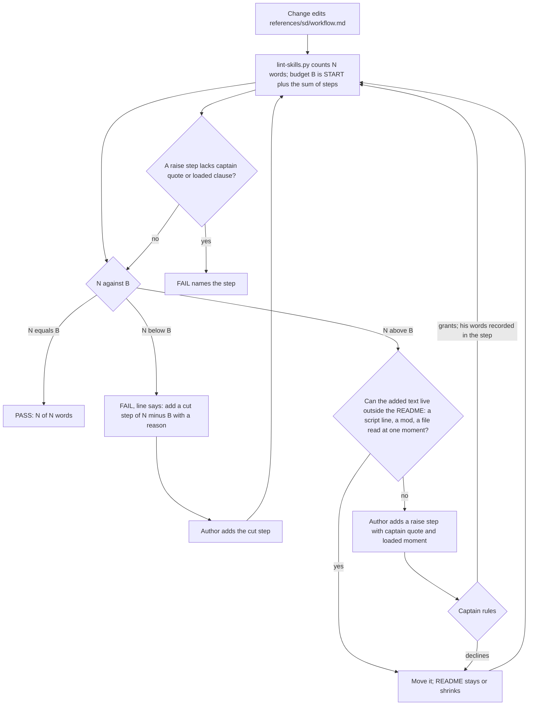

Filed on the Captain's words (chat, 2026-10-17): 「棘輪上限＋規則縮短建檔，文件不應該一直變長，除非可以證明文件內容不是一次性載入，這裡的意義是文件如果一次載入太長，那 llm 的注意力八成會失焦」.

## Scope

- Measured on origin/main 2026-10-17: `references/sd/workflow.md` 5495 words, `WORKFLOW_WORD_BUDGET` 5511 in `scripts/lint-skills.py`; at the budget's creation (7b84465e, 2026-10-09) 4414 words and budget 4420. Between those dates the budget was raised in about 22 commits, each to the new word count; the largest cut (#643) removed 70 words. Stage principles and SKILL files for ideation, implementation, validation and dev: 3127 to 3679 words over the same span.
- Ratchet: when a change shortens `workflow.md`, the budget falls to the new count in the same change; a raise needs a Captain ruling recorded with it, and is allowed only with evidence that the added text is not loaded at once (for example a passage moved to a mod, a script's output, or a file read only at one moment).
- Shrink: a rule that a script now checks (laws.md L1 and L2, `dispatch_records.py`, `delivery_gate.py`, `design_surfaces.py`, `observer_check.py`) is reduced in the prose to one pointer sentence when the script's failure message tells the reader what to do; ideation measures the words saved and checks each failure message first.
- Measure, not assert: the attention claim is the Captain's premise; the measure kept by this task is words loaded at once and the observer's count of rules stated in the README but not followed per task (the repeated pattern in observer reports since 2026-10-13).
- Two homes (FO, 2026-10-17, Captain asked 「law跟原則會重複嗎？」): each law in `references/sd/laws.md` opens with a **Rule.** line that restates a README rule (L1: the observer report before the merge sentinel, README `## Extensions` learn and `### done`; L2: the dispatch-record parts, README `## Stages`). No check compares them; `test_laws_check.py` compares laws.md with the runner's registry only. Candidate: the README stays the one home of each rule, laws.md's Rule line names the README section instead of restating it, and the README prose of a law-checked rule shrinks to a pointer.

## FO alignment

Alignment: not needed before ideation; the Captain approved filing it (his words are at the top of this file).
Release review: not needed: workflow maintenance, on no journey map.
Surfaces: none
Visible change: none

## Design

Every figure was measured on origin/main of iamcxa/kc-claude-plugins fetched 2026-10-17 (kc-dev-flow-2 0.24.0, `ca368cee`), by exporting `kc-dev-flow-2/` to a scratch directory and running its scripts there. Nothing was written to the repository.

### Chain check

- Spacedock 0.27.0 (installed plugin): `grep -rIl -i 'word.budget\|max_words\|word_limit'` over its tree finds nothing. It has no document-length rule, so the check belongs to this package.
- kc-dev-flow-2 already states the shrink rule in prose: `skills/maintain-flow/SKILL.md` says that for each rule added to the README one states "whether a package script, test or SD command already enforces it, in which case write one sentence naming that enforcer instead of restating it", and that "raising the budget or listing an overlap is a change that says why". Nothing enforces it: `git log -G'^WORKFLOW_WORD_BUDGET = '` on `lint-skills.py` shows 24 commits from 2026-10-09 to 2026-10-15, 21 raises and 2 cuts (4420 to 5511). So this design adds no new prose rule. It adds the enforcement for a rule that exists, and amends one sentence of it.
- The budget's only reader is `kc-dev-flow-2/scripts/lint-skills.py`, run by `.github/workflows/kc-dev-flow-2-tests.yml` (steps `lint-skills.py` and `test_lint_skills.py`). Adopter READMEs are copies synced by refit and run no budget; not checked in the adopters' repositories.
- Sibling packages in this repository: `git grep -i 'WORD_BUDGET'` finds the constant only in kc-dev-flow-2 and its test.

### Why the budget has not held

`lint-skills.py` fails only when the count is above the budget. A cut leaves the budget where it was, so the slack is spent by the next addition: today the README has 5495 words against 5511, and the candidate below (5432) would leave 79 words of room if nothing else changed. A raise is one number edited with a comment line, and 21 of them have gone in unchallenged in six days.

### Where the words are

The README is read whole at start and resume (`skills/dev/SKILL.md`: "Read the framework"). Words per section on origin/main: Stages 534, `backlog` 620, `ideation` 342, `validation` 241, Review-finding disposition 259, FO steps: review findings 690, Captain amendments 414 with its template, Number guards 277 + FO steps: number guards 468, Delivery authority 465, Extensions 224. The three passages this task can shorten save 63 words (1.1%); the sections that carry the mass state FO procedures a script cannot perform. The ratchet, not the shrink, is what changes the trend.

### PRFAQ

**Press release.** From this release the workflow README cannot grow by accident. `lint-skills.py` holds the word budget as a start value plus a list of steps, and refuses the README whenever its count differs from that sum, in either direction, with the line to add. A step that raises the budget must quote the Captain's words and name the one moment FO reads the added text; a step that lowers it needs only a reason. Rules a script already checks stop being retold in the README: the dispatch-record parts and the defects of a task's acceptance criteria and amendment entries are stated once, by the script's own failure line.

**FAQ**

- *Why equal, not at most?* At most is today's rule, and it banked 79 words of slack within one review. Equal makes a cut lower the budget in the same change, which is the Captain's ratchet. Cost: two PRs that both edit the README conflict on the budget steps and the later one recounts.
- *What counts as proof that added text is not loaded at once?* The README is read whole, so for README text it cannot be proved, only claimed. The `loaded:` clause names the single moment and the Captain rules on it; text that can move to a mod, a script's output or another file needs no raise. The script checks the clause is there, not that it is true.
- *Why keep the observer, delivery and law texts?* Their failure messages are complete, but the README sentence is what the observer quotes and a Captain ruling put it back (see Measured pointer candidates).
- *Does FO now run the dispatch-record check?* The README says to, before committing a record. Whether FO does is not tested here; it is measured after release (AC-9), and the same step for `--names` has a before and after.



### Mechanism

- `lint-skills.py`: replace `WORKFLOW_WORD_BUDGET = 5511` and its 10 comment lines of raise history by `WORKFLOW_BUDGET_START = 5511` and `WORKFLOW_BUDGET_STEPS`, a list of `dict(delta, why, captain, loaded)`; `WORKFLOW_WORD_BUDGET` is computed as START plus the deltas, so no second number can disagree. `captain` and `loaded` are required, non-blank, with `captain` containing a 「…」 quote, only when `delta > 0`.
- Messages, each with its remedy: over ("N words exceeds the budget of B; move the added text out of the README, or add a raise step with `captain` and `loaded`"), under ("N words is k under the budget of B; add a cut step of -k with a reason"), raise step without ruling (names the step index and the missing key).
- The candidate carries one step: `delta=-79`, reason "dispatch_records.py and design_surfaces.py print the parts and defects; the README points to them", so the budget is 5432 and the pass line reads `5432 of 5432 words`.
- Bound: the script checks form and arithmetic. It cannot tell that a quote is the Captain's or that `loaded` is true, and an author who edits START itself evades the ratchet; the diff shows a changed constant named START, and validation compares each quote with the gate record.
- ADR (draft, no number): "A rise in the workflow word budget needs a Captain ruling recorded with it." Words line: 「文件不應該一直變長，除非可以證明文件內容不是一次性載入，這裡的意義是文件如果一次載入太長，那 llm 的注意力八成會失焦」 (chat, 2026-10-17). FO reserves the number when it dispatches implementation.

### Measured pointer candidates

Each script's failure output was read first (run on fixtures in a scratch copy, 2026-10-17).

| Rule restated in the README | Script and what it prints | Decision | Words |
|---|---|---|---|
| Dispatch-record parts (Dispatched line, Model line, Checklist and Scope notes sections, follow-up record parts) | `dispatch_records.py <task>` prints one line per missing part, for example `implementation-1.md: needs a 'Model:' line`, and `needs a checklist of its own, not only a reference to another dispatch record` | shrink to a pointer sentence plus the run step | 114 to 86 (-28) |
| Bare script names | `--names` prints `<file>:<line>: bare package script name X` with no remedy; `laws_check.py` parses it with `re.fullmatch(r"(.+\.md):(\d+): (bare package script name \S+)", line)` and fails closed on any other line, and `pr_watch.py` with an anchored `findall` | keep the README sentence; changing the line means changing both parsers and their tests | 0 |
| Completion line to `main` | `needs a scope-notes line naming main as the completion recipient` names the part, not the sentence; it was the most frequent miss (7 of 15 parts, laws.md L2 Bit) | keep the exact line in the README | 0 |
| Acceptance criteria present (ideation Gate content: "including a missing `## Acceptance criteria` section or one that declares no criterion") | `missing '## Acceptance criteria' section` and `'## Acceptance criteria' declares no criterion (a '**AC-<id>**' bold line)` | shrink | 32 to 19 (-13) |
| Amendment entry defects (Captain amendments, last paragraph) | five lines, for example `'### Amendment 1' has no 'Captain:' line with his words`, `supersedes AC-2 but it is still declared in '## Acceptance criteria'` | shrink; keep the sentence on what the check cannot see | 56 to 34 (-22) |
| Surfaces and Visible change syntax (backlog) | `'Surfaces:' has unknown value(s) X` does not list the known values | no shrink: rewriting the sentence to name the seed check came out 5 words longer | 0 |
| Head equals validated candidate, and the run of `delivery_gate.py` (Delivery authority) | prints a `next:` line per exit | keep: the first sentence is quoted by the observer and pinned (`readme-keeps-delivery-rules`); the second returned to the README by the Captain's amendment 6 of `fo-lifecycle-mod` | 0 |
| Sentinel waits for a committed observer report | `observer_check.py` prints the dispatch and save steps as `next:` lines | keep: one sentence of 13 words, quoted by the observer | 0 |
| `laws.md` L1 Rule line (31 words) | the README holds one sentence of it (Delivery authority), not "`## Extensions` and `### done`" as filed: `grep -n -i observer references/sd/workflow.md` finds only that sentence and the reviewer-model sentence | see decision D3 | 5 in a file no agent loads |
| `laws.md` L2 Rule line | already points at the script and restates no README text | none | 0 |
| `package_version.py`, `workflow_checkout.py` exit sentences (Stages) | messages are complete | not in this change: `worker-loads-declared-package` edits that paragraph | 88 (the whole paragraph) |
| Number guards (277 + 468 words) | `number_guards.py check` prints `FAIL R<n>: <path>: <reason>` | not measured here; its FO steps (Reserve, Applied, Collision) are procedures a script cannot do | unknown |

Total removed: 63 words; README 5495 to 5432. `lint-skills.py` on the candidate README prints `5432 of 5511 words; no unlisted passage repeats it`, and `test_sd_dispatch.py` reports exactly one pin failing, `dispatch-record`, whose three `need` strings name the removed parts.

### Words FO reads at each moment

Counting rule: `len(text.split())`, the same for base and candidate. README passages are the span FO acts on at that moment; script output is the clean-run output. Recount script (run on any two files):

```
import sys
BASE, CAND = (open(p).read() for p in sys.argv[1:3])
SPANS = [("startup: whole README", None, None),
         ("dispatch build: Stages paragraph", "FO resolves `<package>` in this workflow", "### `backlog`"),
         ("ideation gate: ### ideation", "### `ideation`", "### `implementation`"),
         ("amendment entry: ## Captain amendments", "## Captain amendments\n\nA change", "## Affected documents"),
         ("merge ask: ## Delivery authority", "## Delivery authority", "## Extensions")]
def words(text, a, b):
    if a is None:
        return len(text.split())
    i = text.index(a)
    return len(text[i:text.index(b, i)].split())
for name, a, b in SPANS:
    print(f"{name}\t{words(BASE, a, b)}\t{words(CAND, a, b)}")
```

Run as `python3 recount.py <README at base> <README at candidate>`; design-time output on origin/main and the draft: 5495/5432, 380/352, 342/329, 414/392, 465/465.

| Moment | Base | Candidate | Output of the moment's script (clean run) |
|---|---|---|---|
| Startup and resume (README read whole, plus the 48-word mod) | 5543 | 5480 | mod and `pr_watch.py tasks` unchanged |
| Dispatch build (Stages paragraph) | 380 | 352 | base 0 words (`--names` is silent when clean); candidate 4 (`1 dispatch record(s) complete`), so 380 to 356 |
| Ideation gate prepare (`ideation` section) | 342 | 329 | `design_surfaces.py check` unchanged |
| Recording an amendment (Captain amendments section) | 414 | 392 | prints defects only when there are some |
| Merge ask (Delivery authority) | 465 | 465 | `delivery_gate.py` unchanged |
| Idle on an open PR, idle on a merged PR, after the archive | unchanged | unchanged | `pr_watch.py`, `observer_check.py` unchanged |

Every touched moment falls; untouched moments are equal by construction, a deliberate departure from learning.md's "each moment below its base" because this change does not touch them.

### Batch overlap

Files this design changes: `kc-dev-flow-2/scripts/lint-skills.py`; `kc-dev-flow-2/scripts/test_lint_skills.py`; `kc-dev-flow-2/references/sd/workflow.md` (three hunks: the Stages paragraph sentences on saving a dispatch record, the ideation Gate content bullet, the last paragraph of Captain amendments); `kc-dev-flow-2/scripts/test_sd_dispatch.py` (the `dispatch-record` entry of `FIXES`); `kc-dev-flow-2/scripts/test_design_surfaces.py` (pin two message texts); `kc-dev-flow-2/skills/maintain-flow/SKILL.md` (one sentence); `docs/adr/<reserved>.md`; the adopters' `docs/dev2/README.md` copies by refit. Not changed: `delivery_gate.py`, `observer_check.py`, `dispatch_records.py`, `design_surfaces.py`, `laws.md` (if D3 is as recommended).

Other batch-2 tasks, read as they stand on 2026-10-17 (all five hold only their backlog text, no design yet):

| Task | Same file or check | What collides |
|---|---|---|
| special-role-triggers | `workflow.md` Stages paragraph (the `Reviewer:` line sits in its first lines) and Review-finding disposition; possibly `observer` or check scripts | its added words meet the budget steps; its hunk is next to mine in the Stages paragraph |
| worker-loads-declared-package | `workflow.md` Stages paragraph (`package_version.py` sentence, directly before my dispatch-record hunk); `dispatch_records.py` (a Candidate part) and the `dispatch-record` pin in `test_sd_dispatch.py` | same paragraph, same pin, possibly the same script; highest overlap |
| prod-security-validation-gate | `workflow.md` `validation` section; `design_surfaces.py` (refusal handling) and `skills/ideation/profiles/prod.md` | it adds validation text under the budget; my ideation-bullet hunk and its `design_surfaces.py` change do not share lines |
| ui-design-review-in-ideation | the ideation Gate content bullet that names `design_surfaces.py check` (my hunk B edits the same bullet); `design_surfaces.py`; `test_design_surfaces.py` | same bullet, same checker and test file |
| merge-gatekeeper | `workflow.md` Delivery authority; `delivery_gate.py`; ADR 0011 | I leave Delivery authority and `delivery_gate.py` alone; its added README words meet the budget |
| (all five) | `lint-skills.py` budget steps | whichever lands second recounts and appends its own step; a raise needs the Captain's ruling |

Order for FO (recommendation, D2): this task first, then worker-loads-declared-package, ui-design-review-in-ideation, prod-security-validation-gate, special-role-triggers, merge-gatekeeper. Landing first means each later README change either moves text out of the README or arrives with a ruling; landing last would let all five raise the budget unchallenged and set the ratchet at their total.

### Decisions for the Captain

- **D1 — the raise rule.** Recommendation: a raise step carries his quoted words and one `loaded:` moment, checked for presence only, as in Mechanism. Gets worse: the README is read whole, so `loaded:` can only be a claim he rules on, and the five other batch-2 tasks each need either an offset or a ruling; in the 6 days measured, 21 raises would have meant 21 rulings.
- **D2 — landing order.** Recommendation: first (list above). Gets worse: the other five rebase onto budget steps and must offset or ask; the first of them waits for this task's merge.
- **D3 — `laws.md` L1 Rule line.** Recommendation: leave it. It states the commit-order the runner judges ("no later than the commit that writes `pr: pr-merge:<N>`"), which the README sentence ("waits for") does not; a pointer would save 5 words in a file no agent loads (`laws.md` is named only by `adoption.md`, `laws_check.py` and its test), and nothing has drifted. Gets worse: two homes stay, and if the README sentence changes only the existing `readme-keeps-delivery-rules` pin warns, not `laws.md`.
- **D4 — Number guards.** Recommendation: file a follow-up task and keep it out of this one. It is 745 words (13.6% of the README), the biggest candidate, and its messages were not read here. Gets worse: this change removes 63 words, about 1%, and the attention argument is mostly unanswered until the follow-up lands.

## Acceptance criteria

Today's figures are origin/main `ca368cee`. Commands run from the repository root at the candidate, under `python3 -B`.

**AC-1**: The budget ratchets in both directions and says what to do. Evidence: `python3 kc-dev-flow-2/scripts/test_lint_skills.py` has three cases on a fixture README: one word over exits 1 with a line containing `exceeds the budget` and `raise step`; one word under exits 1 with a line containing `under the budget` and `cut step`; equal exits 0 and prints `N of N words`. At the candidate `python3 kc-dev-flow-2/scripts/lint-skills.py` prints `references/sd/workflow.md: 5432 of 5432 words` (design-time: 5432 of 5511 on the draft before the budget steps), and `grep -c '^# 5[0-9][0-9][0-9]:' kc-dev-flow-2/scripts/lint-skills.py` prints 0. Falsifier: restoring `count > budget` as the only comparison makes the under case exit 0 and the test fail.
**AC-2**: A raise needs the Captain's words and a loaded moment. Evidence: `test_lint_skills.py` cases: a step with `delta > 0` and no `captain` exits 1 naming the step index; one with `captain` lacking a 「…」 quote exits 1; one with `captain` and `loaded` and a README of exactly the new count exits 0; a step with `delta < 0` and neither key exits 0; a ledger whose sum differs from the README count exits 1. Falsifier: deleting the `delta > 0` branch makes the first case exit 0. Limit: form and arithmetic only; the quote's truth and the `loaded` claim are read by validation against the gate record, and editing START evades the check (the diff shows it).
**AC-3**: The three passages shrink and no touched moment rises. Evidence: `python3 recount.py <base README> <candidate README>` (the script in Words FO reads, kept in this task's validation folder at implementation) prints, per moment, candidate below base for startup, dispatch build, ideation gate and amendment, and equal for merge ask; the dispatch-build total with the 4-word clean output is below 380. Design-time: 5495 to 5432; 380 to 352 (356); 342 to 329; 414 to 392; 465 to 465. Falsifier: any touched moment at or above its base fails the criterion; an independent recount by validation, not the implementer's script, is required (learning.md: the first recount script once under-counted).
**AC-4**: The dispatch-record pin follows the move and the full check is a README step. Evidence: the README holds `runs `python3 <package>/scripts/dispatch_records.py <task folder>`` and `A follow-up message to a worker FO resumes is a dispatch too`; `test_sd_dispatch.py --sd-plugin-root <active Spacedock plugin root>` passes with the `dispatch-record` entry's `need` strings re-pointed to that text and its `swaps` regenerated; `git diff origin/main -- kc-dev-flow-2/scripts/dispatch_records.py kc-dev-flow-2/scripts/laws_check.py kc-dev-flow-2/scripts/pr_watch.py` is empty. Falsifier: reverting the README sentence to its base text makes the re-pointed `need` fail under `fix_gaps`; a change to the `--names` line breaks `laws_check.py`, which fails closed (`does not parse`), so the diff command is the guard.
**AC-5**: The two messages the README stops restating are pinned. Evidence: `test_design_surfaces.py` gains assertions that a task with no `## Acceptance criteria` prints `missing '## Acceptance criteria' section` and one with the heading and no `**AC-` line prints `declares no criterion`, and that the amendment-entry messages quoted in the table appear for their fixtures. Falsifier: rewording either message fails the assertion (run the mutation under `python3 -B`).
**AC-6**: Rules a script and the Captain keep are untouched. Evidence: `git diff origin/main -- kc-dev-flow-2/scripts/delivery_gate.py kc-dev-flow-2/scripts/observer_check.py kc-dev-flow-2/references/sd/laws.md` is empty, and the README still holds `the sentinel waits for a committed observer report` and `a head other than the latest validation record's `Candidate:` is revalidated or its difference told to the Captain` (the `readme-keeps-delivery-rules` pin passes). If the Captain rules D3 otherwise this criterion is replaced by amendment.
**AC-7**: The prose rule names its enforcement. Evidence: `grep -n 'raising the budget or listing an overlap is a change that says why' kc-dev-flow-2/skills/maintain-flow/SKILL.md` prints nothing, and the sentence that replaces it says a raise needs a Captain ruling in the budget steps while an overlap listing says why; `python3 kc-dev-flow-2/scripts/doc_impact.py origin/main <candidate>` lists each document that mentions the budget and the stage report gives `updated` or `unaffected: <reason>` for each. Falsifier: the old sentence still present.
**AC-8**: The Captain's ruling lands as a record. Evidence: `python3 kc-dev-flow-2/scripts/adr_lint.py docs/adr --since origin/main --require <reserved number>` exits 0 for an ADR titled for the ruling in Mechanism with the Captain's quoted words in its Words line; the design names it without a number. Falsifier: `--require` exits 1 without the file.
**AC-9**: After release, whether the pointers and the ratchet change what FO does is measured, not assumed. Evidence at ideation (baselines, 2026-10-17): `git -C <state checkout> grep -c '^violation' -- '*observer.md'` totals 32 violation lines over the 15 observer reports archived since 2026-10-13; the rule "a checklist or scope-notes line that names a package script writes ..." is the most repeated, in 5 of the 10 reports dated 2026-10-13 to 2026-10-15 and in 0 of the 5 dated 2026-10-16 to 2026-10-17 (the `--names` step shipped 2026-10-16, not a controlled comparison); `laws.md` L2 Bit records 15 missing parts in 10 of 48 dispatch records. After the release is synced, `python3 <package>/scripts/laws_check.py` L2 over the next 20 records added, and the observer's `violation` lines on the next 5 archived tasks, are compared with those baselines at the `learn` step and reported to the Captain. Limit: this is a measurement, not a ship gate; no run here shows FO runs the new step, and the claim shipped is only what AC-1 to AC-8 prove.

## Stage Report: ideation

- DONE: A design (PRFAQ and Mermaid) for a word budget for kc-dev-flow-2/references/sd/workflow.md that only goes down (enforced in kc-dev-flow-2/scripts/lint-skills.py), with a raise allowed only on a recorded Captain ruling and evidence that the added text is not loaded at once; and which rules a script already checks shrink to one pointer sentence, each script's failure message read first, with the words saved measured; plus the laws.md Rule lines that restate README rules
  `## Design`: PRFAQ, flowchart, Mechanism (budget = START plus steps, equal not at-most), Measured pointer candidates table (63 words removed, README 5495 to 5432). Corrections found: maintain-flow already states the pointer rule in prose; the README does not restate L1 under `## Extensions`/`### done`; `--names` output is parsed by `laws_check.py` and `pr_watch.py`, so it stays.
- DONE: A `### Batch overlap` section naming each file the design would change and each other batch-2 task that changes the same file or check, so FO can order implementation
  `### Batch overlap`: file list, five-task table, order recommended (this task first), D2.
- DONE: The words FO reads at each lifecycle moment, before and after, per root learning.md "Measure the words FO reads at each moment, not one file's size"
  `### Words FO reads at each moment`: startup 5543 to 5480, dispatch build 380 to 356, ideation gate 342 to 329, amendment 414 to 392, merge ask 465 unchanged; recount script inline, run on the draft.
- DONE: Acceptance criteria with reproducible evidence clauses and falsifiers, and unresolved decisions for the Captain, each with a recommendation and what gets worse under it
  `## Acceptance criteria` AC-1 to AC-9 (AC-9 is a post-release measure with baselines 32 violation lines in 15 observer reports, 15 missing parts in 10 of 48 records); decisions D1 to D4. `design_surfaces.py check` exits 0 on this file.

### Summary

The ratchet is one change in `lint-skills.py`: the budget becomes a start value plus recorded steps, the README count must equal it, and a raise step must quote the Captain and name the moment FO reads the added text. The shrink is small (63 words, 1.1%) because most README mass is FO procedure; the pointers are limited to the dispatch-record parts, the acceptance-criteria and amendment defects. Not measured: whether FO runs the new dispatch-record step (AC-9 measures it after release); Number guards (745 words) was not read and is proposed as a follow-up (D4).
