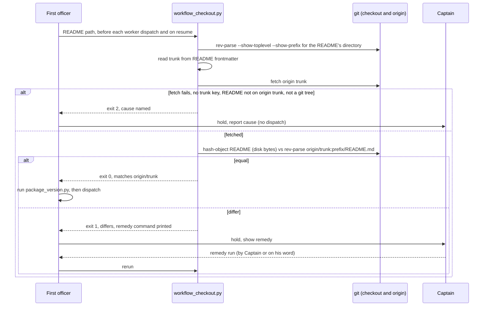

On 2026-10-13 FO drove task `journey-map-dev2-contract` through backlog, ideation, implementation and validation from a workflow checkout detached at a 2026-10-08 commit whose `docs/dev2/README.md` was 397 lines behind the 0.21.0 sync on origin/main (e2524e93). Four dispatches (ideation-1, ideation-3, implementation-1, validation-1) ran on the stale rules; two rules only the newer README carries were missed (dispatch records under `<task>/dispatch/`, the `package_version.py` hold). Observer report on that task, violations 3 and 4. `package_version.py` compares the loaded package with the README it is given, so a stale README passes; nothing compares the README with the trunk's.

## Captain's words

Captain 2026-10-13, in chat, after the learn result listed this as package-issue candidate 3: 「1-3 回報，且立即排修」

## Scope

- A check FO runs before a dispatch that fails when the workflow checkout's README differs from the trunk's README, with the remedy named.
- Non-goals: changing Spacedock (including `dispatch build`); comparing the rest of the workflow directory (`_mods/`); moving or repairing the checkout from inside the check; the other two tasks' fixes.

## Acceptance criteria

All paths are relative to `kc-dev-flow-2/` in `iamcxa/kc-claude-plugins`; `<repo>` is a checkout of that repository, `<package>` the package root. Throwaway means `git worktree add --detach /tmp/<name> <sha>` or a `git clone` in a temp directory, removed afterwards; the README's own rule (throwaway-checkout probes are allowed) covers it.

**AC-1** A checkout detached at a commit behind the trunk fails the check and names the remedy.
Evidence: `git -C <repo> worktree add --detach /tmp/dev2-stale 6d344bcb && python3 <package>/scripts/workflow_checkout.py /tmp/dev2-stale/docs/dev2/README.md; echo $?` prints `1`, and stdout contains `differs from origin/main` and the command `git -C /tmp/dev2-stale checkout --detach origin/main`.
Fixture discriminates today: `git show 6d344bcb:docs/dev2/README.md | git hash-object --stdin` is `946f5203…` (507 lines), `git show origin/main:docs/dev2/README.md | git hash-object --stdin` is `835dad49…` (594 lines), measured 2026-10-13 at origin/main `9e68eb87`.
Falsifier: replace the comparison with an unconditional pass; this run then exits 0 and the test goes red.

**AC-2** A checkout whose README equals the trunk's passes.
Evidence: the same command on `git worktree add --detach /tmp/dev2-current origin/main` exits `0` and stdout contains `matches origin/main`.
Falsifier: make the script exit 1 whenever the commits differ rather than the README bytes; a checkout at an older commit with an identical README then fails here (the unit test builds that case).

**AC-3** The bytes FO reads decide, not the committed ones.
Evidence: in the `/tmp/dev2-current` checkout, `printf '\nlocal edit\n' >> docs/dev2/README.md` and rerun: exit `1`. Restore with `git checkout -- docs/dev2/README.md` and rerun: exit `0`.
Falsifier: read the README with `git rev-parse HEAD:<path>` instead of `git hash-object <path>`; the edited file then passes and the test goes red.

**AC-4** A stale remote-tracking ref does not hide staleness: the check fetches the trunk first.
Evidence: unit test with a bare `origin`, a clone `A` and a clone `B`. Commit a README change in `A` and push; in `B`, whose `origin/main` is behind and whose README equals that stale ref, run the check: exit `1`. Then repeat with the fetch call removed from the script: exit `0` (the false pass).
Falsifier: the test for the fetch-less variant is the falsifier; it must be shown red against that variant by running it once with the fetch removed.

**AC-5** What cannot be verified is exit 2 with a stated reason, never a pass.
Evidence: one unit test per case, each asserting exit `2` and a stdout/stderr phrase naming the cause: `origin` unreachable (`git remote set-url origin /nonexistent`); README without `trunk:`; README outside a git work tree; README not tracked on `origin/<trunk>` (an unmerged workflow); no argument or a missing file (usage).
Falsifier: swallow the fetch error and compare against the local ref; the unreachable-origin test then exits 0 or 1 and goes red.

**AC-6** The instruction sits where a stale-README FO still reads it, and cannot be deleted silently.
Evidence: `<package>/skills/dev/SKILL.md` and `<package>/references/sd/workflow.md` each name `<package>/scripts/workflow_checkout.py`, asserted by a test in `test_workflow_checkout.py` in the pattern of `test_the_package_template_carries_the_line_and_matches_its_manifest` in `test_package_version.py`; `python3 kc-dev-flow-2/scripts/lint-skills.py` and the new test both exit `0` in the CI run on the delivery PR, where `kc-dev-flow-2-tests.yml` runs the new test file.
Falsifier: delete the sentence from `skills/dev/SKILL.md`; the test goes red. Write it with a bare `scripts/workflow_checkout.py`; `lint-skills.py` exits non-zero (its bound-path rule).

## Design

### Chain check

- Spacedock 0.27.0: no such check. `spacedock --help` lists no command, and neither `status` nor `dispatch build` takes or reports a README/trunk comparison. The only mechanical point on Spacedock's side would be `dispatch build`; that is outside this task (non-goal).
- kc-dev-flow-2 at origin/main `9e68eb87`: `scripts/package_version.py` compares the loaded package version with the release line inside the README it is handed, so a stale README passes. `scripts/number_guards.py` already resolves the trunk from README frontmatter (`trunk:`), reading `origin/<trunk>`. This design reuses that frontmatter reader (import `frontmatter` from the same directory) rather than adding a second trunk resolver.
- Sibling adopter (carlove): nothing comparable. ADRs 0001-0011 in `docs/adr`: none governs README currency. `Override:` lines in the state checkout (`git grep -n 'Override:'`): none from a gate record; the hits are prose saying there were none.

### PRFAQ

**Plain account.** FO reads its rules from the workflow README in whatever checkout it was started in. That checkout can be frozen at an old commit, and then FO follows old rules without knowing. On 2026-10-13 this happened for four dispatches. After this change, before each dispatch FO runs one small command that asks git: "is this README the same as the trunk's?" If not, FO stops, says so, and prints the one command that fixes it.

**Press release (future).** kc-dev-flow-2 now refuses to dispatch from a workflow checkout whose README is not the trunk's README. `workflow_checkout.py` fetches the trunk, compares the bytes of the README FO is about to follow with the trunk's, and exits 0 on equal, 1 on different (with the remedy), 2 when it cannot tell. It sits beside the existing `package_version.py` hold and uses the same exit convention and the same input, the README path.

**FAQ.**
- *Why a new script and not a second mode of `package_version.py`?* That script is a pure file read that answers "is the package old?"; its exit 1 means "load a newer package". Adding git and a second meaning to exit 1 makes the hold ambiguous. Two commands with one convention is clearer; both live in the same README sentence.
- *Why must the instruction also live in `skills/dev/SKILL.md`?* The failure is a stale README. A sentence that exists only in the README cannot be read by an FO holding a README old enough to lack it (the 2026-10-08 copy contains neither the `package_version.py` hold nor the dispatch records). `kc-dev-flow-2:dev` is loaded from the package, not from the checkout, so it is the one package-owned text a stale-README FO still sees. The `workflow.md` sentence still ships so synced adopters carry the rule in their own README.
- *Why compare working-tree bytes?* FO follows the file on disk. A committed-blob comparison would pass a README with uncommitted edits (AC-3).
- *Why fetch inside the check?* A detached checkout's `origin/<trunk>` is whatever the last fetch left. Without a fetch the check is only as current as someone else's last command (AC-4).
- *Does the check move the checkout?* No. It prints the remedy; it never switches a checkout that concurrent sessions may be driving (see Unresolved decision 3).
- *What does it not cover?* See Limits.

### Flow

Order in prose: resolve the repo from the README's own directory (never the FO's cwd), read `trunk:` from that README, fetch `origin <trunk>`, hash the README on disk, read the trunk's blob at the same repo-relative path, compare. Exit 0 equal; exit 1 different, stdout names both short hashes, the checkout's HEAD, and the remedy (`git -C <toplevel> checkout --detach origin/<trunk>` for a detached HEAD; for a branch HEAD it says to bring the branch level with `origin/<trunk>`); exit 2 for anything that stops the comparison. FO holds on 1 and 2 and does not dispatch; FO does not push or merge the trunk.

### Files, and what is shared with the other two tasks

New (this task only): `scripts/workflow_checkout.py`, `scripts/test_workflow_checkout.py`. Edited here: `skills/dev/SKILL.md` (one sentence). Shared, each edit in a different place:
- `references/sd/workflow.md`: this task edits the `package_version.py` sentence block (above `### backlog`, near line 90). `worker-completion-goes-to-main` is expected to edit the same block (its scope-notes sentence about the `main` completion line) and `## Dispatch facts` (the `Signal:` bullet); `observer-before-merge-guard` the delivery/merge-guard text near lines 236 and 516-529. The block near line 90 is a true overlap: implement in the Captain's order (this task first) and let the second task rebase onto it.
- `scripts/lint-skills.py`: no edit expected here, but `WORKFLOW_WORD_BUDGET` (5331) caps `workflow.md` for all three tasks, and the same lint refuses a 12-word run repeated between `workflow.md` and a skill, so the `dev` sentence and the `workflow.md` sentence must be worded differently. Whoever lands past the budget raises it and says why.
- `.github/workflows/kc-dev-flow-2-tests.yml`: one new step per task that adds a test file; cost is one extra Python step in the existing job, not a new job or trigger (duration not measured).
- `extensions/learn/EXTENSION.md`: observer task only. The adopter copy `docs/dev2/README.md` is changed by a sync PR after release, by none of the three.

### Limits

- Prose-enforced: nothing in kc-dev-flow-2 forces FO to run the command. The only mechanical enforcement point is Spacedock's `dispatch build`, outside this task. Whether the 2026-10-13 FO loaded `kc-dev-flow-2:dev` is not recorded in its dispatch records, so this design cannot claim it would have been caught; it claims only that the instruction is now in the one package-owned text such an FO would read.
- One file: `docs/dev2/_mods/` and the rest of the workflow directory are not compared. A sync PR changes README and mods together, so a README match is a proxy.
- A README equal to the trunk's but older than the loaded package is still only the existing `package_version.py` "re-sync it" advisory.
- A workflow whose README is not yet on `origin/<trunk>` (a first adoption PR) exits 2 until it merges.
- Not measured: the time of the fetch.

## Unresolved decisions for the Captain

1. **Fetch inside the check, and hold when the remote cannot be reached?** Recommend yes. Without a fetch the check passes whenever the stale checkout's own `origin/main` is also stale (AC-4). Gets worse: an offline FO cannot dispatch until the Captain accepts the hold in words.
2. **Strict equality, so a README that is ahead of the trunk (a branch carrying an unmerged README edit) also holds?** Recommend yes. "Ahead" versus "behind" for one file needs a commit walk the check does not otherwise need, and the Captain's wording was "differs". Gets worse: an FO session started inside a branch that edits the README must hold; the remedy for that case is the Captain's to name.
3. **Does FO run the printed remedy, or only show it?** Recommend show it and wait for the Captain, as the `package_version.py` hold does. Switching the shared checkout changes the README under every concurrent session driving it. Gets worse: one extra Captain turn each time the checkout is stale.

## FO alignment

Alignment: not needed before ideation; the Captain ruled to report and fix now.
Release review: not needed: workflow maintenance, on no journey map.
Surfaces: none
Visible change: none

## Number guards

ADR: 0014

## Stage Report: ideation

- DONE: A design (PRFAQ and Mermaid) for a check FO runs before every worker dispatch that fails when the workflow checkout's README differs from the trunk's, naming the remedy, within what kc-dev-flow-2 controls (not Spacedock), consistent with the existing package_version.py hold
  `## Design`: chain check (Spacedock none; `package_version.py` trusts the README; `number_guards.py` frontmatter reader reused), PRFAQ, sequence diagram, new `scripts/workflow_checkout.py` with the `package_version.py` exit convention; instruction placed in `skills/dev/SKILL.md` as well as `workflow.md` because a stale README cannot carry its own fix.
- DONE: Acceptance criteria with reproducible evidence clauses and falsifiers, including one run against a checkout detached at a commit behind the trunk (e.g. 6d344bcb, the 2026-10-08 commit the journey-map-dev2-contract FO used) that must fail
  `## Acceptance criteria` AC-1..AC-6, each with a falsifier. Current state per criterion, none run yet (ideation writes no repository file):
  AC-1 not yet verified; fixture discriminates: README blobs at 6d344bcb `946f5203…` (507 lines) vs origin/main `835dad49…` (594), measured with `git show … | git hash-object --stdin`.
  AC-2 not yet verified; origin/main README blob equals e2524e93's (`835dad49…`), so the pass case exists.
  AC-3 not yet verified; AC-4 not yet verified; AC-5 not yet verified; AC-6 not yet verified.
  `python3 <package>/scripts/design_surfaces.py check <task>` printed "design surfaces presentable" (exit 0).
- DONE: Unresolved decisions for the Captain, each with a recommendation and what gets worse under it
  Three in `## Unresolved decisions for the Captain`: fetch and hold when the remote is unreachable; strict equality (README ahead also holds); FO shows the remedy rather than running it.

### Summary

The check is a new script beside `package_version.py` that fetches the trunk and compares the on-disk README bytes with `origin/<trunk>`; exit 0/1/2 as for the existing hold. The key design finding is placement: the sentence must also live in `skills/dev/SKILL.md`, the one package-owned text a stale-README FO still reads, and the limit that it stays prose-enforced is stated. Shared files with the other two tasks are named in `## Design`, notably `references/sd/workflow.md` near the `package_version.py` block and the `WORKFLOW_WORD_BUDGET`.

## Stage Report: implementation

- DONE: One Draft PR (fix(kc-dev-flow-2): ...) from a branch off origin/main adding scripts/workflow_checkout.py and its test, the sentences in skills/dev/SKILL.md and references/sd/workflow.md, the tests-workflow step, and ADR 0014; AC-1 to AC-6 green with each falsifier shown failing by a mutation run
  PR #631 (Draft), commit 085e28aa on spacedock-ensign/workflow-checkout-must-match-trunk-readme, branched at origin/main 9e68eb87.
  AC-1/2/3 run on real throwaway worktrees (6d344bcb: exit 1, `differs from origin/main`, `git -C /tmp/dev2-stale checkout --detach origin/main`; origin/main: exit 0; appended line: exit 1, restored: exit 0). AC-4..6 are `test_workflow_checkout.py`, 11 tests on real git repos with a bare origin.
  Mutations, each red: unconditional pass (4 tests), commit-hash compare (2), committed-blob read (1), fetch removed (3), fetch error swallowed (1: unreachable-origin test), sentence deleted from skills/dev/SKILL.md (1); bare script path in SKILL.md fails lint-skills.py.
- DONE: ADR 0014 records the accepted D1 (fetch inside the check; unreachable remote holds), D2 (strict equality) and D3 (FO shows the remedy and waits) with the Captain's words; adr_lint.py docs/adr --require 0014 passes
  `docs/adr/0014-the-first-officer-checks-its-readme-against-the-trunk-before-dispatch.md`; adr_lint printed `13 ADR file(s) checked, 0 legacy`, exit 0.
- DONE: roborev_gate.py evidence= line, CI green on the PR head, lint-skills.py green (raise WORKFLOW_WORD_BUDGET only by the words this task adds, saying why), and the CI cost per PR measured or stated as not measured
  `clean on 085e28aa3; evidence=roborev:607`. CI on 085e28aa: all five checks pass (unit tests 43s whole job, which includes the new step). WORKFLOW_WORD_BUDGET 5331 to 5369 (+38, the workflow.md sentence), reason in a lint-skills.py comment. CI cost: one added Python step in the existing unit-tests job; its own duration not measured.

### Summary

`workflow_checkout.py` fetches `origin/<trunk>` and compares the on-disk README bytes with the trunk's blob; exit 0/1/2 as designed, remedy printed on 1. The instruction is in `skills/dev/SKILL.md` (package-owned) and `references/sd/workflow.md`. The check stays prose-enforced; no file outside the design's list changed (plus `lint-skills.py` for the budget). Note for the next two tasks: they rebase onto the `package_version.py` sentence block in workflow.md and the raised budget of 5369.

## Stage Report: validation

- DONE: Independent verdict on #631 head 085e28aa against AC-1 to AC-6, re-running each evidence command and at least one falsifier per criterion yourself rather than citing the implementation report
  Verdict PASSED. Candidate: PR #631 head 085e28aa30872fbdf6341640a8ae16b8504c4083 (Draft, OPEN), base origin/main 9e68eb87; all five CI checks SUCCESS. Throwaway worktrees, removed.
  AC-1 `/tmp/dev2-stale` at 6d344bcb: exit 1, `differs from origin/main: on disk 946f5203, origin/main 835dad49`, remedy `git -C /tmp/dev2-stale checkout --detach origin/main`. AC-2 origin/main checkout: exit 0 `matches origin/main`. AC-3 appended a line: exit 1; `git checkout --` restore: exit 0. Also exit 0 from the workflow dir with a relative path, and exit 0 on the real live FO workflow README (HEAD e2524e93, same blob 835dad49).
  AC-4/5/6 are `test_workflow_checkout.py`: 11 tests, OK. Mutations I ran on a copy (candidate untouched), each red for the stated reason: `if True` for the equality test (4 tests fail: behind-trunk, ahead, stale-ref, disk-bytes); HEAD-commit compare instead of bytes (2: equal-README-at-another-commit, disk-bytes); `HEAD:path` blob instead of `hash-object` (1: disk-bytes); fetch removed (3: stale-ref, behind-trunk, unreachable-origin); fetch error swallowed (1: unreachable-origin); `<package>/scripts/workflow_checkout.py` removed from skills/dev/SKILL.md (1: instruction-present test); bare `scripts/workflow_checkout.py` in SKILL.md makes `lint-skills.py` exit 1 (`named without <package>/scripts/`), unmutated exit 0 (5369 of 5369 words).
- DONE: A minimal acceptance script the Captain can run (three to six steps, exact commands, expected output), run by you exactly as written in a fresh shell from a named checkout, with its observed output
  Below under Acceptance script. Run as `env -i HOME=$HOME PATH=$PATH bash --noprofile --norc <file>`: exit 0, output matched every expectation. Needs: network to origin, `git`, `python3`; named checkout `/Users/kent/conductor/workspaces/kc-claude-plugins/colombo`, which already holds 085e28aa.
- DONE: adr_lint.py docs/adr --since <base> run with its exit code; verdict PASSED or REJECTED with findings classified by the workflow's Review-finding disposition
  `adr_lint.py docs/adr --since 9e68eb87 --require 0014` at 085e28aa: `13 ADR file(s) checked, 0 legacy`, exit 0. Also: `comment_ratio.py 9e68eb87 085e28aa` exit 0 (3 comment lines of 211 code lines, 1.4%, max 5%; each added comment read, none narrates); `dispatch_records.py` exit 0 (3 records complete); `design_surfaces.py check` exit 0; `number_guards.py check` exit 0 (no migrations-path; its reported head is the workflow checkout's, not the candidate's, so it adds nothing here). Verdict PASSED, no Material finding. Findings: Polish: `doc_impact.py` lists kc-dev-flow-2/README.md and skills/maintain-flow/SKILL.md and the implementation report records neither `updated` nor `unaffected`; I checked both only mention `lint-skills.py` and the tests workflow generically, so `unaffected: neither names workflow_checkout.py or the 5331 budget`. Polish: the printed remedy does not quote a checkout path containing a space (`git -C /tmp/sp ace/c checkout ...`); no current harm, FO shows it and the Captain runs it. Deferred risk: `git fetch` has no timeout or `GIT_TERMINAL_PROMPT=0`, so an HTTPS origin needing a prompt could stall a non-interactive FO; would become Material if an FO is observed hanging on this check. Known limit (ADR 0014, not a finding): prose-enforced, one file compared.

### Acceptance script

Run from any shell (it changes git config only inside a throwaway clone, never in the shared checkout); prints, in order: (1) exit 1 stale, (2) exit 0 current, (3) exit 1 edited then exit 0 restored, (4) exit 2 unreachable origin in a throwaway clone, (5) `OK` for 11 tests. Not covered: that a real FO session runs it before dispatch (prose-enforced), the rest of the workflow directory, and CI.

    set -eu
    REPO=/Users/kent/conductor/workspaces/kc-claude-plugins/colombo
    for d in pkg stale current; do git -C "$REPO" worktree remove --force /tmp/accept-$d 2>/dev/null || true; done
    git -C "$REPO" fetch -q origin main
    git -C "$REPO" worktree add -q --detach /tmp/accept-pkg 085e28aa
    git -C "$REPO" worktree add -q --detach /tmp/accept-stale 6d344bcb
    git -C "$REPO" worktree add -q --detach /tmp/accept-current origin/main
    S=/tmp/accept-pkg/kc-dev-flow-2/scripts/workflow_checkout.py
    python3 "$S" /tmp/accept-stale/docs/dev2/README.md || echo "exit $?"
    python3 "$S" /tmp/accept-current/docs/dev2/README.md; echo "exit $?"
    printf '\nlocal edit\n' >> /tmp/accept-current/docs/dev2/README.md
    python3 "$S" /tmp/accept-current/docs/dev2/README.md || echo "exit $?"
    git -C /tmp/accept-current checkout -q -- docs/dev2/README.md
    python3 "$S" /tmp/accept-current/docs/dev2/README.md; echo "exit $?"
    rm -rf /tmp/accept-clone
    git clone -q --no-checkout "$REPO" /tmp/accept-clone
    git -C /tmp/accept-clone fetch -q "$REPO" refs/remotes/origin/main:refs/heads/probe
    git -C /tmp/accept-clone checkout -q probe
    git -C /tmp/accept-clone remote set-url origin /nonexistent/origin.git
    python3 "$S" /tmp/accept-clone/docs/dev2/README.md || echo "exit $?"
    rm -rf /tmp/accept-clone
    python3 -B /tmp/accept-pkg/kc-dev-flow-2/scripts/test_workflow_checkout.py 2>&1 | tail -3
    for d in pkg stale current; do git -C "$REPO" worktree remove --force /tmp/accept-$d; done

Observed (2026-10-13, origin/main 9e68eb87): `README differs from origin/main: on disk 946f5203, origin/main 835dad49 (checkout HEAD 6d344bcb). Dispatch holds. Remedy: git -C /tmp/accept-stale checkout --detach origin/main` / `exit 1`; `README matches origin/main (835dad49; checkout HEAD 9e68eb87)` / `exit 0`; `README differs ... on disk 5eb1f9f3 ... Remedy: git -C /tmp/accept-current checkout --detach origin/main` / `exit 1`; `README matches origin/main (835dad49 ...)` / `exit 0`; `cannot verify the workflow README against its trunk: cannot fetch origin/main ... Dispatch holds.` / `exit 2`; `Ran 11 tests ... OK`. The origin/main hash will change once a later sync PR merges; the shape (1, 0, 1, 0, 2, OK) will not.

### Summary

PASSED. My first draft of the acceptance script ran `git remote set-url` in a worktree, which rewrote `remote.origin.url` for every worktree of this repository (shared config) to `/nonexistent/origin.git`; I restored it to `https://github.com/iamcxa/kc-claude-plugins.git` (inferred from the sibling clone and the PR's repository, original value not recorded), confirmed `git ls-remote origin` and the state push work, and moved that step into a throwaway clone; the script above is the corrected one and was rerun in a fresh shell with the origin URL unchanged. Every AC reproduced on throwaway checkouts of 085e28aa, and each of six mutations turned the intended test red. No Material or Needs-decision finding; two Polish items and one Deferred risk are recorded above for FO. Unverified: behaviour of a real FO session (the check is prose-enforced) and CI duration.

### Feedback Cycles

- Cycle 1 (FO, 2026-10-13): validation recommended PASSED on #631 085e28aa and FO ran its acceptance script as written (`env -i` bash, every step as expected; shared `remote.origin.url` unchanged before and after). Codex review round 1 (review:5500393427) left two P2, both to fix (rounds 1 and 2 fix every finding); investigation first, then FO fix authorization, then a fresh validation recheck.
  - P2 #631 `scripts/workflow_checkout.py` (around line 74): `git hash-object` applies clean filters (for example `*.md text eol=lf`), so a README rewritten with CRLF hashes equal to the LF trunk blob and the check passes although the disk bytes differ. Use `--no-filters`.
  - P2 #631 `scripts/workflow_checkout.py` (around line 49): the printed remedy does not shell-quote the checkout path, so a path with whitespace or shell metacharacters is not runnable as shown. Quote it.
- Cycle 2 (FO, 2026-10-13): validation cycle 2 recommended PASSED on #631 70da29c7 and FO ran its acceptance script as written (every step as expected; shared origin URL unchanged). Codex review round 2 (review:5500564188) left one P1, to fix (a P1 blocks in every round); investigation first, then FO fix authorization, then a fresh validation recheck.
  - P1 #631 `skills/dev/SKILL.md` (around line 65): the instruction runs `workflow_checkout.py` directly, but the file is committed mode 100644, so the shell exits 126 "Permission denied" instead of a documented status. Invoke it through `python3` as `references/sd/workflow.md` does, or make it executable.

## Stage Report: implementation (cycle 2, Codex round-1 P2 repair)

- DONE: Investigation first, with no candidate change: reproduce both Codex round-1 P2 on #631 head 085e28aa, send FO the result and a proposed fix, wait for authorization
  Both reproduced in a throwaway repo (`*.md text eol=lf`: CRLF README hashed 1075535a = trunk, exit 0; path with a space: `git -C .../my work` failed, exit 128); sent to `main`, FO authorized.
- DONE: Fix each with a test that fails without the fix (shown failing by a mutation run)
  Commit 70da29c7: `--no-filters` on `hash-object`, `shlex.quote` on the remedy path. Test 13 total, OK.
  `test_a_crlf_readme_does_not_hash_equal_to_the_lf_trunk_blob_through_a_clean_filter` asserts exit 1 for a CRLF README under the eol=lf filter; fails (1 failure) with `--no-filters` removed.
  `test_the_printed_remedy_runs_as_typed_when_the_checkout_path_has_a_space` runs the printed remedy via `sh -c` from `/` and asserts HEAD == origin/main; fails (1 failure) with `shlex.quote` removed. Each mutation failed only its own test.
- DONE: Push to #631's branch; CI green on the new head
  Pushed 085e28aa..70da29c7 (no force). `gh pr checks 631`: unit tests, version parity, route gate, CI routing, GitGuardian all pass.
- DONE: roborev gate
  `clean on 70da29c74; evidence=roborev:610` (exit 0, one run, base 085e28aa).

### Limits

With `core.autocrlf=true` (or any smudge filter that rewrites bytes on checkout) the README on disk differs from the trunk blob, so the check exits 1 and holds the dispatch. This follows the script's contract that the bytes on disk decide; no handling added, per FO.

### Summary

New head 70da29c7 fixes both P2 in `workflow_checkout.py` only (plus its test file); both files were already in the PR diff. Nothing left for FO beyond merging the head into the stacked observer-before-merge-guard branch.

## Stage Report: validation (cycle 2)

- DONE: Independent recheck of the cycle-1 repair on #631 head 70da29c7: both Codex round-1 P2 (clean filters hide a CRLF README; the printed remedy does not quote the checkout path) reproduced fixed against 085e28aa, their new tests shown failing under a mutation you run yourself, and AC-1 to AC-6 re-run at the new head with any change from the cycle-1 validation named
  Verdict PASSED. Candidate #631 head 70da29c7463561b79a9c12520dc37294e02ab540 (Draft, OPEN), base origin/main 9e68eb87; repair diff 085e28aa..70da29c7 is `workflow_checkout.py` (+3 -2) and `test_workflow_checkout.py` (+24) only; all five CI checks SUCCESS. Throwaway worktrees and fixtures, removed; candidate untouched.
  P2a reproduced on a fresh repo with `.gitattributes` `*.md text eol=lf`, README rewritten CRLF (`file`: CRLF line terminators): 085e28aa prints `README matches origin/main`, exit 0 (false pass); 70da29c7 prints `differs from origin/main: on disk bb515805, origin/main 2b7dc795`, exit 1. P2b: detached checkout in `/tmp/val2-fx/stale checkout`: 085e28aa prints `git -C /tmp/val2-fx/stale checkout checkout --detach origin/main`, run from `/` via `sh -c` it fails (exit 128, no such directory); 70da29c7 prints `git -C '/tmp/val2-fx/stale checkout' checkout --detach origin/main`, run via `sh -c` exits 0 and moves HEAD to origin/main.
  Mutations I ran on a copy: removing `--no-filters` fails only `test_a_crlf_readme_does_not_hash_equal_to_the_lf_trunk_blob_through_a_clean_filter` (asserts exit 1 for a CRLF README under the eol=lf filter); removing `shlex.quote` fails only `test_the_printed_remedy_runs_as_typed_when_the_checkout_path_has_a_space` (runs the printed remedy via `sh -c` and asserts HEAD == origin/main). Both copies also showed an ERROR in `test_the_instruction_is_in_the_skill_and_the_workflow_template` that the unmutated copy shows too: it reads package files by relative path and my copy sat outside the package tree, so it is my copy's location, not the candidate (the candidate's own run is green).
  AC-1 to AC-3 run on real worktrees by the acceptance script below (stale 6d344bcb exit 1 with the remedy; origin/main exit 0; appended line exit 1, restored exit 0). AC-4 to AC-6 are `test_workflow_checkout.py`: 13 tests OK (cycle 1: 11; the two new ones are the P2 tests); `lint-skills.py` PASS (5369 of 5369 words). Change from cycle 1: none in any AC result; the printed remedy now shell-quotes the path, and the README is hashed with `--no-filters`.
- DONE: The minimal acceptance script updated to the new head, run by you exactly as written in a fresh shell from a named checkout, with its observed output
  Below under Acceptance script. Run as `env -i HOME=$HOME PATH=$PATH bash --noprofile --norc <file>`: exit 0, output matched every expectation; `remote.origin.url` identical before and after (`https://github.com/iamcxa/kc-claude-plugins.git`). Needs network to origin, `git`, `python3`; named checkout `/Users/kent/conductor/workspaces/kc-claude-plugins/colombo`, which already holds 70da29c7.
- DONE: adr_lint.py docs/adr --since <base> run at the new head with its exit code; verdict PASSED or REJECTED with findings classified by the workflow's Review-finding disposition
  `adr_lint.py docs/adr --since 9e68eb87 --require 0014` at 70da29c7: `13 ADR file(s) checked, 0 legacy`, exit 0. Also at 70da29c7: `comment_ratio.py 9e68eb87 70da29c7` exit 0 (3 comment lines of 234 code lines, 1.3%; the repair adds none); `dispatch_records.py` exit 0 (6 records complete); `design_surfaces.py check` exit 0; `number_guards.py check` exit 0 (head 70da29c74635). Verdict PASSED, no Material finding. Findings: none new. Carried from cycle 1, unchanged: Polish `doc_impact.py` still lists kc-dev-flow-2/README.md and skills/maintain-flow/SKILL.md (`unaffected: neither names workflow_checkout.py or the 5331 budget`); Deferred risk `git fetch` has no timeout or `GIT_TERMINAL_PROMPT=0` (Material if an FO is observed hanging on this check). The cycle-1 Polish about an unquoted remedy path is now fixed. Deferred risk, already in cycle 2's Limits: with `core.autocrlf=true` or a smudge filter the disk README differs from the trunk blob, so the check holds (exit 1, fail-safe, never a false pass); Material if a supported FO checkout is observed held for that reason.

### Acceptance script (cycle 2)

Run from any shell (it changes git config only inside a throwaway clone, never in the shared checkout); prints, in order: (1) exit 1 stale, remedy with the spaced path quoted, (2) exit 0 current, (3) exit 1 edited then exit 0 restored, (4) exit 2 unreachable origin in a throwaway clone, (5) `OK` for 13 tests. Not covered: that a real FO session runs it before dispatch (prose-enforced), the rest of the workflow directory, a host with `core.autocrlf=true`, and CI.

    set -eu
    REPO=/Users/kent/conductor/workspaces/kc-claude-plugins/colombo
    for d in "pkg" "stale checkout" "current"; do git -C "$REPO" worktree remove --force "/tmp/accept-$d" 2>/dev/null || true; done
    git -C "$REPO" fetch -q origin main
    git -C "$REPO" worktree add -q --detach /tmp/accept-pkg 70da29c7
    git -C "$REPO" worktree add -q --detach "/tmp/accept-stale checkout" 6d344bcb
    git -C "$REPO" worktree add -q --detach /tmp/accept-current origin/main
    S=/tmp/accept-pkg/kc-dev-flow-2/scripts/workflow_checkout.py
    python3 "$S" "/tmp/accept-stale checkout/docs/dev2/README.md" || echo "exit $?"
    python3 "$S" /tmp/accept-current/docs/dev2/README.md; echo "exit $?"
    printf '\nlocal edit\n' >> /tmp/accept-current/docs/dev2/README.md
    python3 "$S" /tmp/accept-current/docs/dev2/README.md || echo "exit $?"
    git -C /tmp/accept-current checkout -q -- docs/dev2/README.md
    python3 "$S" /tmp/accept-current/docs/dev2/README.md; echo "exit $?"
    rm -rf /tmp/accept-clone
    git clone -q --no-checkout "$REPO" /tmp/accept-clone
    git -C /tmp/accept-clone fetch -q "$REPO" refs/remotes/origin/main:refs/heads/probe
    git -C /tmp/accept-clone checkout -q probe
    git -C /tmp/accept-clone remote set-url origin /nonexistent/origin.git
    python3 "$S" /tmp/accept-clone/docs/dev2/README.md || echo "exit $?"
    rm -rf /tmp/accept-clone
    python3 -B /tmp/accept-pkg/kc-dev-flow-2/scripts/test_workflow_checkout.py 2>&1 | tail -3
    for d in "pkg" "stale checkout" "current"; do git -C "$REPO" worktree remove --force "/tmp/accept-$d"; done

Observed (2026-10-13, origin/main 9e68eb87): `README differs from origin/main: on disk 946f5203, origin/main 835dad49 (checkout HEAD 6d344bcb). Dispatch holds. Remedy: git -C '/tmp/accept-stale checkout' checkout --detach origin/main` / `exit 1`; `README matches origin/main (835dad49; checkout HEAD 9e68eb87)` / `exit 0`; `README differs ... on disk 5eb1f9f3 ... Remedy: git -C /tmp/accept-current checkout --detach origin/main` / `exit 1`; `README matches origin/main (835dad49 ...)` / `exit 0`; `cannot verify the workflow README against its trunk: cannot fetch origin/main ... Dispatch holds.` / `exit 2`; `Ran 13 tests ... OK`. The origin/main hash will change once a later sync PR merges; the shape (1, 0, 1, 0, 2, OK) will not.

### Summary

PASSED. Both Codex round-1 P2 reproduce as real defects at 085e28aa (a CRLF README under an eol=lf filter passes; the remedy for a spaced path is not runnable) and are fixed at 70da29c7; each new test fails only under the mutation that removes its fix. No AC result changed from cycle 1, and the acceptance script now runs at 70da29c7 with a spaced stale-checkout path. I wrote no `git config` in any shared worktree (the unreachable-origin step runs in a throwaway clone; origin URL identical before and after). Unverified: behaviour of a real FO session (prose-enforced), CI duration, and a host with `core.autocrlf=true`.

## Stage Report: implementation (cycle 3, Codex round-2 P1 repair)

- DONE: reproduce the Codex round-2 P1 on #631 head 70da29c7 and sweep every script FO is told to run
  `git ls-tree` shows workflow_checkout.py 100644; direct run from a `git archive` copy exits 126, `python3 ...` runs. Only skills/dev/SKILL.md named it bare; references/sd/workflow.md already used python3. Out of scope, reported to FO: references/sd/adoption.md L24 names poc_readme.py bare (pre-existing, file not in the PR).
- DONE: fix with a check that fails without the fix, shown failing by a mutation run
  New head 20c9ec53. skills/dev/SKILL.md now runs `python3 <package>/scripts/workflow_checkout.py`. test_every_instruction_runs_the_script_through_python3_unless_it_is_executable asserts every `<package>/scripts/workflow_checkout.py` mention in skills/dev/SKILL.md and references/sd/workflow.md is preceded by `python3` (wrap tolerated) unless the file is executable; it replaces a substring-only test that passed on the broken text. Mutation: SKILL.md reverted to the bare form -> that test fails ("1 != 0 ... without python3"), 12 others pass; restored -> 13 tests OK; lint-skills.py OK.
- DONE: roborev gate and push
  `roborev_gate.py --base 70da29c7`: `clean on 20c9ec53a; evidence=roborev:613` (exit 0, first run). Pushed without force.
- DONE: CI green on the new head
  `gh pr checks 631`: 5 of 5 pass on 20c9ec53ab5b (unit tests, version parity, route gate, static contracts, GitGuardian).

### Summary

The dev skill told FO to run a mode-100644 script directly (exit 126); it now goes through python3 like package_version.py, guarded by a test that names the failing mutation. Left for FO: adoption.md L24 bare poc_readme.py mention, and merging 20c9ec53 into stacked PRs #632 and #633.

## Stage Report: validation (cycle 3)

- DONE: Independent recheck of the cycle-2 repair on #631 head 20c9ec53: the Codex round-2 P1 (the dev skill ran workflow_checkout.py directly while it is mode 100644) reproduced fixed against 70da29c7, the new test shown failing under a mutation you run yourself, and AC-1 to AC-6 re-run at the new head with any change from validation cycle 2 named
  Verdict PASSED. Candidate #631 head 20c9ec53ab5bd3ec32dc5aa31ba79b667102b76d (Draft, OPEN), merge-base 9e68eb87; repair diff 70da29c7..20c9ec53 is `skills/dev/SKILL.md` (+1 -1, `python3 ` added) and `scripts/test_workflow_checkout.py` (+8 -2) only; all five CI checks SUCCESS; merge-tree with current origin/main (6d0f8da9, #630, disjoint files) is clean. Throwaway worktrees removed; candidate untouched.
  P1 reproduced by following the dev skill's sentence literally (text extracted from SKILL.md, `<package>`/`<workflow-dir>` substituted, run in a fresh `env -i` bash): at 70da29c7 the command is `<package>/scripts/workflow_checkout.py <README>`, bash prints `Permission denied`, exit 126 (git mode `100644`); at 20c9ec53 it is `python3 <package>/scripts/workflow_checkout.py <README>`, prints `README matches origin/main (835dad49; ...)`, exit 0. `references/sd/workflow.md` already used `python3` and still does.
  Mutations I ran in a throwaway worktree at 20c9ec53 (candidate untouched; unmutated: 13 tests OK): (M1) `python3 ` removed from SKILL.md -> only `test_every_instruction_runs_the_script_through_python3_unless_it_is_executable` fails ("1 != 0 ... skills/dev/SKILL.md runs ... without python3 and the file is not executable"); (M2) same removal in workflow.md -> the same test fails naming workflow.md; (M3) the workflow_checkout.py mention deleted from SKILL.md -> the same test fails on "does not name"; (M4) `chmod +x` the script plus the bare SKILL.md form -> 13 OK (the test's stated exemption works: a bare run is fine once the file is executable).
  AC-1..AC-3 on real worktrees via the script below (stale 6d344bcb exit 1 + remedy; origin/main exit 0; appended line exit 1, restored exit 0). AC-4..AC-6 are `test_workflow_checkout.py`, 13 tests OK; `lint-skills.py` PASS (5369 of 5369 words). Change from cycle 2: none in any AC result; the only behavioural change is the dev skill's sentence, now runnable as written, and AC-6's presence assertion is now part of the stronger python3-launch test (the substring-only test is gone; M3 shows presence is still asserted). Also exit 0 on the live FO workflow README (checkout HEAD e2524e93, blob 835dad49).
- DONE: The minimal acceptance script updated to the new head, run by you exactly as written in a fresh shell from a named checkout, with its observed output, including the instruction followed literally as the dev skill now writes it
  Below under Acceptance script (cycle 3). Run as `env -i HOME=$HOME PATH=$PATH bash --noprofile --norc <file>`: exit 0, output matched every expectation; `remote.origin.url` identical before and after (`https://github.com/iamcxa/kc-claude-plugins.git`). Needs network to origin, `git`, `python3`; named checkout `/Users/kent/conductor/workspaces/kc-claude-plugins/colombo`, which already holds 20c9ec53.
- DONE: adr_lint.py docs/adr --since <base> run at the new head with its exit code; verdict PASSED or REJECTED with findings classified by the workflow's Review-finding disposition
  `adr_lint.py docs/adr --since 9e68eb87 --require 0014` at 20c9ec53: `13 ADR file(s) checked, 0 legacy`, exit 0. Also at 20c9ec53: `comment_ratio.py 9e68eb87 20c9ec53` exit 0 (3 comment lines of 240 code lines, 1.2%; the repair adds none: 70da29c7..20c9ec53 is 8 code lines, 0 comment); `dispatch_records.py` exit 0 (9 records complete); `design_surfaces.py check` exit 0; `number_guards.py check` exit 0 (no migrations-path). Verdict PASSED, no Material finding. Findings: Needs decision (FO, not this task): `skills/dev/SKILL.md` line 23 runs `<package>/scripts/learning.py --repo ... notices` bare, and `learning.py` is mode 100644 (installed copy `-rw-r--r--`; `$PKG/scripts/learning.py` run directly prints `permission denied`) - the same defect class as the round-2 P1, in a line this PR does not touch; implementation already reported `references/sd/adoption.md` `poc_readme.py` as the same class. It needs its own task or an FO ruling on scope. Polish carried from cycle 1, unchanged: `doc_impact.py` lists kc-dev-flow-2/README.md and skills/maintain-flow/SKILL.md (`unaffected: neither names workflow_checkout.py or the 5331 budget`). Deferred risks carried, unchanged: `git fetch` without a timeout or `GIT_TERMINAL_PROMPT=0` (Material if an FO is seen hanging on it); `core.autocrlf=true` or a smudge filter holds the dispatch (fail-safe, never a false pass; Material if a supported FO checkout is held for it).

### Acceptance script (cycle 3)

Run from any shell (it changes git config only inside a throwaway clone, never in the shared checkout); prints, in order: (1) exit 1 stale, remedy with the spaced path quoted, (2) exit 0 current, (3) exit 1 edited then exit 0 restored, (4) exit 2 unreachable origin in a throwaway clone, (5) `OK` for 13 tests, (6) the sentence read out of `skills/dev/SKILL.md` and run as it is written there: exit 0. Not covered: that a real FO session runs it before dispatch (prose-enforced), the rest of the workflow directory, a host with `core.autocrlf=true`, other bare script mentions in the dev skill (`learning.py`), and CI.

    set -eu
    REPO=/Users/kent/conductor/workspaces/kc-claude-plugins/colombo
    for d in "pkg" "stale checkout" "current"; do git -C "$REPO" worktree remove --force "/tmp/accept-$d" 2>/dev/null || true; done
    git -C "$REPO" fetch -q origin main
    git -C "$REPO" worktree add -q --detach /tmp/accept-pkg 20c9ec53
    git -C "$REPO" worktree add -q --detach "/tmp/accept-stale checkout" 6d344bcb
    git -C "$REPO" worktree add -q --detach /tmp/accept-current origin/main
    S=/tmp/accept-pkg/kc-dev-flow-2/scripts/workflow_checkout.py
    python3 "$S" "/tmp/accept-stale checkout/docs/dev2/README.md" || echo "exit $?"
    python3 "$S" /tmp/accept-current/docs/dev2/README.md; echo "exit $?"
    printf '\nlocal edit\n' >> /tmp/accept-current/docs/dev2/README.md
    python3 "$S" /tmp/accept-current/docs/dev2/README.md || echo "exit $?"
    git -C /tmp/accept-current checkout -q -- docs/dev2/README.md
    python3 "$S" /tmp/accept-current/docs/dev2/README.md; echo "exit $?"
    rm -rf /tmp/accept-clone
    git clone -q --no-checkout "$REPO" /tmp/accept-clone
    git -C /tmp/accept-clone fetch -q "$REPO" refs/remotes/origin/main:refs/heads/probe
    git -C /tmp/accept-clone checkout -q probe
    git -C /tmp/accept-clone remote set-url origin /nonexistent/origin.git
    python3 "$S" /tmp/accept-clone/docs/dev2/README.md || echo "exit $?"
    rm -rf /tmp/accept-clone
    python3 -B /tmp/accept-pkg/kc-dev-flow-2/scripts/test_workflow_checkout.py 2>&1 | tail -3
    CMD=$(python3 -c 'import re; t = open("/tmp/accept-pkg/kc-dev-flow-2/skills/dev/SKILL.md").read(); c = " ".join(re.search(r"run `([^`]*workflow_checkout\.py[^`]*)`", t).group(1).split()); print(c.replace("<package>", "/tmp/accept-pkg/kc-dev-flow-2").replace("<workflow-dir>", "/tmp/accept-current/docs/dev2"))')
    echo "dev skill says: $CMD"
    bash -c "$CMD"; echo "exit $?"
    for d in "pkg" "stale checkout" "current"; do git -C "$REPO" worktree remove --force "/tmp/accept-$d"; done

Observed (2026-10-13, origin/main 6d0f8da9, README blob unchanged 835dad49): `README differs from origin/main: on disk 946f5203, origin/main 835dad49 (checkout HEAD 6d344bcb). Dispatch holds. Remedy: git -C '/tmp/accept-stale checkout' checkout --detach origin/main` / `exit 1`; `README matches origin/main (835dad49; checkout HEAD 6d0f8da9)` / `exit 0`; `README differs ... on disk 5eb1f9f3 ... Remedy: git -C /tmp/accept-current checkout --detach origin/main` / `exit 1`; `README matches origin/main (835dad49 ...)` / `exit 0`; `cannot verify the workflow README against its trunk: cannot fetch origin/main ... Dispatch holds.` / `exit 2`; `Ran 13 tests ... OK`; `dev skill says: python3 /tmp/accept-pkg/kc-dev-flow-2/scripts/workflow_checkout.py /tmp/accept-current/docs/dev2/README.md` / `README matches origin/main (835dad49 ...)` / `exit 0`. The origin/main hash will change when a later sync PR merges; the shape (1, 0, 1, 0, 2, OK, 0) will not.

### Summary

PASSED. The round-2 P1 is a real defect at 70da29c7 (the dev skill's sentence, followed literally, exits 126 on a mode-100644 file) and is fixed at 20c9ec53 (exit 0); the new test fails when `python3` is removed from either instruction and passes when the file is executable, as its name says. No AC result changed from cycle 2. One Needs-decision item for FO: the same bare-path defect in `learning.py` (dev skill line 23) and `poc_readme.py` (adoption.md), outside this PR. I wrote no `git config` in any shared worktree. Unverified: behaviour of a real FO session (prose-enforced), CI duration, and a host with `core.autocrlf=true`.
