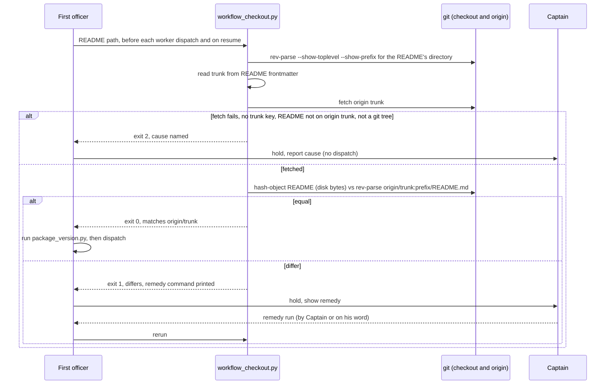

On 2026-10-13 FO drove task `journey-map-dev2-contract` through backlog, ideation, implementation and validation from a workflow checkout detached at a 2026-10-08 commit whose `docs/dev2/README.md` was 397 lines behind the 0.21.0 sync on origin/main (e2524e93). Four dispatches (ideation-1, ideation-3, implementation-1, validation-1) ran on the stale rules; two rules only the newer README carries were missed (dispatch records under `<task>/dispatch/`, the `package_version.py` hold). Observer report on that task, violations 3 and 4. `package_version.py` compares the loaded package with the README it is given, so a stale README passes; nothing compares the README with the trunk's.

## Captain's words

Captain 2026-10-13, in chat, after the learn result listed this as package-issue candidate 3: 「1-3 回報，且立即排修」

## Scope

- A check FO runs before a dispatch that fails when the workflow checkout's README differs from the trunk's README, with the remedy named.
- Non-goals: changing Spacedock (including `dispatch build`); comparing the rest of the workflow directory (`_mods/`); moving or repairing the checkout from inside the check; the other two tasks' fixes.

## Acceptance criteria

All paths are relative to `kc-dev-flow-2/` in `iamcxa/kc-claude-plugins`; `<repo>` is a checkout of that repository, `<package>` the package root. Throwaway means `git worktree add --detach /tmp/<name> <sha>` or a `git clone` in a temp directory, removed afterwards; the README's own rule (throwaway-checkout probes are allowed) covers it.

**AC-1** A checkout detached at a commit behind the trunk fails the check and names the remedy.
Evidence: `git -C <repo> worktree add --detach /tmp/dev2-stale 6d344bcb && python3 <package>/scripts/workflow_checkout.py /tmp/dev2-stale/docs/dev2/README.md; echo $?` prints `1`, and stdout contains `differs from origin/main` and the command `git -C /tmp/dev2-stale checkout --detach origin/main`.
Fixture discriminates today: `git show 6d344bcb:docs/dev2/README.md | git hash-object --stdin` is `946f5203…` (507 lines), `git show origin/main:docs/dev2/README.md | git hash-object --stdin` is `835dad49…` (594 lines), measured 2026-10-13 at origin/main `9e68eb87`.
Falsifier: replace the comparison with an unconditional pass; this run then exits 0 and the test goes red.

**AC-2** A checkout whose README equals the trunk's passes.
Evidence: the same command on `git worktree add --detach /tmp/dev2-current origin/main` exits `0` and stdout contains `matches origin/main`.
Falsifier: make the script exit 1 whenever the commits differ rather than the README bytes; a checkout at an older commit with an identical README then fails here (the unit test builds that case).

**AC-3** The bytes FO reads decide, not the committed ones.
Evidence: in the `/tmp/dev2-current` checkout, `printf '\nlocal edit\n' >> docs/dev2/README.md` and rerun: exit `1`. Restore with `git checkout -- docs/dev2/README.md` and rerun: exit `0`.
Falsifier: read the README with `git rev-parse HEAD:<path>` instead of `git hash-object <path>`; the edited file then passes and the test goes red.

**AC-4** A stale remote-tracking ref does not hide staleness: the check fetches the trunk first.
Evidence: unit test with a bare `origin`, a clone `A` and a clone `B`. Commit a README change in `A` and push; in `B`, whose `origin/main` is behind and whose README equals that stale ref, run the check: exit `1`. Then repeat with the fetch call removed from the script: exit `0` (the false pass).
Falsifier: the test for the fetch-less variant is the falsifier; it must be shown red against that variant by running it once with the fetch removed.

**AC-5** What cannot be verified is exit 2 with a stated reason, never a pass.
Evidence: one unit test per case, each asserting exit `2` and a stdout/stderr phrase naming the cause: `origin` unreachable (`git remote set-url origin /nonexistent`); README without `trunk:`; README outside a git work tree; README not tracked on `origin/<trunk>` (an unmerged workflow); no argument or a missing file (usage).
Falsifier: swallow the fetch error and compare against the local ref; the unreachable-origin test then exits 0 or 1 and goes red.

**AC-6** The instruction sits where a stale-README FO still reads it, and cannot be deleted silently.
Evidence: `<package>/skills/dev/SKILL.md` and `<package>/references/sd/workflow.md` each name `<package>/scripts/workflow_checkout.py`, asserted by a test in `test_workflow_checkout.py` in the pattern of `test_the_package_template_carries_the_line_and_matches_its_manifest` in `test_package_version.py`; `python3 kc-dev-flow-2/scripts/lint-skills.py` and the new test both exit `0` in the CI run on the delivery PR, where `kc-dev-flow-2-tests.yml` runs the new test file.
Falsifier: delete the sentence from `skills/dev/SKILL.md`; the test goes red. Write it with a bare `scripts/workflow_checkout.py`; `lint-skills.py` exits non-zero (its bound-path rule).

## Design

### Chain check

- Spacedock 0.27.0: no such check. `spacedock --help` lists no command, and neither `status` nor `dispatch build` takes or reports a README/trunk comparison. The only mechanical point on Spacedock's side would be `dispatch build`; that is outside this task (non-goal).
- kc-dev-flow-2 at origin/main `9e68eb87`: `scripts/package_version.py` compares the loaded package version with the release line inside the README it is handed, so a stale README passes. `scripts/number_guards.py` already resolves the trunk from README frontmatter (`trunk:`), reading `origin/<trunk>`. This design reuses that frontmatter reader (import `frontmatter` from the same directory) rather than adding a second trunk resolver.
- Sibling adopter (carlove): nothing comparable. ADRs 0001-0011 in `docs/adr`: none governs README currency. `Override:` lines in the state checkout (`git grep -n 'Override:'`): none from a gate record; the hits are prose saying there were none.

### PRFAQ

**Plain account.** FO reads its rules from the workflow README in whatever checkout it was started in. That checkout can be frozen at an old commit, and then FO follows old rules without knowing. On 2026-10-13 this happened for four dispatches. After this change, before each dispatch FO runs one small command that asks git: "is this README the same as the trunk's?" If not, FO stops, says so, and prints the one command that fixes it.

**Press release (future).** kc-dev-flow-2 now refuses to dispatch from a workflow checkout whose README is not the trunk's README. `workflow_checkout.py` fetches the trunk, compares the bytes of the README FO is about to follow with the trunk's, and exits 0 on equal, 1 on different (with the remedy), 2 when it cannot tell. It sits beside the existing `package_version.py` hold and uses the same exit convention and the same input, the README path.

**FAQ.**
- *Why a new script and not a second mode of `package_version.py`?* That script is a pure file read that answers "is the package old?"; its exit 1 means "load a newer package". Adding git and a second meaning to exit 1 makes the hold ambiguous. Two commands with one convention is clearer; both live in the same README sentence.
- *Why must the instruction also live in `skills/dev/SKILL.md`?* The failure is a stale README. A sentence that exists only in the README cannot be read by an FO holding a README old enough to lack it (the 2026-10-08 copy contains neither the `package_version.py` hold nor the dispatch records). `kc-dev-flow-2:dev` is loaded from the package, not from the checkout, so it is the one package-owned text a stale-README FO still sees. The `workflow.md` sentence still ships so synced adopters carry the rule in their own README.
- *Why compare working-tree bytes?* FO follows the file on disk. A committed-blob comparison would pass a README with uncommitted edits (AC-3).
- *Why fetch inside the check?* A detached checkout's `origin/<trunk>` is whatever the last fetch left. Without a fetch the check is only as current as someone else's last command (AC-4).
- *Does the check move the checkout?* No. It prints the remedy; it never switches a checkout that concurrent sessions may be driving (see Unresolved decision 3).
- *What does it not cover?* See Limits.

### Flow

Order in prose: resolve the repo from the README's own directory (never the FO's cwd), read `trunk:` from that README, fetch `origin <trunk>`, hash the README on disk, read the trunk's blob at the same repo-relative path, compare. Exit 0 equal; exit 1 different, stdout names both short hashes, the checkout's HEAD, and the remedy (`git -C <toplevel> checkout --detach origin/<trunk>` for a detached HEAD; for a branch HEAD it says to bring the branch level with `origin/<trunk>`); exit 2 for anything that stops the comparison. FO holds on 1 and 2 and does not dispatch; FO does not push or merge the trunk.

### Files, and what is shared with the other two tasks

New (this task only): `scripts/workflow_checkout.py`, `scripts/test_workflow_checkout.py`. Edited here: `skills/dev/SKILL.md` (one sentence). Shared, each edit in a different place:
- `references/sd/workflow.md`: this task edits the `package_version.py` sentence block (above `### backlog`, near line 90). `worker-completion-goes-to-main` is expected to edit the same block (its scope-notes sentence about the `main` completion line) and `## Dispatch facts` (the `Signal:` bullet); `observer-before-merge-guard` the delivery/merge-guard text near lines 236 and 516-529. The block near line 90 is a true overlap: implement in the Captain's order (this task first) and let the second task rebase onto it.
- `scripts/lint-skills.py`: no edit expected here, but `WORKFLOW_WORD_BUDGET` (5331) caps `workflow.md` for all three tasks, and the same lint refuses a 12-word run repeated between `workflow.md` and a skill, so the `dev` sentence and the `workflow.md` sentence must be worded differently. Whoever lands past the budget raises it and says why.
- `.github/workflows/kc-dev-flow-2-tests.yml`: one new step per task that adds a test file; cost is one extra Python step in the existing job, not a new job or trigger (duration not measured).
- `extensions/learn/EXTENSION.md`: observer task only. The adopter copy `docs/dev2/README.md` is changed by a sync PR after release, by none of the three.

### Limits

- Prose-enforced: nothing in kc-dev-flow-2 forces FO to run the command. The only mechanical enforcement point is Spacedock's `dispatch build`, outside this task. Whether the 2026-10-13 FO loaded `kc-dev-flow-2:dev` is not recorded in its dispatch records, so this design cannot claim it would have been caught; it claims only that the instruction is now in the one package-owned text such an FO would read.
- One file: `docs/dev2/_mods/` and the rest of the workflow directory are not compared. A sync PR changes README and mods together, so a README match is a proxy.
- A README equal to the trunk's but older than the loaded package is still only the existing `package_version.py` "re-sync it" advisory.
- A workflow whose README is not yet on `origin/<trunk>` (a first adoption PR) exits 2 until it merges.
- Not measured: the time of the fetch.

## Unresolved decisions for the Captain

1. **Fetch inside the check, and hold when the remote cannot be reached?** Recommend yes. Without a fetch the check passes whenever the stale checkout's own `origin/main` is also stale (AC-4). Gets worse: an offline FO cannot dispatch until the Captain accepts the hold in words.
2. **Strict equality, so a README that is ahead of the trunk (a branch carrying an unmerged README edit) also holds?** Recommend yes. "Ahead" versus "behind" for one file needs a commit walk the check does not otherwise need, and the Captain's wording was "differs". Gets worse: an FO session started inside a branch that edits the README must hold; the remedy for that case is the Captain's to name.
3. **Does FO run the printed remedy, or only show it?** Recommend show it and wait for the Captain, as the `package_version.py` hold does. Switching the shared checkout changes the README under every concurrent session driving it. Gets worse: one extra Captain turn each time the checkout is stale.

## FO alignment

Alignment: not needed before ideation; the Captain ruled to report and fix now.
Release review: not needed: workflow maintenance, on no journey map.
Surfaces: none
Visible change: none

## Number guards

ADR: 0014

## Stage Report: ideation

- DONE: A design (PRFAQ and Mermaid) for a check FO runs before every worker dispatch that fails when the workflow checkout's README differs from the trunk's, naming the remedy, within what kc-dev-flow-2 controls (not Spacedock), consistent with the existing package_version.py hold
  `## Design`: chain check (Spacedock none; `package_version.py` trusts the README; `number_guards.py` frontmatter reader reused), PRFAQ, sequence diagram, new `scripts/workflow_checkout.py` with the `package_version.py` exit convention; instruction placed in `skills/dev/SKILL.md` as well as `workflow.md` because a stale README cannot carry its own fix.
- DONE: Acceptance criteria with reproducible evidence clauses and falsifiers, including one run against a checkout detached at a commit behind the trunk (e.g. 6d344bcb, the 2026-10-08 commit the journey-map-dev2-contract FO used) that must fail
  `## Acceptance criteria` AC-1..AC-6, each with a falsifier. Current state per criterion, none run yet (ideation writes no repository file):
  AC-1 not yet verified; fixture discriminates: README blobs at 6d344bcb `946f5203…` (507 lines) vs origin/main `835dad49…` (594), measured with `git show … | git hash-object --stdin`.
  AC-2 not yet verified; origin/main README blob equals e2524e93's (`835dad49…`), so the pass case exists.
  AC-3 not yet verified; AC-4 not yet verified; AC-5 not yet verified; AC-6 not yet verified.
  `python3 <package>/scripts/design_surfaces.py check <task>` printed "design surfaces presentable" (exit 0).
- DONE: Unresolved decisions for the Captain, each with a recommendation and what gets worse under it
  Three in `## Unresolved decisions for the Captain`: fetch and hold when the remote is unreachable; strict equality (README ahead also holds); FO shows the remedy rather than running it.

### Summary

The check is a new script beside `package_version.py` that fetches the trunk and compares the on-disk README bytes with `origin/<trunk>`; exit 0/1/2 as for the existing hold. The key design finding is placement: the sentence must also live in `skills/dev/SKILL.md`, the one package-owned text a stale-README FO still reads, and the limit that it stays prose-enforced is stated. Shared files with the other two tasks are named in `## Design`, notably `references/sd/workflow.md` near the `package_version.py` block and the `WORKFLOW_WORD_BUDGET`.

## Stage Report: implementation

- DONE: One Draft PR (fix(kc-dev-flow-2): ...) from a branch off origin/main adding scripts/workflow_checkout.py and its test, the sentences in skills/dev/SKILL.md and references/sd/workflow.md, the tests-workflow step, and ADR 0014; AC-1 to AC-6 green with each falsifier shown failing by a mutation run
  PR #631 (Draft), commit 085e28aa on spacedock-ensign/workflow-checkout-must-match-trunk-readme, branched at origin/main 9e68eb87.
  AC-1/2/3 run on real throwaway worktrees (6d344bcb: exit 1, `differs from origin/main`, `git -C /tmp/dev2-stale checkout --detach origin/main`; origin/main: exit 0; appended line: exit 1, restored: exit 0). AC-4..6 are `test_workflow_checkout.py`, 11 tests on real git repos with a bare origin.
  Mutations, each red: unconditional pass (4 tests), commit-hash compare (2), committed-blob read (1), fetch removed (3), fetch error swallowed (1: unreachable-origin test), sentence deleted from skills/dev/SKILL.md (1); bare script path in SKILL.md fails lint-skills.py.
- DONE: ADR 0014 records the accepted D1 (fetch inside the check; unreachable remote holds), D2 (strict equality) and D3 (FO shows the remedy and waits) with the Captain's words; adr_lint.py docs/adr --require 0014 passes
  `docs/adr/0014-the-first-officer-checks-its-readme-against-the-trunk-before-dispatch.md`; adr_lint printed `13 ADR file(s) checked, 0 legacy`, exit 0.
- DONE: roborev_gate.py evidence= line, CI green on the PR head, lint-skills.py green (raise WORKFLOW_WORD_BUDGET only by the words this task adds, saying why), and the CI cost per PR measured or stated as not measured
  `clean on 085e28aa3; evidence=roborev:607`. CI on 085e28aa: all five checks pass (unit tests 43s whole job, which includes the new step). WORKFLOW_WORD_BUDGET 5331 to 5369 (+38, the workflow.md sentence), reason in a lint-skills.py comment. CI cost: one added Python step in the existing unit-tests job; its own duration not measured.

### Summary

`workflow_checkout.py` fetches `origin/<trunk>` and compares the on-disk README bytes with the trunk's blob; exit 0/1/2 as designed, remedy printed on 1. The instruction is in `skills/dev/SKILL.md` (package-owned) and `references/sd/workflow.md`. The check stays prose-enforced; no file outside the design's list changed (plus `lint-skills.py` for the budget). Note for the next two tasks: they rebase onto the `package_version.py` sentence block in workflow.md and the raised budget of 5369.
