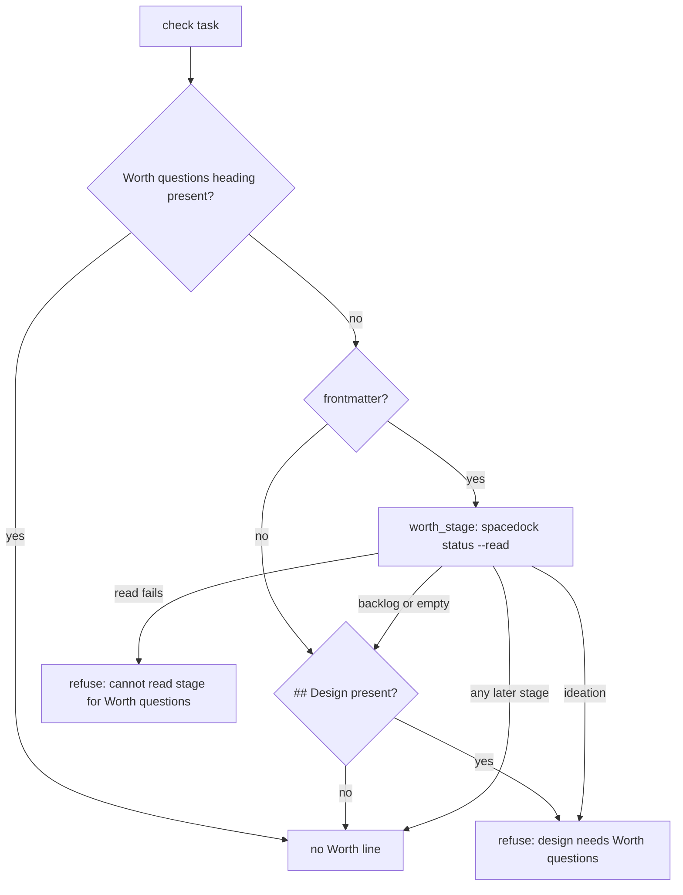

## Scope

- Source: the Captain chose 「不擋，開優先修正（建議）」 (host question dialog, 2026-11-11), answering 「已經過了設計關卡的舊任務，要不要被新的「值不值得」檢查擋下？我建議不要：開一張優先修正任務，讓檢查只在任務還沒過設計關卡時要求那一節，發一個修補版（0.39.1）再同步到 kc-claude-plugins 和 qnow。理由是那些設計是你已經核准過的，事後要求補寫等於改動你核准的文字；變差的是這些進行中的任務不會被問到那三個問題，而且要再跑一輪修正和發版，這期間兩個 repo 裡走到驗證關卡的任務會先卡著。」
- Bite (FO reproduced 2026-11-11 with `scripts/design_surfaces.py check`): on kc-dev-flow-2 0.39.0 the check exits 1 with `design needs '### Worth questions'` for `adr-required-statement` and `merge-guard-stops-unasked-merges` (validation) and `archive-waits-for-observer-report` (implementation) in this workflow, whose designs passed their ideation gates before the release; on 0.38.1 the same three print no such line. An adopter's FO reported the same on a task between implementation and validation (peer message, 2026-11-11), which is how it was found.
- How it shipped: PR #841's validation-2 report recorded it as F1 Deferred risk needing a Captain compatibility decision; FO described it to the Captain at the #841 merge ask as affecting only designs not yet through the design gate, and did not run the check on a task past ideation before the release.
- Outcome: `design_surfaces.py check` requires the Worth questions section only for a task that has not yet passed its ideation gate; a task past that gate is not refused for lacking it, at any later stage; a task still in ideation is refused as today.
- Open for the design: what "passed its ideation gate" is read from (the task's stage, its gate records, or its first dispatch record as the Budget exemption does), and what happens when that cannot be read; the design shows the choice by replaying this workflow's and an adopter's in-flight tasks at pinned commits, with counts of tasks released and tasks still refused.
- Non-goals: the two Codex findings and the fifteen sibling findings left unrepaired at the #841 merge ask; any change to what the three questions ask or to the Budget rule; backfilling any approved design.

## Budget
1 cycle per stage, in one package PR to `kc-dev-flow-2/scripts/design_surfaces.py`, its tests and, if the design shows ADR 0077's words exclude the outcome, that ADR.

## Stop condition
- The three tasks named under Bite pass the check at the candidate and a task in ideation with no Worth questions section is still refused; the full kc-dev-flow-2 test commands pass on the result of merging the candidate with main, run by FO before the merge ask. Return to the Captain if the fix needs a change to what a task still in ideation must answer.

## FO alignment

Alignment: not needed: the Captain ruled the direction in the question quoted under Scope; how the gate is read is a design detail he approves at the ideation gate.
Surfaces: none
Visible change: none
Release review: not needed: workflow maintenance, on no journey map.

## Design

### PRFAQ

**Proposition.** From kc-dev-flow-2 0.39.1, `design_surfaces.py check` asks for `### Worth questions` only while a task has not passed its ideation gate. A design the Captain already approved is no longer refused at implementation, validation or any later stage for lacking a section that did not exist when he approved it. A task still in ideation is refused exactly as on 0.39.0.

**FAQ.**
- *What does "passed its ideation gate" mean to the check?* The task's stage, read by the same native reader 0.39.0 already uses (`worth_stage`, which runs `spacedock status --read --json`). Stage `ideation` means not passed. Stage `backlog`, or no stage, counts as not passed when a `## Design` section exists. Any other stage means passed. Spacedock moves a task out of ideation only when the gate approval is consumed, so the stage after ideation is the record of the gate.
- *Why not the gate records?* On both pinned snapshots, the gate-record reading gives the same released and refused tasks as the stage reading; it differs only on two qnow files that are not tasks. It also needs a second parser (`decision_ledger.gate_entries`), because the native reader returns `gates` as an empty string. A task sent back to ideation by a redo amendment has an approved ideation gate on record but must answer again; the stage handles that with no extra rule.
- *Why not the first dispatch record, as the Budget exemption does?* An ideation dispatch made before 0.39.0 carries no `Budget:` header. On the pinned snapshots, 15 of the 17 tasks still in ideation have an `ideation-1.md` with no such header, so that test would release them. One has the header (this task), and qnow's `sms-usage-alert` has no ideation record at all. The Captain ruled tasks in ideation stay refused.
- *Why the native reader and not the `FM_STATUS` regex in the same function?* 0.39.0 already makes this decision through `worth_stage`. Changing the reader would be a second change with no bite behind it.
- *What if the stage cannot be read?* The check refuses with the existing line `cannot read stage for Worth questions: <why>` and does not print the Worth line. An unreadable stage is not proof the gate passed. That posture is unchanged: on 0.39.0, a task with no design and an unreadable stage already gets this line. The line names the real cause (no Spacedock binary, malformed frontmatter) instead of a false request for a section. CI installs Spacedock (`kc-dev-flow-2-tests.yml`), and a README-less copy still reads (exit 0, `validation`, see Replay).
- *What about a task with no frontmatter?* No change: it is not a Spacedock task, so a design without the section is refused, as the existing tests (`WorthQuestionsTests`, fixtures without frontmatter) expect.
- *Does ADR 0077 change?* No. Its words are "Each ideation design answers, per scope part: ..." and "Adopters receive the behavior when they update the package and workflow; old records remain exempt." Both already limit the rule to ideation and exempt old records; the check fell short of them. The Budget allows editing the ADR only if its words exclude this outcome, and they do not.

**Acceptance evidence plan.** Unit tests for each stage (below), the differential replay on two pinned snapshots, and the Bite tasks run at the candidate. FO runs the full kc-dev-flow-2 test commands on the merge result before the merge ask.



### Change

The only change is to the Worth block of `check_task` in `kc-dev-flow-2/scripts/design_surfaces.py`, plus new cases in `kc-dev-flow-2/scripts/test_design_surfaces.py` (`WorthQuestionsTests`). Prototype diff against 0.39.0 (`origin/main` 44f11855), applied in a scratch copy only:

```diff
         needed = design is not None
-        if not needed and text.lstrip("\n").startswith("---\n"):
+        if text.lstrip("\n").startswith("---\n"):
             try:
-                needed = worth_stage(path) == "ideation"
+                stage = worth_stage(path)
+                needed = stage == "ideation" or (needed and stage in (None, "", "backlog"))
             except (OSError, ValueError, subprocess.TimeoutExpired) as exc:
+                needed = False
                 errors.append(f"{path.name}: cannot read stage for Worth questions: {exc}")
```

The existing 226 tests in `test_design_surfaces.py` pass unchanged on the prototype (`python3 -B -m unittest test_design_surfaces`: `Ran 226 tests`, `OK (skipped=4)`). No current test covers a past-ideation task, which is how the defect shipped.

Bounded existing-code check: the stage reader (`worth_stage`) and the unreadable-stage error already exist. The fix reuses them and adds no reader, script or flag. Observation: on the pinned snapshot, `design_surfaces.py check` on `merge-guard-stops-unasked-merges` (stage `validation`) prints the Worth line on 0.39.0 and does not print it on 0.38.1.

### Replay

Pinned inputs, read-only: this workflow's state `7fa26e4391fb13df6ceb450775d3a271e46080c8` with README from `44f11855264bde64da284ffa9c1fef70e8ac38dd:docs/dev2/README.md`; qnow's state `a01fae619a2b1a9eff8233a70b77962a7e10a458` (`spacedock-state/dev2`) with README from `429b4673e0cff4088adf5ee75db64830de441917:docs/dev2/README.md`. Reproduce: `git -C <state> archive <sha> | tar -x -C <dir>/dev2/.spacedock-state`, `git -C <repo> show <sha>:docs/dev2/README.md > <dir>/dev2/README.md`, then for every top-level `*.md` except `README.md` run 0.39.0's and the candidate's `design_surfaces.py check` and compare their output with the Worth line and the `design surfaces presentable` line removed.

Result: 173 tasks (75 here, 98 in qnow), 0 tasks with any other output difference, 0 tasks newly refused.
- This workflow: 18 refused for Worth today; 5 released (`adr-required-statement`, `merge-guard-stops-unasked-merges` validation; `archive-waits-for-observer-report`, `ops-inbox-r1-setup-and-isolation`, `validation-reads-pr-review-comments` implementation); 13 still refused, all in ideation, this task included.
- qnow: 9 refused for Worth today; 5 released (`booking-attempt-identity`, `branch-price-copy`, `shop-edits-booking` implementation; `operator-secret-hardening`, `owner-cancels-booking` validation); 4 still refused, all in ideation.
- Exit 0 after release: 3 of 5 here and 3 of 5 in qnow. The other four keep defects that 0.39.0 also prints and that this task does not touch. One is `adr-required-statement`'s Amendment 1 `Supersedes:` form, which 0.38.1 also refuses (see Decision D1).
- Copy with no README: `spacedock status --read --json` on a lone copy of `adr-required-statement.md` exits 0 with status `validation`, and the candidate prints no Worth line for it.

### Callers that run the full check after ideation

- Implementation stage worker (`references/sd/workflow.md`: "run by implementation and validation"): released.
- Validation stage worker, same passage: released.
- FO at the validation gate of a `ui` task (`workflow.md` validation Gate content): released.
- Observer at archive (`skills/observer/SKILL.md`, "Replay the design check"): it extracts the task at its ideation-briefing sha, where `status:` is still `ideation`, so the candidate still refuses it. Replayed: `merge-guard-stops-unasked-merges` at `d57ed9b75ba5` and `archive-waits-for-observer-report` at `cdbfae07247e` exit 1 with the Worth line on both 0.39.0 and the candidate. The observer would report a `violation` for every design approved before 0.39.0. That is outside this task's file list; see Decision D2.
- Unchanged and still refused, as intended: the ideation worker and FO before `spacedock gate prepare`, which both run while the stage is `ideation`. `pr_watch.py` runs only `check --seed`, which does not check Worth. `delivery_gate.py`, `dispatch_records.py`, `dispatch_stage.py`, `laws_check.py` and `validation_security.py` import helpers and do not run `check_task`.

### Chain and prior rulings

- Spacedock 0.27.3: `spacedock status --read --json` returns the task's `status` but gives `gates` as an empty string, so the stage is the record its native reader exposes. `spacedock gate --help` lists prepare, withdraw, record and consume, and none of them reads a gate back. Spacedock has no "passed stage X" query to reuse.
- kc-dev-flow-2 at `origin/main` 44f11855 (0.39.0): `worth_stage` and the unreadable-stage error already exist in `design_surfaces.py`. `decision_ledger.gate_entries` parses gate records. The Budget exemption reads the first dispatch record's `Budget:` header (`role_triggers.budget_status`). The fix reuses `worth_stage`.
- Sibling adopter qnow (`qnow-adopt-dev2`, state `a01fae61`): there is no local workaround to borrow; its FO reported the same refusal. It is the second replay corpus.
- Prior rulings read: ADR 0077 (above), and every `^Override: recommended` line in this state checkout and its `_archive/` (5 lines). None of those 5 lines concerns stop conditions, the observer or the Worth rule. ADR 0017, "History laws judge only the events a push adds", ruled that checks judge new events and do not keep historical ones red; D2 follows it. ADR 0077's Captain amendment 4 let a task change two test files its design did not list, once he was asked; D2 asks the same way and does not assume.

### Worth questions

- **Scope part: the stage rule in `check_task`.** Captain's words served: 「開一張優先修正任務，讓檢查只在任務還沒過設計關卡時要求那一節」. Without it, 10 in-flight tasks across this workflow and qnow stay refused at implementation or validation for wording he already approved, and FO has to backfill or wave past the check. Premise that would make it unneeded: the refusal is advisory, so FO could proceed anyway. Cheap test, done: `design_surfaces.py check` exits 1, and workflow.md says "a non-zero exit as the gate not presentable".
- **Scope part: tests for each stage.** Captain's words served: 「還在設計階段又沒寫那一節的任務照樣被擋」 (backlog ask). Without them, the next change to this block can flip either side unseen; 0.39.0 shipped with no past-ideation case. Premise that would make them unneeded: an existing test already covers a frontmatter task past ideation. Cheap test, done: the 226 existing tests pass on both rules, so none does.
- **Scope part, only if D2 is approved: one sentence in the observer skill.** Captain's words served: 「已經過了設計關卡的舊任務，要不要被新的「值不值得」檢查擋下？我建議不要」. Archive is a later stage, and the observer is the one caller this check change cannot release. Without it, the archive report of each design approved before 0.39.0 shows a `violation` FO did not commit. Premise that would make it unneeded: the observer already treats this as historical. Cheap test, done: its historical-copy sentence covers only seed-field failures, and the briefing-sha replays above exit 1 with the Worth line. This part sits outside the approved file list, so it is the Captain's to keep or cut (D2).

### Words FO reads at each moment

Counted with `wc -w` on the check output, base 0.39.0 and candidate, on the pinned snapshots. Documents FO reads (`workflow.md`, ideation `principles.md`, ADR 0077) are not changed: 0 words either way.
- Ideation, before `gate prepare`: unchanged. `adoption-asks-which-extensions` and qnow `office-action-audit-log` print 28 words on both.
- Implementation and validation reports, and the `ui` validation gate: each released clean task falls from 28 to 13 words. The 19-word Worth line goes, and the 4-word `design surfaces presentable` line appears. Each released task with other defects falls by 19 words: `adr-required-statement` 53→34, `ops-inbox-r1-setup-and-isolation` 55→36, qnow `operator-secret-hardening` 96→77, `owner-cancels-booking` 51→32.
- Merge ask: unchanged; the check output is not part of it.
- After archive (observer report): unchanged unless D2 is approved; with D2, each pre-0.39.0 task loses one `violation` row.
- A released task prints nothing new. The unreadable-stage line already existed; with a design present, that line replaces the 19-word Worth line.

### Batch overlap

This task runs alone as a Captain-approved priority exception. It has no other batch task.
- Files this design would change: `kc-dev-flow-2/scripts/design_surfaces.py` (the Worth block in `check_task` only) and `kc-dev-flow-2/scripts/test_design_surfaces.py` (`WorthQuestionsTests`); with D2, also `kc-dev-flow-2/skills/observer/SKILL.md` (one sentence in "Replay the design check"). No ADR, README, version or index file; release-please owns the 0.39.1 bump.
- Live tasks of other sessions, read at the pinned state: `adoption-asks-which-extensions` (ideation), `adr-silent-undo-probe` (ideation), `comment-check-reaches-delivery-gate` (ideation; changes `delivery_gate.py`), `journey-canvas-hosted-poc` (ideation), `ops-inbox-r1-setup-and-isolation` (implementation; `kc-ops-inbox`), `pr-review-lite-value-pilot` (implementation) and `adr-required-statement` (validation; extends `adr_lint.py`). These only run or mention the check. None changes `design_surfaces.py`, its tests, the observer skill or the Worth rule. Three of them (`adr-required-statement`, `ops-inbox-r1-setup-and-isolation` and this workflow's other in-ideation tasks) change outcome under this fix, as listed in Replay. `journey-server-host-pilot`: no file under this state checkout or its `_archive/` at `7fa26e43`, so its files cannot be named here; FO should check it in its own workflow.
- Same-workflow live tasks that edit the same files: `fo-write-checks-parse-top-level` (ideation; `design_surfaces.py` `scope_lines` and `ScopeCheckTests`), `captain-ruling-sources-checked` (ideation; adds a rulings check to `check_task` and its tests) and `seed-check-requires-alignment-result` (ideation; the `seed=True` branch of `check_task`). They touch the same two files but different functions; textual merge conflicts only.
- Recommended order: this task first (priority exception, about 5 changed lines); the three same-file tasks rebase onto it.

## Acceptance criteria

**AC-1** On the pinned state of this workflow (`7fa26e43`), the candidate's `design_surfaces.py check` prints no `design needs '### Worth questions'` line for `adr-required-statement`, `merge-guard-stops-unasked-merges` and `archive-waits-for-observer-report`. The last two exit 0. `adr-required-statement`'s remaining output equals 0.38.1's for the same copy. Evidence: the Replay export commands, then the check on each copy at the candidate and at 0.38.1. Falsifier: reverting the `check_task` hunk brings the Worth line back on all three.

**AC-2** A task whose frontmatter stage is `ideation` and that has no Worth section is refused, with or without `## Design`. So is a `backlog` task with `## Design`. Tasks at `implementation`, `validation` and `done` with `## Design` and no Worth section are not refused for it. Evidence: new `WorthQuestionsTests` cases that write a frontmatter task per stage and run `check_task` with the real Spacedock reader. Falsifier: `needed = design is not None` (0.39.0) fails the later-stage cases; `needed = False` fails the ideation and backlog cases.

**AC-3** When the stage cannot be read, a frontmatter task with `## Design` and no Worth section gets one `cannot read stage for Worth questions:` error and no Worth line. Evidence: a test that points `SPACEDOCK_BIN` at a command that exits non-zero. Falsifier: dropping the `errors.append` in the `except` branch makes the test pass a task it should refuse.

**AC-4** The differential replay on both pinned snapshots (this workflow's state `7fa26e43` and qnow's `a01fae61`, READMEs as in Replay) covers 173 tasks. It shows no output difference except the Worth line removed for exactly the 10 tasks named in Replay, all past ideation. No task gains a line. The 17 tasks still refused are all at stage `ideation`. Evidence: the Replay procedure run with the candidate as built. Falsifier: any row with another difference, or a past-ideation task that keeps the line.

**AC-5** The PR changes only `kc-dev-flow-2/scripts/design_surfaces.py` and `kc-dev-flow-2/scripts/test_design_surfaces.py`, plus `kc-dev-flow-2/skills/observer/SKILL.md` if D2 is approved. Its title is `fix(kc-dev-flow-2): …` so release-please proposes 0.39.1. The full kc-dev-flow-2 test commands pass on the result of merging the candidate with main, run by FO before the merge ask. Evidence: `git diff --name-only origin/main...HEAD`, the PR title, and FO's merge-result run. Falsifier: an extra path, a non-`fix` title, or a failing suite.

**AC-6** Only if D2 is approved: the observer skill's historical-copy sentence also covers the `design needs '### Worth questions'` line. A briefing copy whose event-time README does not name worth answers is reported as current-schema incompatibility, not as a `violation`. Evidence: the skill text at the candidate, plus one observer replay of `merge-guard-stops-unasked-merges` at briefing sha `d57ed9b75ba5` with README from before 0.39.0, reporting incompatibility. Falsifier: the unchanged sentence yields `violation` for the same replay.

## Decisions for the Captain

**D1. Stop condition for `adr-required-statement`.** The Stop condition says the three Bite tasks "pass the check at the candidate". Two can; `adr-required-statement` cannot within this scope. Its Amendment 1 lacks a valid `Supersedes:` value, which 0.38.1 refuses too. Recommendation: read "pass" for that task as "no Worth line, and the rest of the output equal to 0.38.1's" (AC-1), and leave the amendment record to that task's own FO. What gets worse: `adr-required-statement` still stops at its validation gate until its FO repairs the amendment, and this task's stop condition is met on a narrower reading than its words.

**D2. The observer's archive replay.** At archive, the observer re-runs the check on the copy at each ideation-briefing sha. There the task is still in ideation, so every design approved before 0.39.0 is reported as a `violation`, including all 10 released tasks once they archive. The observer skill already reports seed-field failures on historical copies as "current-schema incompatibility", and calls them a violation only when the event-time README required the form. The 0.39.0 README template names "worth answers" in the ideation gate content; 0.38.1's does not. Recommendation: add `skills/observer/SKILL.md` to this PR's file list and widen that one sentence to cover the Worth line. What gets worse: the PR grows by one file outside the approved Budget, and the skill gains a few words against its word budget. Without it, the archive reports of these tasks carry a violation FO did not commit, and learn may act on it.

## Stage Report: ideation

- DONE: Decide what 'passed its ideation gate' is read from (the task's stage through the native reader, its gate records, or its first dispatch record as the Budget exemption does) and what the check does when that cannot be read; show the choice by replaying this workflow's in-flight tasks and one adopter's at pinned commits, read-only, with counts of tasks released and tasks still refused; name every caller that runs the full check after ideation; keep the refusal for a task still in ideation
  Stage through `worth_stage`; an unreadable stage refuses with the existing line. Replay of 173 tasks (state `7fa26e43` and qnow `a01fae61`): 10 released, 17 still refused (all in ideation), 0 other differences. Callers: implementation, validation, the `ui` validation gate (released) and the observer's archive replay (not released; D2). See `## Design`.
- DONE: A `### Batch overlap` section naming each file the design would change and each other batch task (none: this task runs alone as a Captain-approved priority exception) and live task of other sessions (adoption-asks-which-extensions, adr-required-statement, adr-silent-undo-probe, comment-check-reaches-delivery-gate, journey-canvas-hosted-poc, journey-server-host-pilot, ops-inbox-r1-setup-and-isolation, pr-review-lite-value-pilot (driven by other sessions; read only)) that changes the same file or check, so FO can order implementation
  `### Batch overlap`: none of the listed tasks changes these files. `journey-server-host-pilot` is absent from this state checkout at `7fa26e43`. Three same-workflow ideation tasks edit the same two files in other functions. Recommended order: this task first.
- DONE: The words FO reads at each lifecycle moment, before and after, per root learning.md "Measure the words FO reads at each moment, not one file's size"
  `### Words FO reads at each moment`: implementation/validation output falls 28→13 words per released clean task and by 19 per released task with other defects; ideation and the merge ask are unchanged; documents change by 0 words.
- DONE: Acceptance criteria with reproducible evidence clauses and falsifiers, and unresolved decisions for the Captain, each with a recommendation and what gets worse under it
  AC-1 to AC-6 under `## Acceptance criteria` (AC-6 only if D2 is approved), with D1 (stop-condition reading for `adr-required-statement`) and D2 (observer archive replay) under `## Decisions for the Captain`.
  AC-1: the prototype prints no Worth line on the three Bite tasks; two exit 0, and `adr-required-statement` prints the same `Supersedes:` defect as 0.38.1 (measured on scratch copies; not yet verified on the built candidate).
  AC-2: not yet verified; the per-stage tests are written at implementation. Today's 226 tests pass on the prototype, which shows none covers a past-ideation task.
  AC-3: not yet verified; the test is written at implementation. A README-less copy reads successfully (`spacedock status --read` exit 0).
  AC-4: measured on the prototype: 173 rows, 0 `OTHER-DIFF`, 10 released, 17 still refused, all in ideation. To be re-run on the built candidate.
  AC-5: not yet verified; it depends on the PR and FO's merge-result run.
  AC-6: not yet verified; conditional on D2.
  `python3 <package>/scripts/design_surfaces.py check` on this task file (0.39.0): `worth-questions-asked-only-before-the-design-gate.md: design surfaces presentable`, exit 0.

### Summary

The check will read "passed its ideation gate" from the task's stage, using the native reader 0.39.0 already calls, and will keep refusing when that stage cannot be read. A five-line prototype releases 10 past-ideation tasks across this workflow and qnow, keeps all 17 in-ideation tasks refused, and changes nothing else across 173 tasks. ADR 0077 already confines the rule to ideation and needs no change. Two decisions return to the Captain: how to read the stop condition for `adr-required-statement`, which has an unrelated defect 0.38.1 also refuses, and whether to widen the observer's historical-copy sentence so archive reports stop flagging pre-0.39.0 designs.
